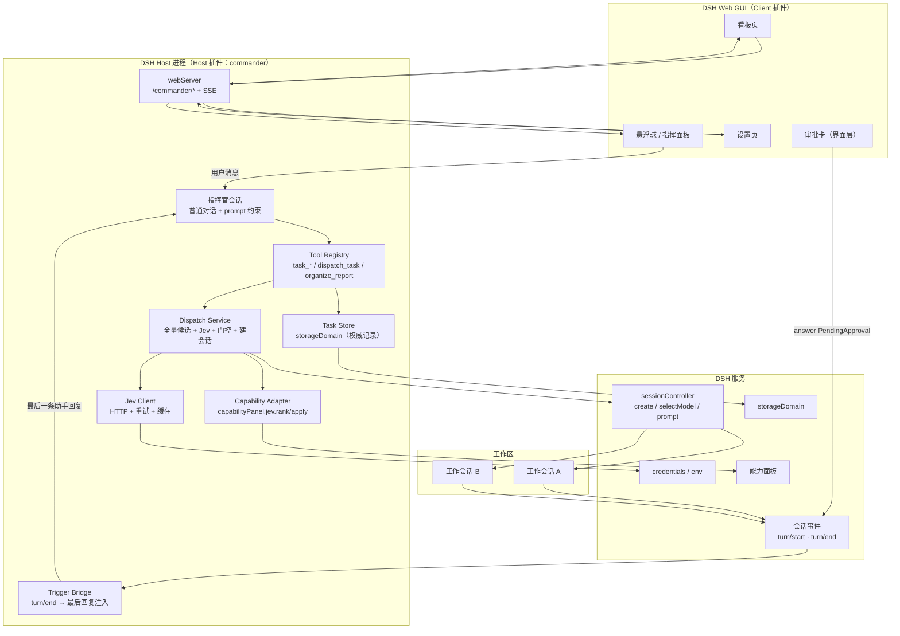
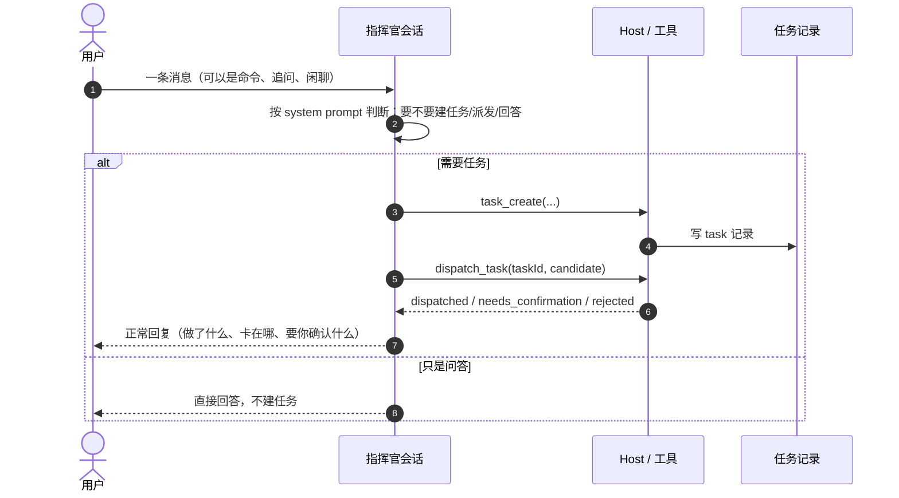
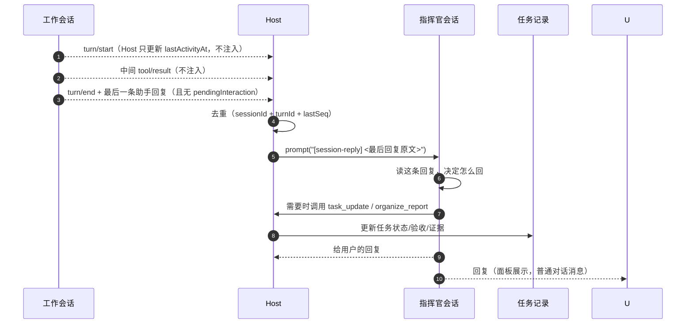
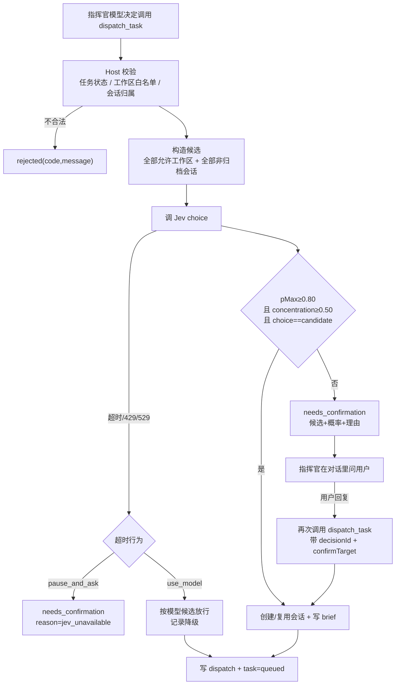
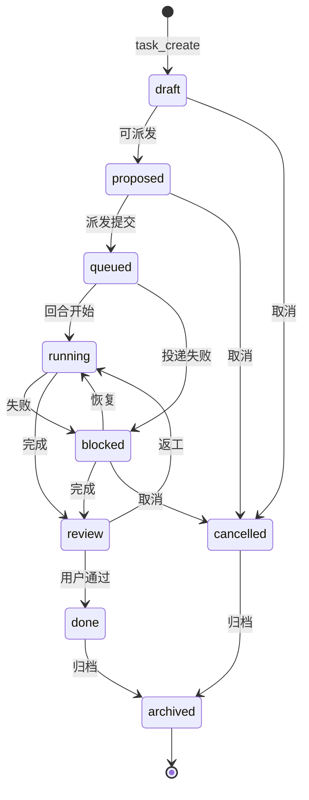

# DSH Commander · 指挥官 —— 架构设计

> 版本：v2.4　日期：2026-11-17
> 对应产品设计：`docs/PRODUCT-DESIGN.md` v1.4
> v2.4 修正：能力选择完全调用能力面板的 capabilityPanel.jev.rank/apply；不再自建目录、范围或 Resolver。
> v2.2 修正：能力策略收敛为两档；指挥官只提需求建议；能力选择由能力面板负责，派发 Jev 不参与。
> v2.1 修正：能力目录不再单独暴露工具；Jev 改为全量覆盖优先、两层兜底；补疑似停滞徽标与 50 案例评估门禁。
> v2.0 修正：去掉结果轮询与任务投影；只注入工作会话停止前的最后回复；指挥官按普通对话 + prompt 约束运行。

---

## 0. 设计原则（本版的核心）

1. **Host 只提供机制，不编排对话流程。** Host 负责：工具注册、事件触发、会话创建、存储、Jev 调用。对话怎么走由指挥官模型在 system prompt 约束下自行决定。
2. **指挥官是普通 DSH 会话。** 它有正常的多轮对话、可随时调用工具；没有"必须先建任务再派发"的硬编码状态机驱动。
3. **只在工作会话停止时回注最后一条助手回复。** 中间的工具调用、进度、审批、提问都不进指挥官上下文。
4. **任务记录就是唯一真相。** 不再维护"事件日志 + 投影"的双写；一条任务记录内含当前状态与有界时间线。
5. **不轮询结果。** 没有 scheduler 定时扫结果；触发完全来自会话停止事件。
6. **Jev 优先全量覆盖，不做召回式预筛。** 预算内把全部允许工作区与全部非归档会话一次送入；超出预算才按"先工作区、后会话"分层，不按时间/词面提前砍候选。

---

## 1. 架构总览



**没有 Scheduler。** 结果不轮询；只有会话 `turn/end` 且进入空闲时触发一次注入。

---

## 2. 关键路径

### 2.1 用户消息 → 对话 → 工具



> Host 不规定"先澄清再建卡再派发"。这些顺序由 prompt 指导，模型可跳过、可合并、可先派发后补卡。

### 2.2 工作会话停止 → 注入最后回复 → 指挥官回复并更新看板



**注入规则**

| 条件 | 行为 |
|---|---|
| `turn/end` 且会话空闲 | 取最后一条 **assistant** 消息注入 |
| 会话在等审批/提问（`pendingInteraction`） | **不注入**；审批只在界面层处理 |
| 中间工具调用、进度、流式片段 | **不注入** |
| 同一 `turnId + lastSeq` | 去重，只注入一次 |
| 最后回复为空/只有工具调用 | 注入一条 `[session-reply] 本轮无文本回复` 或不注入（可配置） |
| 回复超过 8KB | 截断，保留头尾，标记 `truncated` |

- 注入是一条 Host 生成的消息，不是用户原话；文本框里带 `taskId / sessionId / turnId / lastSeq` 元数据。
- 指挥官收到后就是一次**普通对话回合**：它可以只回一句，也可以调用多个工具更新看板。
- "更新看板"不是 Host 强制的后置步骤；是指挥官按 prompt 习惯在回复时调用工具。

### 2.3 派发决策



用户点确认卡的按钮时，Client 往指挥官会话发一条普通用户消息（例如「采用建议」），指挥官据此再次调用工具；不由 Host 硬编码确认流程。

---

## 3. 数据落盘

### 3.1 存储选型

- 使用 `ctx.storageDomain`，域 `commander`，`layout: 'per-record'`。
- **任务记录是权威数据**，不做事件溯源、不做投影双写；记录内含当前状态与有界时间线。
- 物理位置由存储后端决定，推荐：

```yaml
- name: '@deepseek-ai/dsh-storage-json'
  config: { root: ~/.dsh/storages }
- name: '@deepseek-ai/dsh-storage-domain'
  config: { backend: json, routes: { commander: json } }
```

### 3.2 表

```ts
export const commanderDomain = defineDomain({
  name: 'commander',
  version: 1,
  layout: 'per-record',
  tables: {
    config:     domainTable(ConfigRecordSchema),
    workspaces: domainTable(WorkspaceRecordSchema),
    commands:   domainTable(CommandRecordSchema),
    tasks:      domainTable(TaskRecordSchema),
    dispatches: domainTable(DispatchRecordSchema),
    boardEdits: domainTable(BoardEditRecordSchema),
    sessions:   domainTable(SessionLinkRecordSchema),
  },
})
```

| 表 | key | 内容 | 保留 |
|---|---|---|---|
| `config` | `singleton` | 指挥官绑定、模型、Jev、UI | 永久 |
| `workspaces` | `workspaceId` | 白名单、摘要、能力策略 | 永久 |
| `commands` | `commandId` | 用户原话、会话、seq | 与任务同寿命 |
| `tasks` | `taskId` | **权威任务记录**（状态 + 有界时间线） | 归档后 90 天 |
| `dispatches` | `decisionId` | 候选、Jev 输出、最终选择 | 1 年 |
| `boardEdits` | `editId` | 人工改动 + 注入状态 | 90 天 |
| `sessions` | `<workspaceId>__<sessionId>` | 会话↔任务↔角色、最后注入点 | 与任务同寿命 |

**没有 `taskEvents` 表，也没有投影。** 时间线是任务记录里的一个数组，最多 100 条，超过后折叠为摘要；这是展示与审计，不是重建来源。

### 3.3 契约

```ts
interface ConfigRecord {
  v: 1
  commander: {
    workspaceId: string
    workspacePath: string
    sessionId: string
    model: { provider: string; model: string; reasoningEffort?: string }
    agentPreset?: string
  }
  jev: {
    provider: 'typesafe' | 'custom'
    endpoint: string                  // 默认 https://api.typesafe.ai/v1/systemone
    model: string                     // 默认 jev-latest
    keySource: 'env' | 'credential'
    envVar: string                    // 默认 JEV_API_KEY
    threshold: number                 // pMax 阈值，默认 0.80
    confidenceFloor: number           // concentration 下限，默认 0.50
    timeoutMs: number                 // 默认 1500
    onTimeout: 'pause_and_ask' | 'use_model'
  }
  board: { archiveAfterDays: number; syncUserEdits: boolean }
  ui: { theme: 'follow'|'light'|'dark'; entryPosition: 'br'|'bl'; hotkey: string }
  updatedAt: number
}

interface WorkspaceRecord {
  v: 1
  id: string
  name: string
  path: string
  allowed: boolean
  summary: string
  summarySource: 'manual' | 'model'
  summaryUpdatedAt?: number
  capabilityPolicy: {
    mode: 'inherit' | 'auto'          // 继承 / 自动选择（由能力面板执行）
    lastSelection?: {
      status: 'applied' | 'fallback' | 'failed'
      enabled: string[]
      disabled: string[]
      durationMs?: number
      reason?: string
      at: number
    }
  }
}

interface CommandRecord {
  v: 1
  id: string
  text: string                 // ≤8KB，超出截断
  sessionId: string
  seq: number
  createdAt: number
  taskIds: string[]
  truncated?: boolean
}

type TaskStatus =
  | 'draft' | 'proposed' | 'queued' | 'running'
  | 'blocked' | 'review' | 'done' | 'cancelled' | 'archived'

interface TaskRecord {
  v: 1
  id: string
  title: string
  goal: string
  status: TaskStatus
  workspaceId: string
  priority: 'low'|'normal'|'high'|'urgent'
  commandId: string
  dispatchId?: string
  assignments: string[]              // sessionId[]
  primarySessionId?: string
  acceptance: AcceptanceItem[]
  capabilities?: CapabilityPlan
  progress?: { label: string; pct?: number; at: number }
  block?: { reason: string; code?: string; since: number }
  timeline: TaskTimelineItem[]       // 有界，≤100
  version: number                    // 乐观并发
  createdAt: number
  updatedAt: number
  lastActivityAt: number
  archivedAt?: number
}

interface AcceptanceItem {
  id: string
  text: string
  verify?: string
  evidence?: string
  source: 'commander'
  derivedFrom?: { sessionId: string; seq: number }
  state: 'evidence_present' | 'insufficient'
}

interface CapabilityPlan {
  policy: 'inherit' | 'auto'
  executor: 'capability-panel'
  status: 'inherited' | 'applied' | 'fallback' | 'failed'
  enabled: string[]                                 // 面板 apply 返回
  disabled: string[]
  durationMs?: number
  reason?: string                                   // fallback / failed 原因
  at: number
}

interface TaskTimelineItem {
  at: number
  type: 'created'|'dispatch'|'session_stop'|'report'|'status'|'user_edit'|'accept'|'rework'
  text: string
  sessionId?: string
  seq?: number
}

interface DispatchRecord {
  v: 1
  id: string
  taskId: string
  createdAt: number
  prefilter: { workspaceIds: string[]; sessionIds: string[]; scores: Record<string, number>; truncated: boolean }
  candidates: DispatchCandidate[]     // ≤8
  modelSuggestion: string
  jev: {
    provider: string; endpoint: string; model: string; requestId: string
    latencyMs: number; ok: boolean
    error?: { code: string; message: string }
    answers?: {
      workspace?: { choice: string; probabilities: Record<string, number>; confidence: number }
      session?:   { choice: string; probabilities: Record<string, number>; confidence: number }
    }
    pMax?: number; concentration?: number         // 两问的最小值，便于排序
    usage?: { input_tokens: number; output_tokens: number }
  }
  outcome: 'auto'|'confirmed'|'overridden'|'cancelled'|'jev_unavailable'|'rejected'
  finalTarget?: { workspaceId: string; mode: 'new'|'attach'; sessionId?: string }
  confirmedBy?: 'user'
  reason?: string
}

interface SessionLinkRecord {
  v: 1
  sessionId: string
  workspaceId: string
  taskId: string
  role: 'work'|'commander'
  mode: 'new'|'attach'
  createdAt: number
  lastInjected?: { turnId: string; seq: number; at: number }  // 去重
  status: 'queued'|'running'|'idle'|'missing'
}

interface BoardEditRecord {
  v: 1
  id: string
  taskId: string
  field: string
  before: unknown
  after: unknown
  actor: 'user'
  at: number
  injectedAt?: number
  injectionKey?: string
}
```

### 3.4 写入协议

1. **单写者**：只有 Host 写域；Client 通过 HTTP 命令。
2. **单记录更新**：一次状态迁移只 `update` 一条 `tasks` 记录（含 timeline 追加）；没有跨表事务。
3. **乐观并发**：`update` 里比较 `version`，冲突则重读重试，最多 3 次。
4. **幂等**：工具调用带 `requestId`；`sessions` 表的 `lastInjected` 做注入去重。
5. **key 规范**：per-record 后端要求 `[a-zA-Z0-9_-]+`；跨字段用 `__`，非法字符归一为 `-`。
6. **崩溃恢复**：任务记录本身是完整状态；未完成的工具调用由调用方重试；注入失败可按 `lastInjected` 判断后补一次。
7. **归档**：归档时把 timeline 压成一条摘要，保留任务记录。

### 3.5 不落盘

- 审批请求/回答全文（只在内存与界面）。
- 工作会话的完整日志、代码正文、文件内容（只存路径/摘要/seq）。
- Jev Key。
- 中间工具调用与进度（不进指挥官，也不落任务时间线，除非指挥官整理时主动写入）。

---

## 4. 指挥官工具

工具由 `ctx.tools.register(defineTool({...}))` 注册；只在指挥官会话可见。Host 不规定调用顺序，prompt 描述何时用。

| 工具 | 作用 | 写盘 |
|---|---|---|
| `task_create` | 建任务草稿 | 是 |
| `task_update` | 改状态/字段/进度/验收 | 是 |
| `task_cancel` | 取消 | 是 |
| `task_archive` | 归档 | 是 |
| `dispatch_task` | 全量候选 + 能力解析 + Jev + 门控 + 建会话；也用于确认 | 是 |
| `organize_report` | 把最后回复整理成验收与证据 | 是 |
| `follow_up` | 向工作会话追问补证 | 否 |
| `board_query` | 查看看板 | 否 |

**已删除 `brief_user`**：指挥官的普通回复就是播报；界面根据任务状态与新消息决定是否提醒，不需要一个单独的"播报工具"。

### 4.1 `dispatch_task`

```json
{
  "name": "dispatch_task",
  "parameters": {
    "taskId": { "type": "string", "required": true },
    "candidate": {
      "type": "object",
      "properties": {
        "workspaceId": { "type": "string" },
        "mode": { "type": "string", "enum": ["new","attach"] },
        "sessionId": { "type": "string" }
      },
      "description": "首次调用提供；确认时可用 decisionId 代替"
    },
    "decisionId": { "type": "string", "description": "needs_confirmation 返回的决策 id" },
    "confirmTarget": {
      "type": "object",
      "properties": {
        "workspaceId": { "type": "string" },
        "mode": { "type": "string", "enum": ["new","attach"] },
        "sessionId": { "type": "string" }
      }
    },
    "capabilityNeeds": {
      "type": "array",
      "items": { "type": "string" },
      "description": "指挥官润色后的能力需求建议（自然语言短语，≤40 字/项）。不需要知道具体能力名；由能力面板的 jev.rank/apply 决定。"
    },
    "requestId": { "type": "string" }
  },
  "output": {
    "schema": {
      "oneOf": [
        { "type": "object", "properties": {
          "status": { "const": "dispatched" },
          "taskId": { "type": "string" }, "decisionId": { "type": "string" },
          "sessionId": { "type": "string" }, "sessionCreated": { "type": "boolean" },
          "target": { "type": "object" },
          "scores": { "type": "object" },
          "capabilities": { "type": "object" }
        }},
        { "type": "object", "properties": {
          "status": { "const": "needs_confirmation" },
          "decisionId": { "type": "string" }, "candidates": { "type": "array" },
          "recommendation": { "type": "object" },
          "scores": { "type": "object" },
          "reason": { "type": "string" }
        }},
        { "type": "object", "properties": {
          "status": { "const": "rejected" },
          "code": { "type": "string" }, "message": { "type": "string" }
        }}
      ]
    }
  }
}
```

- 首次调用返回 `needs_confirmation` 时**不派发**；指挥官在对话里问用户。
- 用户回复后，指挥官再调一次，带 `decisionId + confirmTarget`（或原 candidate）完成派发。
- 幂等：`requestId`；同一 decision 只能提交一次。

### 4.2 `organize_report`

```json
{
  "name": "organize_report",
  "parameters": {
    "taskId": { "type": "string", "required": true },
    "sessionId": { "type": "string", "required": true },
    "seqFrom": { "type": "number", "required": true },
    "seqTo": { "type": "number", "required": true },
    "outcome": { "type": "string", "enum": ["delivered","partial","blocked","no_progress"], "required": true },
    "acceptance": { "type": "array", "required": true, "items": {
      "type": "object",
      "properties": {
        "text": { "type": "string" },
        "verify": { "type": "string" },
        "evidence": { "type": "string" },
        "derivedFromSeq": { "type": "number" }
      }
    }},
    "summary": { "type": "string", "description": "≤800 字，来自最后回复" }
  },
  "output": {
    "schema": {
      "type": "object",
      "properties": {
        "taskId": { "type": "string" },
        "status": { "type": "string", "enum": ["review","running","blocked"] },
        "evidenceState": { "type": "string", "enum": ["complete","insufficient"] },
        "insufficient": { "type": "array", "items": { "type": "string" } }
      }
    }
  }
}
```

- 校验证据 seq 落在区间内；不评估达标。
- 写任务记录：acceptance、timeline、status=review（或 blocked）。
- 不强制调用；指挥官可以根据最后回复决定先 `task_update` 还是直接 `organize_report`。

### 4.3 能力选择：两种策略，执行完全交给能力面板

**策略只有两个**（每工作区）：

| 策略 | 行为 |
|---|---|
| `inherit` 继承工作区（默认） | 不做任何能力操作，新会话沿用工作区默认配置 |
| `auto` 自动选择 | 调用能力面板的 `capabilityPanel.jev.rank` + `jev.apply`，由面板按任务文本决定本会话启用哪些能力 |

**为什么不再自建 Resolver**

- 能力面板（`dsh-capability-settings`）已经提供完整实现（`ctx.provide("capabilityPanel")`，见 `lib/index.js:439`；`lib/jev/rank.js`、`lib/jev/apply.js`）：
  - `ctx.provide("capabilityPanel", …)` 暴露 Host 服务；
  - `jev.rank({ sessionId, draft, cwd })`：按角色/任务/操作三维做 `noul` 评分，取 max，阈值来自能力面板配置（默认 0.50），按体积自动分片；
  - `jev.apply({ sessionId, plan, cwd })`：批量写会话级 Skills / MCP / Tools 开关，带失败回滚、冷会话排队。
- 因此指挥官插件**不维护能力目录、不做匹配、不配置能力阈值**。它只做两件事：
  1. 按策略决定调用还是不调用面板；
  2. 把**委派文本**（`capabilityNeeds` + 任务 brief）作为 `draft` 交给面板。

**调用顺序（auto）**

```text
1. sessionController.create({ workspaceId, agentPreset })  → sessionId
2. capabilityPanel.jev.rank({ sessionId, draft, cwd })      → plan
3. capabilityPanel.jev.apply({ sessionId, plan, cwd })      → { enabled, disabled, elapsedMs }
4. sessionController.prompt({ sessionId, mode:'queue', content: brief })
```

- `draft` 里包含指挥官润色后的能力需求（例如「需要浏览器自动化、单测」）与任务目标。
- 面板自己决定启用哪些、阈值、分片、工具/技能/MCP 的口径；指挥官不解读 plan。
- `apply` 失败或面板不可用：**回退 inherit**（继续派发），记录 `status=fallback` 与原因；不阻塞任务。
- 派发到已有会话不使用策略（不调用面板），沿用该会话已有配置。
- 结果写入 `CapabilityPlan` 与 `WorkspaceRecord.capabilityPolicy.lastSelection`，确认卡/任务详情只展示摘要（启用/禁用数、耗时、fallback 原因）。

### 4.4 其他工具

- `task_create`：`title/goal/workspaceId/priority/commandId` → `{taskId,status:"draft"}`。
- `task_update`：允许 `priority/progress/blockReason/title/status`（状态受状态机约束）。
- `task_cancel` / `task_archive`。
- `board_query`：返回 ≤30 条摘要。
- `follow_up`：向工作会话发一条补证/追问；每任务 15 分钟最多 1 次。

### 4.5 人专用操作（不给模型）

| Method + Path | 用途 |
|---|---|
| `POST /commander/tasks/:id/accept` | 唯一验收入口 |
| `POST /commander/tasks/:id/rework` | 返工并生成续做 brief |
| `PATCH /commander/board/tasks/:id` | 人工改看板；异步注入指挥官 |
| `GET /commander/state` | 看板/面板 SSE |

派发确认不需要专门路由：Client 把用户的选择作为一条普通消息发给指挥官，指挥官再次调用 `dispatch_task`。

---

## 5. Jev 请求与 20 工作区 / 800 会话

### 5.1 调用约定

- `POST https://api.typesafe.ai/v1/systemone`，`model: jev-latest`。
- 超时 1500ms；`429/529` 退避重试 1 次；`4xx` 不重试。
- 请求体优先包含**全部允许工作区 + 全部非归档会话**（预算内）；超出预算才分层。

### 5.2 候选构造：先全量，后分层

**不做召回式预筛**。不按 30 天、Top-K、词面分数提前砍候选；相关任务可能来自几周前，这是常态。

```
allowedWorkspaces = 所有 allowed === true 的工作区（≤20）
sessions = 所有非归档会话（包含数周前；按 lastActiveAt 倒序描述）
```

**模式 A：全量一波（优先）**

估算 `state + questions` 的 token 数（JSON 字符数 / 3 的近似）。若 ≤ 24k（默认预算，低于 32k 单问题上限）：

- 一个问题问工作区：`workspace` choice，选项 = 所有 allowed 工作区（≤20），描述含摘要与最近任务；
- 一个问题问会话：`session` choice，选项 = 所有会话 + `new`；**会话详情只放 `state.sessions`，criteria 用 id/短标签，避免同一段文本重复计 token**；
- 一次请求问完，利用 Jev "多问题并行"的建议。

**模式 B：两层（超出预算时）**

1. 第一问：`workspace` choice，全部 allowed 工作区；
2. 第二问：`session` choice，**所选工作区的全部非归档会话** + `new`，不做 Top-K；

**一致性校验**

- 模式 A 的 `workspace` 与 `session` 是两个独立问题，Jev 看不到彼此答案；
- 代码校验 `chosenSession.workspaceId === chosenWorkspace`：
  - 一致 → 直接用；
  - 不一致 → 追加一次小请求，只给 2–3 个组合候选（会话所属工作区 + 新会话 / 原工作区 + 新会话），由 Jev 或用户定；
  - 仍然冲突 → `needs_confirmation`。

### 5.3 请求示例（全量一波，节选）

```json
{
  "model": "jev-latest",
  "state": {
    "task": { "title": "...", "goal": "...", "acceptanceHints": ["..."], "priority": "high" },
    "command": { "text": "...", "workspaceHint": "HtDot" },
    "workspaces": [
      { "id": "htdot", "name": "HtDot", "summary": "电商后台：订单、结算、导出链路",
        "recentTasks": ["..."] }
    ],
    "sessions": [
      { "id": "sess_8f31a2", "workspaceId": "htdot", "title": "订单导出 · 流式改造",
        "lastActiveAt": "2026-11-16T17:21:00+08:00", "contextUsage": 0.78 }
    ],
    "constraints": { "allowedWorkspaces": ["htdot","mira","live"] }
  },
  "questions": {
    "workspace": {
      "type": "choice",
      "instructions": "哪个工作区最适合这个任务？综合考虑职责、历史任务与能力匹配。",
      "criteria": {
        "htdot": { "what": "HtDot", "why": "...", "not_for": "..." },
        "mira": { "what": "Mira", "why": "...", "not_for": "..." }
      }
    },
    "session": {
      "type": "choice",
      "instructions": "该工作区里哪个会话最合适？没有合适的就选 new。",
      "criteria": {
        "sess_8f31a2": { "what": "订单导出 · 流式改造", "why": "...", "not_for": "上下文 78%" },
        "new": { "what": "新建会话", "why": "上下文干净" }
      }
    }
  }
}
```

### 5.4 响应与门控

```json
{
  "model": "jev-1.14.0",
  "answers": {
    "workspace": { "type": "choice", "choice": "htdot", "probabilities": { "htdot": 0.62, "mira": 0.21, "live": 0.17 }, "confidence": 0.43 },
    "session": { "type": "choice", "choice": "sess_8f31a2", "probabilities": { "sess_8f31a2": 0.58, "new": 0.42 }, "confidence": 0.16 }
  },
  "usage": { "input_tokens": 12400, "output_tokens": 64 }
}
```

```ts
const pWorkspace = workspaceAnswer.probabilities[workspaceAnswer.choice]
const pSession = sessionAnswer.probabilities[sessionAnswer.choice]
const pass =
  pWorkspace >= 0.80 &&
  pSession >= 0.80 &&
  workspaceAnswer.confidence >= 0.50 &&
  sessionAnswer.confidence >= 0.50

// 记录时：pMax = min(pWorkspace, pSession)，concentration = min(两问 confidence)
```

> 说明：问两个独立问题后，组合概率是乘积；如果按乘积设 0.8，几乎必然要人工确认。建议分别门控（工作区 0.8、会话 0.8），或对 `new` 只要求工作区门控。阈值用 50 案例校准（见 §8）。

### 5.5 800 会话 / 20 工作区

| 情况 | 处理 |
|---|---|
| 全部摘要 ≤24k tokens | **一波过**：20 个工作区 + 全部非归档会话 |
| 超出预算 | 先问工作区（20 个选项），再问该工作区**全部**非归档会话 + new |
| 800 会话摘要太大 | 每会话描述压到 ≤60 字符（工作区 · 标题 · 最近活动），标题截断；criteria 只放 id，详情放 state；仍超就两层 |
| 会话很久以前 | **不排除**；只按 `lastActiveAt` 排序展示 |
| 归档会话 | 排除（可恢复后再派发） |
| 工作区没有摘要 | 保留，描述里标记"未配置摘要"；不影响召回 |
| 答案冲突 | 小请求复核 2–3 个组合，仍冲突交给人 |

**预算**：默认 24k tokens（Jev 单问题 32k 上限留余量）。可选长上下文 262k，但更慢且精度下降，默认关闭。

## 6. 任务状态机

状态仍然需要，因为看板、验收、并发都依赖它；但**迁移由工具调用、人操作或会话事件触发，不由 Host 编排对话**。



| 状态 | 看板列 | 进入方式 |
|---|---|---|
| draft | 待派发确认 | `task_create` |
| proposed | 待派发确认 | `dispatch_task` 返回 needs_confirmation |
| queued | 进行中 | 派发提交（会话创建 + brief 投递） |
| running | 进行中 | Host 收到 `turn/start`（机械更新运行态，不注入对话） |
| blocked | 受阻 | 投递失败、工具失败、会话丢失 |
| review | 待验收 | 指挥官调用 `organize_report` |
| done | 已完成 | 仅 `POST /accept` |
| cancelled | 归档区 | 用户/指挥官取消 |
| archived | 归档区 | 归档 |

**不变量**

1. `done` 只能从 `review` 进入，且只能由人触发。
2. `review` 至少 1 条 acceptance。
3. 一个任务同一时刻一个主会话；改派新增 assignment。
4. `dispatch` 提交后能力计划不可变。
5. 审批/提问不写入任务记录。
6. 状态迁移只更新任务记录一条；不写投影、不写事件表。
7. **凡是通过工具改变了任务状态的指挥官回合，必须以一条用户可见的回复结束**（prompt 约束，不允许静默改板）。

---

## 7. 失败模式

| 失败 | 处理 |
|---|---|
| 最后回复为空/只有工具调用 | 注入 `[session-reply] 无文本` 或跳过（配置） |
| 注入重复 | `lastInjected` 去重（sessionId+turnId+seq） |
| 注入时 commander 正忙 | 排队一条；合并同一 session 的连续停止 |
| 会话非空闲且 `now-lastActivityAt > 20min` | 看板只显示“疑似停滞”徽标；不改状态、不轮询注入、不自动追问 |
| 回复 >8KB | 头尾截断 + `truncated` |
| Jev 超时 | 默认 `pause_and_ask` |
| Jev 低置信 | `needs_confirmation` |
| 会话创建/投递失败 | 任务回 proposed/blocked，不新建第二个会话 |
| 能力应用失败 | 不启动会话，blocked(code=capability_apply_failed) |
| 任务记录并发写 | version 冲突重试 3 次 |
| 人工改动注入失败 | `boardEdits.injectedAt` 为空，启动补注入一次 |

观测：注入次数/去重数、注入到回复时延、Jev 时延/失败率、派发自动/确认比例、验收整理时延、任务记录冲突数。

---

## 8. 开发前验证：Jev 50 案例（门禁）

阈值不是拍脑袋定的。开发前必须用约 50 个真实派发案例跑一轮评估，再决定 `pWorkspace / pSession / confidence` 的阈值。

**案例集**（`docs/eval/`）

- 每条案例包含：任务文本、当时的允许工作区与摘要、全部非归档会话摘要、期望目标（工作区/模式/会话）。
- 分层：12 条明显工作区、12 条跨工作区歧义、10 条"相关会话是几天/几周前"、6 条应新建会话、5 条能力驱动、5 条应询问用户。
- 用真实快照，不用合成文本；避免用"最近会话"先验污染标签。

**指标**

| 指标 | 定义 | 目标 |
|---|---|---|
| 工作区 Top-1 | 选中工作区 == 期望 | ≥ 85% |
| 会话 Top-1 | 需要 attach 时选中会话 == 期望 | ≥ 70% |
| 模式准确率 | new/attach 判断正确 | ≥ 85% |
| 自动派发精确率 | 门控放行的案例中目标正确 | ≥ 95% |
| 自动派发覆盖率 | 门控放行比例 | ≥ 40% |
| 校准 | 按 pMax 分桶预测正确率 | 单调、无严重过自信 |
| 时延/成本 | p50/p95 时延、tokens | p95 < 3s |

**阈值选择**：扫描 `pWorkspace × pSession × confidence`，选精确率 ≥95% 下覆盖率最高的组合；若达不到，默认收紧到"每次确认"，不牺牲正确率。

**工具**：`tools/jev-eval.mjs`（live / `--mock`、阈值扫描、Markdown 报告）；协议与分层见 `docs/eval/jev-dispatch-eval.md`；当前有 6 条示例，50 条真实快照需在开发前补齐。

**全量覆盖模式也要测**：同一批案例分别用"全量一波"和"两层"跑，比较准确率与 token；若全量明显更准且 ≤24k，默认全量。

---

## 9. 待实测

1. `turn/end` 与"最后一条 assistant 消息"的对应关系（是否每个 turn 只有一条最终回复）。
2. 会话等待审批/提问时是否会触发 `turn/end`；若会，必须用 `pendingInteraction` 过滤。
3. 回复注入后 commander 是否总能在同一回合调用工具更新看板（prompt 约束效果）。
4. 能全量覆盖的 token 估算准确度；800 会话的实际字符数与 Jev 延迟。
5. 能力选择：能力面板 `jev.rank/apply` 的集成测试（auto 成功、面板不可用回退 inherit、已有会话不应用、apply 失败回退）。
6. 会话级能力应用接口（dsh-capability-settings 是否可由 Host 调用）。
7. 单 Host 进程假设；多 Host 写域需要跨进程锁。
