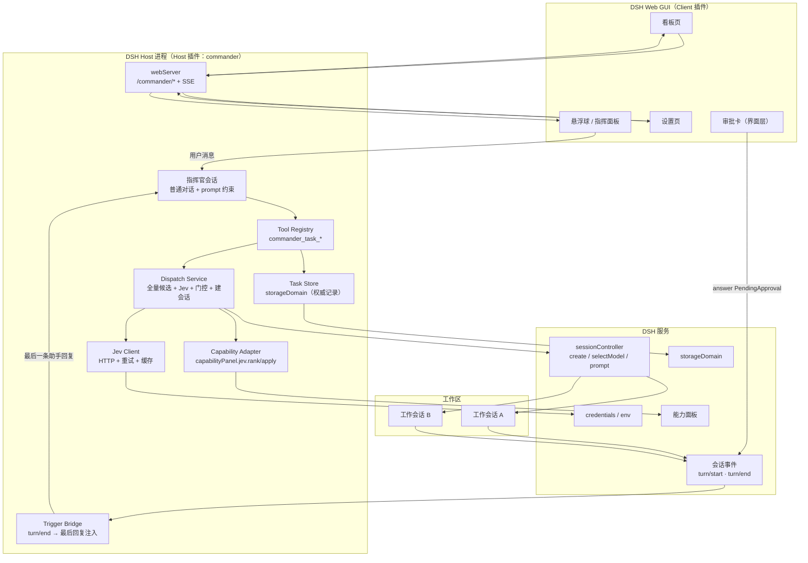
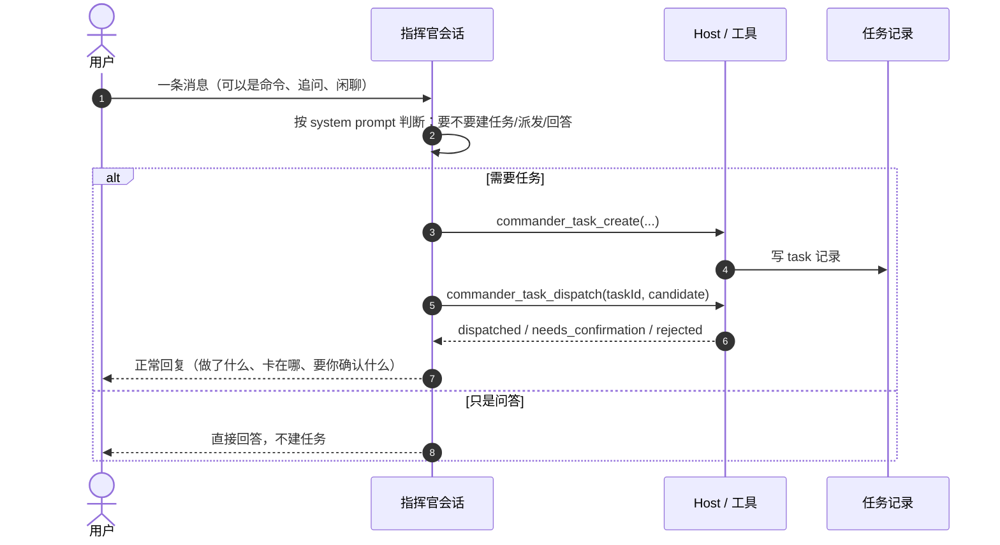
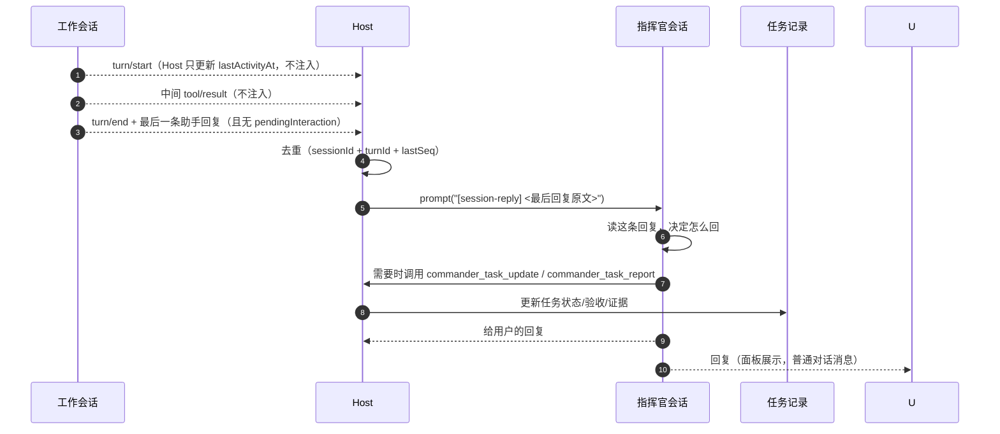
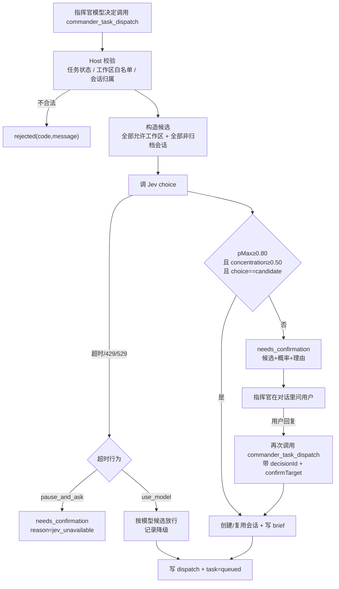
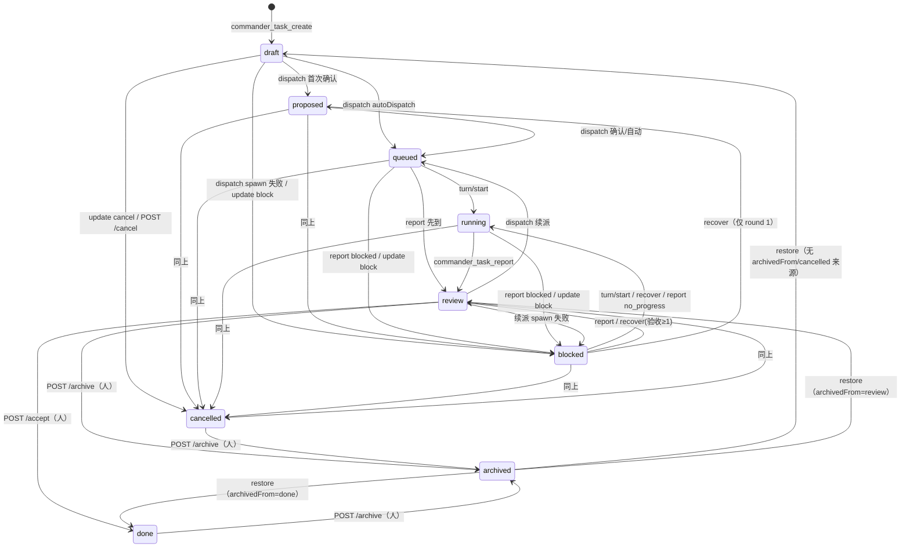

# DSH Commander · 指挥官 —— 架构设计

> 版本：v2.4　日期：2026-11-17
> 对应产品设计：`docs/PRODUCT-DESIGN.md` v1.4
> v2.4 修正：能力选择完全调用能力面板的 capabilityPanel.jev.rank/apply；不再自建目录、范围或 Resolver。
> v2.4 平台契约修正（2026-11-17）：存储表名 `boardEdits`→`board_edits`（DSH per-record 表名须匹配 `/^[a-z][a-z0-9_]*$/`，V4 实测见 `docs/validation/v4-storage-domain.md`）；键 `editId`、`BoardEditRecord` 字段、layout/version/语义全部不变。
> v2.2 修正：能力策略收敛为两档；指挥官只提需求建议；能力选择由能力面板负责，派发 Jev 不参与。
> v2.1 修正：能力目录不再单独暴露工具；Jev 改为全量覆盖优先、两层兜底；补疑似停滞徽标与 50 案例评估门禁。
> v2.0 修正：去掉结果轮询与任务投影；只注入工作会话停止前的最后回复；指挥官按普通对话 + prompt 约束运行。

---

## 0. 设计原则（本版的核心）

1. **Host 只提供机制，不编排对话流程。** Host 负责：工具注册、事件触发、会话创建、存储、Jev 调用。对话怎么走由指挥官模型在 system prompt 约束下自行决定。
2. **指挥官是普通 DSH 会话。** 它有正常的多轮对话、可随时调用工具；没有"必须先建任务再派发"的硬编码状态机驱动。
3. **只在工作会话停止时回注最后一条助手回复。** 中间的工具调用、进度、审批、提问都不进指挥官上下文。
4. **任务记录就是唯一真相。** 不再维护"事件日志 + 投影"的双写；一条任务记录内含当前状态与有界时间线。
5. **不轮询结果。** 没有 scheduler 定时扫结果；触发完全来自会话停止事件。
6. **Jev 优先全量覆盖，不做召回式预筛。** 预算内把全部允许工作区与全部非归档会话一次送入；超出预算才按"先工作区、后会话"分层，不按时间/词面提前砍候选。

---

## 1. 架构总览



**没有 Scheduler。** 结果不轮询；只有会话 `turn/end` 且进入空闲时触发一次注入。

---

## 2. 关键路径

### 2.1 用户消息 → 对话 → 工具



> Host 不规定"先澄清再建卡再派发"。这些顺序由 prompt 指导，模型可跳过、可合并、可先派发后补卡。

### 2.2 工作会话停止 → 注入最后回复 → 指挥官回复并更新看板



**注入规则**

| 条件 | 行为 |
|---|---|
| `turn/end` 且会话空闲 | 取最后一条 **assistant** 消息注入 |
| 会话在等审批/提问（`pendingInteraction`） | **不注入**；审批只在界面层处理 |
| 中间工具调用、进度、流式片段 | **不注入** |
| 同一 `turnId + lastSeq` | 去重，只注入一次 |
| 最后回复为空/只有工具调用 | 注入一条 `[session-reply] 本轮无文本回复` 或不注入（可配置） |
| 回复超过 8KB | 截断，保留头尾，标记 `truncated` |

- 注入是一条 Host 生成的消息，不是用户原话；文本框里带 `taskId / sessionId / turnId / lastSeq` 元数据。
- 指挥官收到后就是一次**普通对话回合**：它可以只回一句，也可以调用多个工具更新看板。
- "更新看板"不是 Host 强制的后置步骤；是指挥官按 prompt 习惯在回复时调用工具。

### 2.3 派发决策



用户点确认卡的按钮时，Client 往指挥官会话发一条普通用户消息（例如「采用建议」），指挥官据此再次调用工具；不由 Host 硬编码确认流程。

---

## 3. 数据落盘

### 3.1 存储选型

- 使用 `ctx.storageDomain`，域 `commander`，`layout: 'per-record'`。
- **任务记录是权威数据**，不做事件溯源、不做投影双写；记录内含当前状态与有界时间线。
- 物理位置由存储后端决定，推荐：

```yaml
- name: '@deepseek-ai/dsh-storage-json'
  config: { root: ~/.dsh/storages }
- name: '@deepseek-ai/dsh-storage-domain'
  config: { backend: json, routes: { commander: json } }
```

### 3.2 表

```ts
export const commanderDomain = defineDomain({
  name: 'commander',
  version: 1,
  layout: 'per-record',
  tables: {
    config:     domainTable(ConfigRecordSchema),
    workspaces: domainTable(WorkspaceRecordSchema),
    commands:   domainTable(CommandRecordSchema),
    tasks:      domainTable(TaskRecordSchema),
    dispatches: domainTable(DispatchRecordSchema),
    board_edits: domainTable(BoardEditRecordSchema),
    sessions:   domainTable(SessionLinkRecordSchema),
  },
})
```

| 表 | key | 内容 | 保留 |
|---|---|---|---|
| `config` | `singleton` | 指挥官绑定、模型、Jev、UI | 永久 |
| `workspaces` | `workspaceId` | 白名单、摘要、能力策略 | 永久 |
| `commands` | `commandId` | 用户原话、会话、seq | 与任务同寿命 |
| `tasks` | `taskId` | **权威任务记录**（状态 + 有界时间线） | 归档后 90 天 |
| `dispatches` | `decisionId` | 候选、Jev 输出、最终选择 | 1 年 |
| `board_edits` | `editId` | 人工改动 + 注入状态 | 90 天 |
| `sessions` | `<workspaceId>__<sessionId>` | 会话↔任务↔角色、最后注入点 | 与任务同寿命 |

> **表名平台契约**：per-record 表名必须匹配 `/^[a-z][a-z0-9_]*$/`，因此第 6 张表为 `board_edits`（接口名仍为 `BoardEditRecord`）。本行是对冻结表名 `boardEdits` 的最小平台适配，Lead 2026-11-17 裁定；证据 `docs/validation/v4-storage-domain.md`。

> **R1（2026-11-19，加法式）**：`sessions` 记录增加 `status='retired'`、可选 `generation/retiredAt`；被轮换退役的指挥官会话**保留记录与会话**，不自动归档、不删除，可用 `mode:'select'` 绑回。契约见 `docs/architecture/rotation-contract-patch.md`。

**没有 `taskEvents` 表，也没有投影。** 时间线是任务记录里的一个数组，最多 100 条，超过后折叠为摘要；这是展示与审计，不是重建来源。

### 3.3 契约

```ts
interface ConfigRecord {
  v: 1
  commander: {
    workspaceId: string
    workspacePath: string
    sessionId: string
    model: { provider: string; model: string; reasoningEffort?: string }
    agentPreset?: string
    // R1（2026-11-19，加法式）：会话轮换；缺省 = 关闭，行为同历史版本
    rotation?: {
      enabled: boolean          // 默认 false；关闭时唯一路径是手动「绑定到新会话」，且不生成交接简报
      periodDays: number        // 1..7，默认 1（纯时间差，无定时器）
      includeUserTail: boolean  // 简报是否含用户最近原话，默认 true
      generation?: number       // 当前第几任，默认 1
      generationStartedAt?: number // 本任开始时间（ms）
    }
  }
  jev: {
    provider: 'typesafe' | 'custom'
    endpoint: string                  // 默认 https://api.typesafe.ai/v1/systemone
    model: string                     // 默认 jev-latest
    keySource: 'env' | 'credential'
    envVar: string                    // 默认 JEV_API_KEY
    workspaceThreshold: number        // pWorkspace 阈值，默认 0.80
    sessionThreshold: number          // pSession 阈值，默认 0.80
    autoDispatch?: boolean            // 两段都过阈值时自动派发（默认 false）
    timeoutMs: number                 // 默认 1500
    onTimeout: 'pause_and_ask' | 'use_model'
  }
  board: { archiveAfterDays: number; syncUserEdits: boolean }
  ui: { theme: 'follow'|'light'|'dark'; entryPosition: 'br'|'bl'; entryEnabled?: boolean; entryPos?: {x:number;y:number}|null; hotkey: string }
  updatedAt: number
}

interface WorkspaceRecord {
  v: 1
  id: string
  name: string
  path: string
  allowed: boolean
  summary: string
  summarySource: 'manual' | 'model'
  summaryUpdatedAt?: number
  capabilityPolicy: {
    mode: 'inherit' | 'auto'          // 继承 / 自动选择（由能力面板执行）
    lastSelection?: {
      status: 'applied' | 'fallback' | 'failed'
      enabled: string[]
      disabled: string[]
      durationMs?: number
      reason?: string
      at: number
    }
  }
}

interface CommandRecord {
  v: 1
  id: string
  text: string                 // ≤8KB，超出截断
  sessionId: string
  seq: number
  createdAt: number
  taskIds: string[]
  truncated?: boolean
}

type TaskStatus =
  | 'draft' | 'proposed' | 'queued' | 'running'
  | 'blocked' | 'review' | 'done' | 'cancelled' | 'archived'

interface TaskRecord {
  v: 1
  id: string
  title: string
  goal: string
  status: TaskStatus
  workspaceId: string
  priority: 'low'|'normal'|'high'|'urgent'
  commandId: string
  dispatchId?: string
  assignments: string[]              // sessionId[]
  primarySessionId?: string
  acceptance: AcceptanceItem[]
  capabilities?: CapabilityPlan
  progress?: { label: string; pct?: number; at: number }
  block?: { reason: string; code?: string; since: number }
  dependsOn?: string[]               // 依赖任务 id，≤5，无环；全部 done（或 done→archived）才可派发
  dependencyNotifiedAt?: number      // 最近一次成功投递 [task-unblocked] 的时间（仅提醒去重）
  archivedFrom?: TaskStatus          // archive 时的原状态；restore 按它回退
  timeline: TaskTimelineItem[]       // 有界，≤100
  version: number                    // 乐观并发
  createdAt: number
  updatedAt: number
  lastActivityAt: number
  archivedAt?: number
}

interface AcceptanceItem {
  id: string
  text: string
  verify?: string
  evidence?: string
  source: 'commander'
  derivedFrom?: { sessionId: string; seq: number }
  state: 'evidence_present' | 'insufficient'
}

interface CapabilityPlan {
  policy: 'inherit' | 'auto'
  executor: 'capability-panel'
  status: 'inherited' | 'applied' | 'fallback' | 'failed'
  enabled: string[]                                 // 面板 apply 返回
  disabled: string[]
  durationMs?: number
  reason?: string                                   // fallback / failed 原因
  at: number
}

interface TaskTimelineItem {
  at: number
  type: 'created'|'dispatch'|'session_stop'|'report'|'status'|'user_edit'|'accept'|'rework'
  text: string
  sessionId?: string
  seq?: number
}

interface DispatchRecord {
  v: 1
  id: string
  taskId: string
  createdAt: number
  prefilter: { workspaceIds: string[]; sessionIds: string[]; scores: Record<string, number>; truncated: boolean }
  candidates: DispatchCandidate[]     // ≤8
  modelSuggestion: string
  jev: {
    provider: string; endpoint: string; model: string; requestId: string
    latencyMs: number; ok: boolean
    error?: { code: string; message: string }
    answers?: {
      workspace?: { choice: string; probabilities: Record<string, number>; confidence: number }
      session?:   { choice: string; probabilities: Record<string, number>; confidence: number }
    }
    pMax?: number; concentration?: number         // 两问的最小值，便于排序
    usage?: { input_tokens: number; output_tokens: number }
  }
  outcome: 'auto'|'confirmed'|'overridden'|'cancelled'|'jev_unavailable'|'rejected'
  finalTarget?: { workspaceId: string; mode: 'new'|'attach'; sessionId?: string }
  confirmedBy?: 'user'
  reason?: string
}

interface SessionLinkRecord {
  v: 1
  sessionId: string
  workspaceId: string
  taskId: string
  role: 'work'|'commander'
  mode: 'new'|'attach'
  createdAt: number
  lastInjected?: { turnId: string; seq: number; at: number }  // 去重
  status: 'queued'|'running'|'idle'|'missing'|'retired'      // R1：retired = 被轮换退役（会话保留，可绑回）；missing = 会话不可恢复
  generation?: number                                        // R1：仅 role='commander'；第几任
  retiredAt?: number                                         // R1：仅 retired 记录
}

interface BoardEditRecord {
  v: 1
  id: string
  taskId: string
  field: string
  before: unknown
  after: unknown
  actor: 'user'
  at: number
  injectedAt?: number
  injectionKey?: string
}
```

### 3.4 写入协议

1. **单写者**：只有 Host 写域；Client 通过 HTTP 命令。
2. **单记录更新**：一次状态迁移只 `update` 一条 `tasks` 记录（含 timeline 追加）；没有跨表事务。
3. **乐观并发**：`update` 里比较 `version`，冲突则重读重试，最多 3 次。
4. **幂等**：工具调用带 `requestId`；`sessions` 表的 `lastInjected` 做注入去重。
5. **key 规范**：per-record 后端要求 `[a-zA-Z0-9_-]+`；跨字段用 `__`，非法字符归一为 `-`。
6. **崩溃恢复**：任务记录本身是完整状态；未完成的工具调用由调用方重试；注入失败可按 `lastInjected` 判断后补一次。
7. **归档**：归档时把 timeline 压成一条摘要，保留任务记录。

### 3.5 不落盘

- 审批请求/回答全文（只在内存与界面）。
- 工作会话的完整日志、代码正文、文件内容（只存路径/摘要/seq）。
- Jev Key。
- 中间工具调用与进度（不进指挥官，也不落任务时间线，除非指挥官整理时主动写入）。

---

## 4. 指挥官工具

工具由 `ctx.tools.register(defineTool({...}))` 注册；只在指挥官会话可见。Host 不规定调用顺序，prompt 描述何时用。

| 工具 | 作用 | 写盘 |
|---|---|---|
| `commander_task_create` | 建任务草稿；可带 `dependsOn` | 是 |
| `commander_task_get` | 取单条最新任务（version/status/ready/waitingFor/block/pendingDispatch） | 否 |
| `commander_task_update` | action enum：`edit/set_dependencies/block/cancel/recover`；必带 `expectedRevision` | 是 |
| `commander_task_dispatch` | 全量候选 + 能力解析 + Jev + 门控 + 建会话；也用于确认/续派 | 是 |
| `commander_task_report` | 把最后回复整理成验收与证据（进入 review 的唯一正常入口） | 是 |
| `commander_task_list` | 查看看板（每行带 version/ready） | 否 |
| `commander_workspace_list` | 看已启用工作区（派发目标，只读） | 否 |
| `commander_session_list` | 看指定工作区的根会话（attach 目标，只读） | 否 |
| `commander_workspace_update` | 维护工作区摘要（与设置页同一字段；不动白名单/策略） | 是 |

**已删除 `brief_user`**：指挥官的普通回复就是播报；界面根据任务状态与新消息决定是否提醒，不需要一个单独的"播报工具"。

### 4.0 状态机与统一迁移入口（定案 v1.0）

状态枚举仍为 9 个：`draft/proposed/queued/running/blocked/review/done/cancelled/archived`。看板六列只做显示合并，不新增状态；`done/archived` 只能走人专用路由。所有任务状态写入必须经过 `src/host/tasks/state-machine.ts` 的唯一迁移入口（迁移图 + actor 权限 + 守卫 + 副作用），不允许各写入口自行 `if`。

| From → To | 唯一入口 | 守卫 |
|---|---|---|
| `draft→proposed/queued`、`proposed→queued`、`review→queued` | `commander_task_dispatch` | pending/依赖；queued 需 primarySessionId |
| `queued/blocked→running` | `turn/start`（及 blocked 的 recover/report） | queue/阻塞守卫 |
| `queued/running/blocked→review` | `commander_task_report`（blocked 也可 recover） | acceptance≥1 |
| `draft/proposed/queued/running→blocked` | dispatch spawn 失败 / `commander_task_update(action=block)` | reason 必填 |
| `blocked→proposed` | `commander_task_update(action=recover)` | 仅 round 1 且无验收历史 |
| `review→done` | `POST /accept`（人） | 幂等 |
| `→cancelled` | `commander_task_update(action=cancel)` / `POST /cancel` | 先停会话，失败不落状态 |
| `review/done/cancelled→archived` | `POST /archive`（人） | 写 `archivedFrom` |
| `archived→archivedFrom` | `POST /restore`（人） | 清 archivedAt/pending/依赖提醒标记 |

依赖：`commander_task_create`/`set_dependencies` 校验 `dependsOn`（≤5、无自依赖/重复/环、不得指向 cancelled 或非 done 归档）；`ready` 只对 `draft/proposed` 有意义；dispatch 用 `dependenciesMet`（不是 ready）做前置检查。accept 首次成功后只提醒 commander（`[task-unblocked]`，一次一条），cancel/review 来源 archive 后提醒 `[task-dependency-blocked]`；Host 不自动派发、不自动改后继状态。

### 4.1 `commander_task_dispatch`

```json
{
  "name": "commander_task_dispatch",
  "parameters": {
    "taskId": { "type": "string", "required": true },
    "candidate": {
      "type": "object",
      "properties": {
        "workspaceId": { "type": "string" },
        "mode": { "type": "string", "enum": ["new","attach"] },
        "sessionId": { "type": "string" }
      },
      "description": "首次调用提供；确认时可用 decisionId 代替"
    },
    "decisionId": { "type": "string", "description": "needs_confirmation 返回的决策 id" },
    "confirmTarget": {
      "type": "object",
      "properties": {
        "workspaceId": { "type": "string" },
        "mode": { "type": "string", "enum": ["new","attach"] },
        "sessionId": { "type": "string" }
      }
    },
    "capabilityNeeds": {
      "type": "array",
      "items": { "type": "string" },
      "description": "指挥官润色后的能力需求建议（自然语言短语，≤40 字/项）。不需要知道具体能力名；由能力面板的 jev.rank/apply 决定。"
    },
    "requestId": { "type": "string" }
  },
  "output": {
    "schema": {
      "oneOf": [
        { "type": "object", "properties": {
          "status": { "const": "dispatched" },
          "taskId": { "type": "string" }, "decisionId": { "type": "string" },
          "sessionId": { "type": "string" }, "sessionCreated": { "type": "boolean" },
          "target": { "type": "object" },
          "scores": { "type": "object" },
          "capabilities": { "type": "object" }
        }},
        { "type": "object", "properties": {
          "status": { "const": "needs_confirmation" },
          "decisionId": { "type": "string" }, "candidates": { "type": "array" },
          "recommendation": { "type": "object" },
          "scores": { "type": "object" },
          "reason": { "type": "string" }
        }},
        { "type": "object", "properties": {
          "status": { "const": "rejected" },
          "code": { "type": "string" }, "message": { "type": "string" }
        }}
      ]
    }
  }
}
```

- 首次调用返回 `needs_confirmation` 时**不派发**；指挥官在对话里问用户。
- 用户回复后，指挥官再调一次，带 `decisionId + confirmTarget`（或原 candidate）完成派发。
- 幂等：`requestId`；同一 decision 只能提交一次。

### 4.2 `commander_task_report`

```json
{
  "name": "commander_task_report",
  "parameters": {
    "taskId": { "type": "string", "required": true },
    "sessionId": { "type": "string", "required": true },
    "seqFrom": { "type": "number", "required": true },
    "seqTo": { "type": "number", "required": true },
    "outcome": { "type": "string", "enum": ["delivered","partial","blocked","no_progress"], "required": true },
    "acceptance": { "type": "array", "required": true, "items": {
      "type": "object",
      "properties": {
        "text": { "type": "string" },
        "verify": { "type": "string" },
        "evidence": { "type": "string" },
        "derivedFromSeq": { "type": "number" }
      }
    }},
    "summary": { "type": "string", "required": true, "description": "≤800 字；指挥官对工作会话最后回复的归纳（Host 原文落库，不核对来源）" }
  },
  "output": {
    "schema": {
      "type": "object",
      "properties": {
        "taskId": { "type": "string" },
        "status": { "type": "string", "enum": ["review","running","blocked"] },
        "evidenceState": { "type": "string", "enum": ["complete","insufficient"] },
        "insufficient": { "type": "array", "items": { "type": "string" } }
      }
    }
  }
}
```

- 校验证据 seq 落在区间内；不评估达标。
- 写任务记录：acceptance、timeline、status=review（或 blocked）、`reportSummary={text,at}`（指挥官归纳的 summary 原文 + 本次整理时间；≤800 字，Host 不核对来源）。
- `reportSummary` 由任务详情接口（`GET /commander/tasks/:id`）透出，看板抽屉的「整理报告」行以**「结论」卡**展示 summary 正文（4 行折叠、可展开，强调色用 DSH 深蓝，不复用证据状态的语义绿）；空 summary 不落库、不展示。
- 不强制调用；指挥官可以根据最后回复决定先 `commander_task_update` 还是直接 `commander_task_report`。

### 4.3 能力选择：两种策略，执行完全交给能力面板

**策略只有两个**（每工作区）：

| 策略 | 行为 |
|---|---|
| `inherit` 继承工作区（默认） | 不做任何能力操作，新会话沿用工作区默认配置 |
| `auto` 自动选择 | 调用能力面板的 `capabilityPanel.jev.rank` + `jev.apply`，由面板按任务文本决定本会话启用哪些能力 |

**为什么不再自建 Resolver**

- 能力面板（`dsh-capability-settings`）已经提供完整实现（`ctx.provide("capabilityPanel")`，见 `lib/index.js:439`；`lib/jev/rank.js`、`lib/jev/apply.js`）：
  - `ctx.provide("capabilityPanel", …)` 暴露 Host 服务；
  - `jev.rank({ sessionId, draft, cwd })`：按角色/任务/操作三维做 `noul` 评分，取 max，阈值来自能力面板配置（默认 0.50），按体积自动分片；
  - `jev.apply({ sessionId, plan, cwd })`：批量写会话级 Skills / MCP / Tools 开关，带失败回滚、冷会话排队。
- 因此指挥官插件**不维护能力目录、不做匹配、不配置能力阈值**。它只做两件事：
  1. 按策略决定调用还是不调用面板；
  2. 把**委派文本**（`capabilityNeeds` + 任务 brief）作为 `draft` 交给面板。

**调用顺序（auto）**

```text
1. sessionController.create({ workspaceId, agentPreset })  → sessionId
2. capabilityPanel.jev.rank({ sessionId, draft, cwd })      → plan
3. capabilityPanel.jev.apply({ sessionId, plan, cwd })      → { enabled, disabled, elapsedMs }
4. sessionController.prompt({ sessionId, mode:'queue', content: prompt })   // prompt = commander_task_dispatch.prompt 原文，Host 零拼接零截断（2026-11-26）
```

- `draft` 里包含指挥官润色后的能力需求（例如「需要浏览器自动化、单测」）与任务目标。
- 面板自己决定启用哪些、阈值、分片、工具/技能/MCP 的口径；指挥官不解读 plan。
- `apply` 失败或面板不可用：**回退 inherit**（继续派发），记录 `status=fallback` 与原因；不阻塞任务。
- 派发到已有会话不使用策略（不调用面板），沿用该会话已有配置。
- 结果写入 `CapabilityPlan` 与 `WorkspaceRecord.capabilityPolicy.lastSelection`，确认卡/任务详情只展示摘要（启用/禁用数、耗时、fallback 原因）。

### 4.4 其他工具

- `commander_task_create`：`title/goal/workspaceId?/priority?/commandId?/dependsOn?` → `{taskId,status:"draft",version,dependsOn,waitingFor,ready}`。
- `commander_task_get`：`taskId` → `{id,version,title,status,round,workspaceId,priority,dependsOn,waitingFor,ready,primarySessionId?,block?,pendingDispatch,acceptanceCount,evidenceInsufficientCount,updatedAt}`；**任何 `commander_task_update` 前先取 version**。
- `commander_task_update`：`taskId + expectedRevision + action`；`status` 参数已删除。action 严格收字段：`edit`（title/priority/progress）、`set_dependencies`（dependsOn）、`block`（reason）、`cancel`、`recover`（recoverTo）。stale revision → `task_stale_revision`，不落盘。
- `commander_task_list`：返回 ≤30 条摘要（含 version/ready/dependsOn/waitingFor）。
- 一律不提供 `follow_up`/`task_cancel`/`task_archive` 这类不存在的工具；取消/归档/恢复/验收是人专用 HTTP 路由。

### 4.5 人专用操作（不给模型）

| Method + Path | 用途 |
|---|---|
| `POST /commander/tasks/:id/accept` | 唯一验收入口（`review→done`，幂等） |
| `POST /commander/tasks/:id/archive` | `review/done/cancelled→archived`，写 `archivedFrom` |
| `POST /commander/tasks/:id/restore` | `archived→archivedFrom`（缺省回 draft） |
| `POST /commander/tasks/:id/cancel` | 非终态→cancelled；先停 running/queued 会话，失败不落状态 |
| `POST /commander/tasks/:id/continue` | 看板继续派发请求（只写批注并通知指挥官；`/rework` 兼容别名） |
| `PATCH /commander/board/tasks/:id` | **只允许 priority/title**；`status` 一律 400/409 |
| `GET /commander/state` | 看板/面板 SSE |

派发确认不需要专门路由：Client 把用户的选择作为一条普通消息发给指挥官，指挥官再次调用 `commander_task_dispatch`。

---

## 5. Jev 请求与 20 工作区 / 800 会话

### 5.1 调用约定

- `POST https://api.typesafe.ai/v1/systemone`，`model: jev-latest`。
- 超时 1500ms；`429/529` 退避重试 1 次；`4xx` 不重试。
- **每次派发固定两次调用**：第 1 段只问工作区，第 2 段只问所选工作区内的会话。不按 token 预算切换"一次双问 / 两层"（v2.5 修正，2026-11-19）。

### 5.2 两段固定结构（v2.5）

类型约定按 TypeSafe 的语义：**`state` 只放被判断的对象**（用户请求 + 转写需求），**候选与其描述放 `criteria`**。两段共用同一个 `state`。

**第 1 段：工作区**

- 候选：所有 `allowed === true` 的工作区（≤100；未配置 `allowed` 的不进候选）
- `state`：`task {title, goal, acceptanceHints?, priority?}` + `command {text, workspaceHint?}`
- `criteria`：`w_i → {name, path, what, recentSessionTitles[≤10]}`
  - `what` 取工作区描述，空则 `"未配置摘要"`
  - `recentSessionTitles` 取该工作区最近活动的会话标题（排除指挥官自身、子会话、归档会话）
  - `path` 是身份信号（remote 镜像 / `.dsh` 本机环境 / 同名父子目录），必须进 criteria

**第 2 段：所选工作区内的会话**

- 候选：该工作区非归档会话（排除指挥官自身、子会话）+ `new`，按 `lastActiveAt` 倒序，**最多 250 个**（Choice 上限 255；截断时 `prefilter.truncated = true`）
- `state`：同第 1 段（**不含候选**）
- `criteria`：`new → {what:"新建会话"}`；`s_i → {what: title, lastActiveAt?, contextUsage?, userQuestions?}`
  - `userQuestions` = 该会话的**用户提问**（按时间序；只取真实用户输入，过滤 `<system-reminder>`/运行时快照/子 agent 消息等注入）
  - 条数：每会话最多 20 条；超过 20 条时**首条与末条必留**，中间按提问长度降序取 18 条（输出仍按时间序）
  - 限额：每条 ≤240 字、每会话 ≤1200 字、总量 ≤45k 字符、最多为最近 60 个候选读取；超出的候选只带标题（仍是合法选项）
  - 字符截断时同样**优先保留首条与末条**，中间条目按时间序用剩余预算填充

**答案合并**

- 工作区 `choice` 按 `wIndex` 回真实 id；会话 `choice` 按 `sIndex` 回真实 id；`new` → `mode='new'`
- 第二段只在所选工作区内选，所以 attach 会话必属该工作区（确认路径仍校验归属与归档）

### 5.3 请求示例（两段，节选）

第 1 段：工作区

```json
{
  "model": "jev-latest",
  "state": {
    "task": { "title": "导出任务断点续传", "goal": "订单导出中断后可继续", "priority": "high" },
    "command": { "text": "订单导出断了能接着导吗", "workspaceHint": "HtDot" }
  },
  "questions": {
    "workspace": {
      "type": "choice",
      "instructions": "哪个工作区最适合承接这个任务？按职责、路径与最近会话标题选择。",
      "criteria": {
        "w_0": {
          "name": "HtDot",
          "path": "/Users/lzx/Documents/GitHub/HtDot",
          "what": "电商后台主站：订单列表、结算、导出、库存与促销活动",
          "recentSessionTitles": ["订单导出改流式", "结算页性能优化"]
        },
        "w_1": {
          "name": "Htdot-OrderCenter",
          "path": "/Users/lzx/Documents/sunteng/Htdot-OrderCenter",
          "what": "HtDot 订单中心前端：React 页面、订单详情交互与前端构建",
          "recentSessionTitles": ["订单详情弹窗", "收货地址编辑"]
        }
      }
    }
  }
}
```

第 2 段：会话（`state` 与上段相同，仅 `criteria` 换成所选工作区会话）

```json
{
  "model": "jev-latest",
  "state": {
    "task": { "title": "导出任务断点续传", "goal": "订单导出中断后可继续", "priority": "high" },
    "command": { "text": "订单导出断了能接着导吗", "workspaceHint": "HtDot" }
  },
  "questions": {
    "session": {
      "type": "choice",
      "instructions": "该工作区里哪个会话最合适？没有合适的就选 new。",
      "criteria": {
        "new": { "what": "新建会话" },
        "s_0": { "what": "订单导出改流式", "lastActiveAt": "2026-11-16T17:21:00+08:00" },
        "s_1": { "what": "结算页性能优化", "lastActiveAt": "2026-11-14T09:03:00+08:00" }
      }
    }
  }
}
```

### 5.4 响应与门控

```json
{
  "model": "jev-1.14.0",
  "answers": {
    "workspace": { "type": "choice", "choice": "htdot", "probabilities": { "htdot": 0.62, "mira": 0.21, "live": 0.17 }, "confidence": 0.43 },
    "session": { "type": "choice", "choice": "sess_8f31a2", "probabilities": { "sess_8f31a2": 0.58, "new": 0.42 }, "confidence": 0.16 }
  },
  "usage": { "input_tokens": 12400, "output_tokens": 64 }
}
```

```ts
const pWorkspace = workspaceAnswer.probabilities[workspaceAnswer.choice]
const pSession = sessionAnswer.probabilities[sessionAnswer.choice]
const pass =
  pWorkspace >= workspaceThreshold &&
  pSession >= sessionThreshold

// 记录时：pMax = min(pWorkspace, pSession)，concentration = min(两问 confidence)（仅记录，不参与门控）
```

> 说明：问两个独立问题后，组合概率是乘积；如果按乘积设 0.8，几乎必然要人工确认。建议分别门控（工作区 0.8、会话 0.8），或对 `new` 只要求工作区门控。阈值用 50 案例校准（见 §8）。
>
> **自动派发（2026-11-19）**：`jev.autoDispatch` 开启且门控通过时直接派发（`outcome='auto'`），关闭时门控仅用于展示、首次恒 `needs_confirmation`（M1 全确认默认值仍为 `false`）。

### 5.5 800 会话 / 20 工作区（两段式后）

| 情况 | 处理 |
|---|---|
| 工作区 ≤100 | 全部 allowed 进第 1 段 criteria（Choice 上限 255） |
| 工作区没有摘要 | `what="未配置摘要"`，仍进候选、不影响召回 |
| 所选工作区会话 >250 | 按 `lastActiveAt` 取前 250，`prefilter.truncated=true` |
| 提问证据预算 | 最近 60 个候选带用户提问，单条 ≤240 字、单会话 ≤1200 字、总量 ≤45k 字符；其余只带标题 |
| 会话很久以前 | **不排除**；按 `lastActiveAt` 倒序展示（在 250 名额内） |
| 归档会话 | 排除（可恢复后再派发） |
| 第 1 段失败 | `jev_unavailable`（默认 `pause_and_ask`）；不跳过工作区直接问会话 |
| 答案一致性 | 第 2 段只含所选工作区会话，天然一致；不再需要"追加小请求复核" |

**预算**：第 1 段通常 2–6k tokens；第 2 段按 250 会话 ×（标题 + 元数据）估算，仍远低于单段 32k 上限。长上下文 262k 仍默认关闭。

## 6. 任务状态机

状态仍然需要，因为看板、验收、依赖都依赖它；但**迁移由工具调用、人操作或会话事件触发，不由 Host 编排对话**。唯一口径与完整矩阵见 `docs/architecture/task-state-machine-final.md` v1.0；实现入口 `src/host/tasks/state-machine.ts`。



| 状态 | 看板列 | 进入方式 |
|---|---|---|
| draft | 待派发 | `commander_task_create` |
| proposed | 待派发 | `commander_task_dispatch` 返回 needs_confirmation |
| queued | 待运行 | 派发提交（会话创建 + brief 投递） |
| running | 运行中 | Host 收到 `turn/start`（机械更新运行态，不注入对话） |
| blocked | 受阻 | spawn/投递失败、report blocked、工具 block |
| review | 待验收 | `commander_task_report`（delivered/partial，acceptance≥1） |
| done | 已验收 | 仅 `POST /accept`（人） |
| cancelled | 回收站 | 人/指挥官取消 |
| archived | 回收站 | 仅 `POST /archive`（人） |

**不变量**

1. `done` 只能从 `review` 进入，且只能由人 accept；`archived` 只能由人 archive/restore。
2. `review` 至少 1 条 acceptance；`queued` 必须有 primarySessionId；`blocked` 必须有 reason；`blocked→proposed` 仅 round 1 且无验收历史。
3. 一个任务同一时刻一个当前轮主会话；改派新增 assignment；同一会话可被多个任务 attach。
4. 所有状态写入经统一迁移入口；`commander_task_update` 只接受 action enum + `expectedRevision`，不接受裸 status。
5. `dependsOn` ≤5、无环；dispatch 前置检查 `dependenciesMet`；accept/cancel/archive 只提醒 commander，Host 不自动派发、不自动改后继状态。
6. 审批/提问不写入任务记录。
7. 状态迁移只更新任务记录一条；不写投影、不写事件表。
8. **凡是通过工具改变了任务状态的指挥官回合，必须以一条用户可见的回复结束**（prompt 约束，不允许静默改板）。

---

## 7. 失败模式

| 失败 | 处理 |
|---|---|
| 最后回复为空/只有工具调用 | 注入 `[session-reply] 无文本` 或跳过（配置） |
| 注入重复 | `lastInjected` 去重（sessionId+turnId+seq） |
| 注入时 commander 正忙 | 排队一条；合并同一 session 的连续停止 |
| 会话非空闲且长时间无活动 | **2026-11-24 移除「疑似停滞」徽标**：不改状态、不轮询注入、不自动追问，看板不对长静默任务做任何标记 |
| 回复 >8KB | 头尾截断 + `truncated` |
| Jev 超时 | 默认 `pause_and_ask` |
| Jev 低置信 | `needs_confirmation` |
| 会话创建/投递失败 | 任务回 proposed/blocked，不新建第二个会话 |
| 能力应用失败 | 不启动会话，blocked(code=capability_apply_failed) |
| 任务记录并发写 | version 冲突重试 3 次 |
| 人工改动注入失败 | `board_edits.injectedAt` 为空，启动补注入一次 |

观测：注入次数/去重数、注入到回复时延、Jev 时延/失败率、派发自动/确认比例、验收整理时延、任务记录冲突数。

---

## 8. 开发前验证：Jev 50 案例（门禁）

阈值不是拍脑袋定的。开发前必须用约 50 个真实派发案例跑一轮评估，再决定 `pWorkspace / pSession / confidence` 的阈值。

**案例集**（`docs/eval/`）

- 每条案例包含：任务文本、当时的允许工作区与摘要、全部非归档会话摘要、期望目标（工作区/模式/会话）。
- 分层：12 条明显工作区、12 条跨工作区歧义、10 条"相关会话是几天/几周前"、6 条应新建会话、5 条能力驱动、5 条应询问用户。
- 用真实快照，不用合成文本；避免用"最近会话"先验污染标签。

**指标**

| 指标 | 定义 | 目标 |
|---|---|---|
| 工作区 Top-1 | 选中工作区 == 期望 | ≥ 85% |
| 会话 Top-1 | 需要 attach 时选中会话 == 期望 | ≥ 70% |
| 模式准确率 | new/attach 判断正确 | ≥ 85% |
| 自动派发精确率 | 门控放行的案例中目标正确 | ≥ 95% |
| 自动派发覆盖率 | 门控放行比例 | ≥ 40% |
| 校准 | 按 pMax 分桶预测正确率 | 单调、无严重过自信 |
| 时延/成本 | p50/p95 时延、tokens | p95 < 3s |

**阈值选择**：扫描 `pWorkspace × pSession × confidence`，选精确率 ≥95% 下覆盖率最高的组合；若达不到，默认收紧到"每次确认"，不牺牲正确率。

**工具**：`tools/jev-eval.mjs`（live / `--mock`、阈值扫描、Markdown 报告）；协议与分层见 `docs/eval/jev-dispatch-eval.md`；当前有 6 条示例，50 条真实快照需在开发前补齐。

**两段式要分开测**：工作区段与会话段各自算 Top-1（两段误差会相乘），并按段看 token 与 p50/p95；会话段在 250 候选截断前后各测一次（v2.5）。

---

## 9. 待实测

1. `turn/end` 与"最后一条 assistant 消息"的对应关系（是否每个 turn 只有一条最终回复）。
2. 会话等待审批/提问时是否会触发 `turn/end`；若会，必须用 `pendingInteraction` 过滤。
3. 回复注入后 commander 是否总能在同一回合调用工具更新看板（prompt 约束效果）。
4. 能全量覆盖的 token 估算准确度；800 会话的实际字符数与 Jev 延迟。
5. 能力选择：能力面板 `jev.rank/apply` 的集成测试（auto 成功、面板不可用回退 inherit、已有会话不应用、apply 失败回退）。
6. 会话级能力应用接口（dsh-capability-settings 是否可由 Host 调用）。
7. 单 Host 进程假设；多 Host 写域需要跨进程锁。
