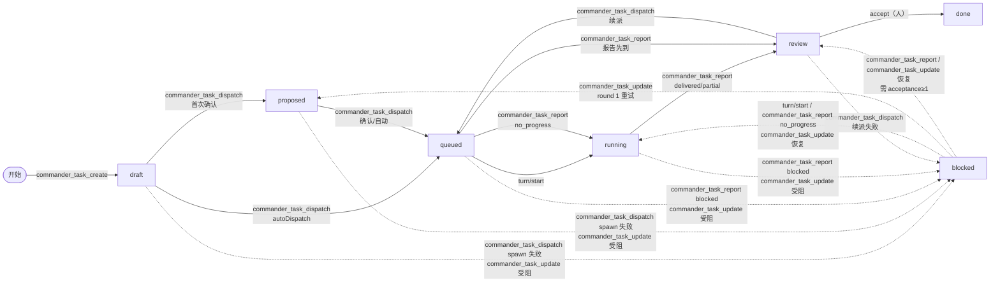
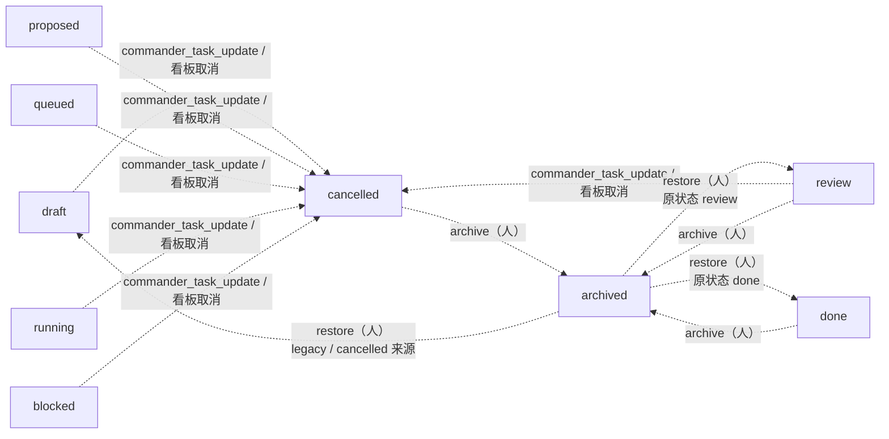

# 任务状态机补全方案（含现状审计）

> 日期：2026-11-21
> 状态：**讨论稿（已被 `task-state-machine-final.md` 取代）**；Task Group §13 仅作讨论，不进入定案，实施以 final 为准。
> 范围：任务状态语义、迁移矩阵、写入者权限、看板列与文案、Host 统一迁移入口、测试与兼容
> 依据：`docs/ARCHITECTURE.md` §6、`docs/architecture/m2m3-contract-patch.md` §2.2/§2.4、`docs/architecture/m5-continue-dispatch.md` §3、`docs/PRODUCT-DESIGN.md` §3.1，以及 2026-11-21 对 `packages/dsh-commander/src` 的逐点审计。

---

## 0. 一页结论

用户口径的六段主链路**在数据模型里一个都不缺**：

| 用户口径 | 内部 `TaskStatus` | 现状 |
|---|---|---|
| 建任务 | `draft` | `commander_task_create` 写入；看板与 `proposed` 合并显示为「待派发确认」 |
| 待派发 | `proposed` | 已存在，但列名是「待派发确认」，且与 `draft` 同列 |
| 待运行 | `queued` | 已存在，但被合并进「进行中」列，用户看不到 |
| 运行中 | `running` | 已存在，与 `queued` 同列 |
| 待验收 | `review` | 已存在，独立列 |
| 已验收 | `done` | 已存在，列名是「已完成」而非「已验收」 |
| 取消 | `cancelled` | 回收站页签 |
| 归档 | `archived` | 回收站页签 |

所以本轮**不需要新增状态枚举，P0 也不改任务记录字段**。真正的问题是两个：

1. **看不见**：看板把 `draft/proposed` 合成「待派发确认」、把 `queued/running` 合成「进行中」，用户自然觉得「待派发」「待运行」缺失。
2. **管不住**：`TASK_TRANSITIONS` 目前只有 `commander_task_update` 一个调用方（`src/host/tools/index.ts:333`），看板 PATCH、`commander_task_report`、dispatch、turn/start、accept、archive/restore 都直接写 `status`，其中看板 PATCH 甚至不做任何迁移校验。这是「状态之间转换不清晰」的根因。

方案一句话：**拆开看板列，把迁移表升级成所有写入口共用的唯一真相，并补齐实际存在但没写进迁移表的边。**

---

## 1. 现状审计

### 1.1 全部状态写入点（源码事实）

| 写入点 | 写入行为 | 证据 |
|---|---|---|
| `commander_task_create` | 建记录 `draft` | `src/host/tools/index.ts:273,287` |
| `commander_task_dispatch` 首次需要确认 | `draft→proposed`；`review` 续派保持 `review` | `src/host/dispatch/service.ts:612,752` |
| `commander_task_dispatch` 派发落地 | 写 `queued`（来源可为 `draft/proposed/review`） | `src/host/dispatch/service.ts:365,416` |
| `commander_task_dispatch` spawn/投递失败 | 直接写 `blocked` | `src/host/dispatch/service.ts:283` |
| 工作会话 `turn/start` | `queued/blocked→running` | `src/host/trigger/status.ts:67-68,135-138` |
| `commander_task_report` | `review`（delivered/partial）／`blocked`／`running`（no_progress） | `src/host/tools/index.ts:636,666` |
| `commander_task_update` | 经 `canTransition` 校验后写 | `src/host/tools/index.ts:333,341-348` |
| 看板 `PATCH status` | 只查目标是否在 `BOARD_MUTABLE_STATUSES`，**不查来源、不走迁移表** | `src/host/board/service.ts:14,195-205` |
| `accept` | `review→done` | `src/host/tasks/actions.ts:77-105` |
| `archive` | `review/done/cancelled→archived` | `src/host/board/service.ts:16,238-251` |
| `restore` | `archived→draft` | `src/host/board/service.ts:253-267` |

### 1.2 问题清单（按严重度）

#### P0-1 看板列与用户口径错位

`BOARD_COLUMNS` 只有五列：`proposed(draft+proposed) / active(queued+running) / blocked / review / done`（`src/client/board.ts:32-38`，文案 `src/client/locales.ts:287-292`）。「待派发」「待运行」两个状态在界面上**没有独立位置**，只剩任务详情里的状态 chip 能看到。

#### P0-2 看板 PATCH 是状态机的最大缺口

`patchTask` 对 `field==='status'` 只做四件事：拒绝 `done/archived`、检查目标在 `BOARD_MUTABLE_STATUSES`、`review` 要有验收、`queued` 要有 `primarySessionId`（`src/host/board/service.ts:195-205`）。**没有 `canTransition(task.status, value)`**，因此：

- `done → blocked/review/cancelled` 可通过 API 直接改回（`done` 不在目标白名单，但它是**来源**，没人拦）；
- `running → proposed/draft` 可拖回；
- `archived → proposed` 可通过 API 复活；
- `cancelled → running` 可复活。

客户端同样不设防：`checkStatusPatch` 只校验目标（`src/client/board.ts:81-92`），`canDragTask` 只排除回收站状态（`:95-97`），所以 `done` 卡片可以拖到「受阻」「待验收」等列。

现有集成测试甚至把 `proposed→running`（迁移表不允许的边）当成合法用例（`tests/integration/m2-board.test.ts:72-94`），说明这不是偶发 bug，而是测试也按「任意改」在写。

#### P0-3 迁移表与实际写入不一致

`TASK_TRANSITIONS`（`src/host/schema.ts:36-46`）与真实写入对不上：

| 实际存在的迁移 | 迁移表 | 证据 |
|---|---|---|
| `draft→queued`（autoDispatch 直接派发） | 缺 | `dispatch/service.ts:365` |
| `review→queued`（续派） | 缺（注释说内部写） | `dispatch/service.ts:416` |
| `review→blocked`（续派 spawn 失败） | 缺 | `dispatch/service.ts:283` |
| `draft/proposed→blocked`（首次派发失败） | 缺 | 同上 |
| `review→archived`（放弃验收后归档） | 缺 | `board/service.ts:242` |
| `archived→draft`（恢复） | 缺（`archived: []`） | `board/service.ts:261` |
| `done` 的归档 | 有 | `schema.ts:43` |

迁移表读起来像「设计意图」，代码实际走的是「各写各的」，两者都无法单独作为契约。

#### P0-4 `commander_task_report` 没有来源状态守卫

`commander_task_report` 只校验会话绑定和验收项，不校验任务当前是否处于可接收报告的阶段（`tools/index.ts:604-666`）。一个已经 `done`、`review` 或 `archived` 的任务，只要会话还绑定着，就可以被重新写成 `review/running/blocked`，等于绕过「已验收只能归档」的终态约束。

#### P0-5 副作用散落在 handler/工具里，未随状态迁移统一

- 看板取消任务时，停会话逻辑在 `handleBoardPatch`，不在 `patchTask`（`api/routes/handlers.ts:156-168`）；任何新调用方直接调 `patchTask` 都会漏掉停会话。
- `commander_task_update` 的取消会先停会话（`tools/index.ts:345-354`），但看板取消靠 handler，两条路径的失败处理、提示文案、timeline 都不完全一致。
- `block` 元数据不会在解除受阻时清掉：`commander_task_update` 写 `running` 时不会删 `block`（`tools/index.ts:341-348`），看板 PATCH 同样不会（`board/service.ts:205`），导致「运行中」卡片还挂着旧的受阻原因。

#### P1-6 归档/恢复语义丢失

- `restore` 固定恢复为 `draft`（`board/service.ts:261`），不记录原状态；一个 `done` 任务归档后恢复，会变成草案。
- `restore` 没有清 `archivedAt`（`board/service.ts:259-264`），恢复后的记录仍带归档时间。
- 从 `cancelled` 归档再恢复，会把已取消任务变成 `draft`，等于复活。
- `archive` 不清理 `pendingInstruction`（继续派发批注），恢复后可能被下一次派发误消费。

#### P1-7「继续派发」没有独立状态

人在 `review` 任务上点「继续派发」只写 `pendingInstruction` + timeline，状态保持 `review`（`tasks/actions.ts:108-161`，`m5-continue-dispatch.md` §3.1 明确要求）。这是有意设计，但看板上「待验收」和「已请求第 N+1 轮派发」完全同形，用户无法区分「等我验收」和「等指挥官派发」。

#### P1-8 文档与代码漂移

- `docs/ARCHITECTURE.md:756` 仍写 `review→running: 返工`，M5 已删除该边（`m5-continue-dispatch.md:66-78`）。
- `m2m3-contract-patch.md:86-95` 仍是「五列」。
- `m5-continue-dispatch.md:74-78` 明确说 `review→queued` 不走 `canTransition`、看板 PATCH 本轮不收紧——这正是本次要收口的技术债。
- `PRODUCT-DESIGN.md:77` 的看板列与现状一致（五列），同样需要更新。

#### P1-9 自动迁移没有 timeline，状态变化不可审计

`queued→running` 只改 `status/lastActivityAt`，不追加 timeline（`trigger/status.ts:68`）。用户看详情时只能看到「已派发」，看不到「回合已开始」，与「转换清晰」的目标相反。

#### P1-10 派发确认的写入竞态

`finishDispatch` 的写循环只校验 `round`，不校验 `status`（`dispatch/service.ts:355-370`）；如果确认与「验收通过/取消」并发，理论上可把 `done/cancelled` 覆盖成 `queued`。spawn 失败写 `blocked` 时也只是拿 `input.task.version` 直接 update（`:278-286`），版本冲突没有重试。

#### P2-11 其余语义

- `stale`（20 分钟无活动）是只读徽标，不是状态，本轮不改（冻结决策）。
- `done` 之后没有「重新开启」路径：要么新建任务，要么先归档再恢复（现状恢复成 draft）。见 §6 决策 C。
- `blocked` 不在用户列的六段里，但它是真实异常态，不能删；方案把它保留为「异常分支」，不塞进主链路。

---

## 2. 目标模型

### 2.1 状态定义

保留现有 9 个 `TaskStatus`，不新增枚举值。

| 内部状态 | 用户名称 | 语义 | 主链路 | 终态 |
|---|---|---|---|---|
| `draft` | 建任务／草案 | 已建卡，尚未发起派发；卡片进「待派发」列并带「草案」chip | 起点 | 否 |
| `proposed` | 待派发 | 已发起过派发；有确认卡 = 待确认，无确认卡 = 需重新发起派发 | 是 | 否 |
| `queued` | 待运行 | 派发已落地（会话+link+brief），等 `turn/start` | 是 | 否 |
| `running` | 运行中 | 工作会话已开始回合；包含「回合进行中」与「回合之间」 | 是 | 否 |
| `blocked` | 受阻 | 异常分支：投递失败、spawn 失败、无进展、会话丢失 | 异常 | 否 |
| `review` | 待验收 | 报告已整理，等待人验收 | 是 | 否 |
| `done` | 已验收 | 人验收通过 | 是 | 是 |
| `cancelled` | 已取消 | 人/指挥官取消，回收站 | 终止 | 是 |
| `archived` | 已归档 | 封存，回收站 | 终止 | 是 |

> `draft` 不单独开一列：它是 `commander_task_create` 与首次派发之间的短暂态；在「待派发」列里用 chip 区分即可。若后续发现「草案」长期堆积，再拆列（见 §6 决策 A）。

### 2.2 主链路与异常分支

```text
commander_task_create
   │
   ▼
draft ──首次派发需要确认──> proposed ──确认/自动──> queued ──turn/start──> running ──commander_task_report──> review ──accept──> done
   │                            │                    │                      │                          │
   └──自动派发──────────────────┴────────────────────┘                      │                          ├──继续派发──> queued (round+1)
                                                                              │                          │
   任何非终态 ──取消──> cancelled <───────────────────────────────────────────┴──────────────────────────┘
                                                                              │
   draft/proposed/queued/running/review ──失败/无进展──> blocked ──恢复──> running/review
                                                                              │
   review/done/cancelled ──归档──> archived ──恢复──> 原状态（legacy→draft）
```

### 2.3 完整迁移矩阵（唯一真相）

`from` 行、`to` 列；`✓` = 允许，`—` = 禁止。写入口缩写：**H** = Host 自动（dispatch/turn），**C** = 指挥官工具（`commander_task_update`/`commander_task_report`），**U** = 人（看板/accept/archive/restore）。

| from \ to | draft | proposed | queued | running | blocked | review | done | cancelled | archived |
|---|---|---|---|---|---|---|---|---|---|
| `draft` | — | H/U/C（首次确认/人工标记） | H（自动派发） | — | H/C/U（失败） | — | — | U/C | — |
| `proposed` | — | — | H（确认/自动） | — | H/C/U（失败） | — | — | U/C | — |
| `queued` | — | — | — | H/U/C（手动恢复） | H/C/U（失败） | C/U（报告先到） | — | U/C | — |
| `running` | — | — | — | — | C/U（失败/无进展） | C/U（报告） | — | U/C | — |
| `blocked` | — | C（重试派发；`commander_task_update`） | — | H/U/C（恢复） | — | C/U（补报告） | — | U/C | — |
| `review` | — | — | H（续派确认） | — | H（续派失败） | — | U（accept） | U/C | U（archive） |
| `done` | — | — | — | — | — | — | — | — | U（archive） |
| `cancelled` | — | — | — | — | — | — | — | — | U（archive） |
| `archived` | U（legacy/cancelled 来源） | — | — | — | — | U（原状态 review） | U（原状态 done） | — | — |

> `proposed→draft`（撤回）、`queued→proposed`（退回）是可选恢复边，**不进 P0 图**；需要时单独加，不要让它们悄悄存在。`archivedFrom='cancelled'` 的恢复目标是 `draft`（见 §6 决策 B），因此图里没有 `archived→cancelled`。

**明确禁止的边**（重点回归）：

- `review→running`（M5 已删除，文档要同步删）
- `done→任何非 archived`；`cancelled→任何非 archived`
- `archived→任何非 restore`
- 任何非 `review→accept` 的 `→done`
- 任何非 `archive` 路由的 `→archived`
- `draft/proposed→review`、`queued→done`、`draft→archived`

### 2.4 写入者权限（实现时按此收紧）

**A. Host 自动边（只由 Host 触发）**

| 边 | 触发 | 守卫 |
|---|---|---|
| `draft→proposed` | `commander_task_dispatch` 首次 `needs_confirmation` | 无 pending decision |
| `draft→queued` | autoDispatch 门控通过 | spawn 成功、session link 已写 |
| `proposed→queued` | 确认/自动派发 | 同上 |
| `review→queued` | 续派确认/自动 | `round+1`、上轮验收归档、spawn 成功 |
| `*→blocked` | spawn/投递失败 | `block.reason` 必填 |
| `queued/blocked→running` | `turn/start` | link 轮次匹配、任务未终态 |

**B. 指挥官工具边（`commander_task_update` / `commander_task_report`）**

- `commander_task_update` 目标：
  - 正常只做元数据 + `blocked`（从 `draft/proposed/queued/running`，需 `blockReason`）+ `cancelled`（任何非终态）。
  - **仅恢复**：从 `blocked` → `proposed`（仅 `round===1` 重试）、`review`（需 `acceptance≥1`）、`running`（人工恢复）。
  - **不再写** `draft/queued`，也**不再从非 `blocked` 状态写** `proposed/review/running`；详细理由见 §10。
- `commander_task_report` 来源：`queued/running/blocked`；目标：`review`（delivered/partial，需 `acceptance≥1`）／`blocked`（blocked）／`running`（no_progress）。**来源为 `draft/proposed/review/done/cancelled/archived` 一律拒绝**。
- `commander_task_dispatch` 来源：`draft/proposed/review`；其余拒绝（沿用 M5）。
- `blocked→proposed` 只留给 `commander_task_update`：首次派发失败后重新发起；`commander_task_dispatch` 本身仍拒绝 `blocked`（沿用 M5 门禁）。**守卫：仅 `round===1` 且无 `acceptanceHistory`**；第 N 轮（N≥2）续派失败只能走 `blocked→review` 再续派，否则 `commander_task_dispatch` 会按「首次派发」重置轮次。

**C. 人操作边（看板/accept/archive/restore）**

| 操作 | 允许边 | 说明 |
|---|---|---|
| 拖拽改状态 | `draft→proposed/cancelled`；`proposed→blocked/cancelled`；`queued→running/blocked/review/cancelled`；`running→blocked/review/cancelled`；`blocked→running/review/cancelled`；`review→cancelled` | `review→queued/running`、`blocked→proposed`、`done→*`、`archived→*` 不允许 |
| 验收通过 | `review→done` | 只能按钮，不能拖拽 |
| 归档 | `review/done/cancelled→archived` | 只能按钮 |
| 恢复 | `archived→原状态`（legacy→draft） | 只能按钮 |
| 继续派发 | 不改状态；写 `pendingInstruction`，由 `commander_task_dispatch` 完成 `review→queued` | 看板显示「第 N+1 轮待派发」badge |

> 与 §10 的关系：§10 建议进一步禁止看板写 `proposed/queued`（防止绕过派发/依赖门禁）；上表是当前口径，是否收紧待拍板。看板的 `blocked/review` 人工纠正仍走同一迁移矩阵。

**D. 取消的统一副作用**（无论 C 还是 U 触发）

1. 先 `stopTaskSessions`，只针对该任务 `role='work'` 且 `status∈{queued,running}` 的会话；失败则整个迁移失败，状态不变。
2. 使该任务的未决确认失效（`pendingDispatch=null`）。
3. 清 `pendingInstruction`、`block`。
4. 追加 timeline `status` 行。

---

## 3. 需要补充的东西（用户列表之外）

| # | 补充项 | 建议 | 理由 |
|---|---|---|---|
| 1 | `blocked`（受阻） | **保留为异常状态**，独立列，不并入主链路 | 投递失败、spawn 失败、无进展都需要可见、可操作；它不是「运行中」子状态 |
| 2 | `draft`（建任务） | **不单独开列**，并入「待派发」加「草案」chip | `commander_task_create` 到首次派发通常只有几秒；单独列会长期空置 |
| 3 | `pendingDispatch`（确认卡） | **是 gate，不是状态**；`proposed` + pending = 「待确认」badge | 避免新增第 10 个状态；确认卡过期后仍是 `proposed` |
| 4 | `pendingInstruction`（继续派发请求） | **是 `review` 上的 overlay**；卡片显示「第 N+1 轮待派发」badge，状态仍为 `review` | M5 的既定决策：不能掉回「待派发」，否则用户以为验收被取消 |
| 5 | `archivedFrom` | **P1 新增可选字段**；归档时记录原状态，恢复时按原状态回 | 修复「done 归档后恢复成 draft」「cancelled 复活」；旧记录缺省按 `draft` |
| 6 | `block` 清理 | **P0**：离开 `blocked` 时删除 `block` | 否则运行中的卡片一直挂着旧原因 |
| 7 | 自动迁移 timeline | **P1**：`queued→running` 等状态真正变化时追加一行 | 详情页可审计；不改状态时（turn/end）不写，避免噪音 |
| 8 | `archivedAt` 清理 | **P0**：恢复时删除 | 现状恢复后仍显示归档时间，详情/列表字段脏 |
| 9 | `done` 重新开启 | **本轮不做**；已验收=终态，返工走新任务 | 若产品需要「已验收再返工」，需单独讨论 `done→review` 与轮次语义 |
| 10 | `stale` 超时 | **不做**；保持只读徽标 | 冻结决策：不轮询、不自动改状态 |
| 11 | 看板「取消」入口 | **P0 补**：卡片/抽屉对非终态任务显示「取消任务」，二次确认后走统一 `cancelTask` | 现状只有指挥官 `commander_task_update` 能取消，看板只有归档按钮；用户无法直接取消 |

---

## 4. 看板与文案

### 4.1 六列映射（替代「五列」）

| 列 | `TaskStatus` | 卡片要点 | 拖拽目标 |
|---|---|---|---|
| 待派发 | `draft`、`proposed` | 草案 chip；有待确认卡时高亮「待确认」；无卡时提示「需重新发起派发」；继续派发请求 badge；取消按钮 | `proposed` |
| 待运行 | `queued` | 「已派发，等待回合开始」；`stale` 徽标；第 N 轮；取消按钮 | `running`、`blocked`、`cancelled`（按钮） |
| 运行中 | `running` | 最近活动时间；第 N 轮；会话数；取消按钮 | `blocked`、`review`（人可纠正）、`cancelled`（按钮） |
| 受阻 | `blocked` | `block.code/reason`；恢复/取消 | `running`、`review`、`cancelled`（按钮） |
| 待验收 | `review` | 验收条数/证据不足数；`pendingInstruction` badge；取消按钮 | `cancelled`（按钮）；验收/继续派发走按钮 |
| 已验收 | `done` | 验收时间；只读 | 归档按钮；不可拖回 |
| 回收站（页签） | `cancelled`、`archived` | 状态、归档时间 | 仅 `archived` 可恢复 |

> `blocked` 位于「运行中」与「待验收」之间，但视觉上是异常列（红/橙），不计入五段主链路。

### 4.2 文案（zh/en 双改）

| key | 现在 | 目标 |
|---|---|---|
| `task.status.draft` | 草案 | 草案 |
| `task.status.proposed` | 待派发 | 待派发 |
| `task.status.queued` | 已排队 | **待运行** |
| `task.status.running` | 进行中 | **运行中** |
| `task.status.done` | 已完成 | **已验收** |
| `board.column.proposed` | 待派发确认 | **待派发** |
| `board.column.active` | 进行中 | **拆成 `board.column.queued` / `board.column.running`** |
| `board.column.review` | 待验收 | 待验收 |
| `board.column.done` | 已完成 | **已验收** |
| `board.column.blocked` | 受阻 | 受阻 |

英文同步：`Pending dispatch / Waiting to run / Running / Blocked / Ready for review / Accepted`。

### 4.3 抽屉进度

`taskStage` 从四段 `proposed/active/review/done`（`src/client/board.ts:409-430`）改为五段：

`待派发 → 待运行 → 运行中 → 待验收 → 已验收`

`blocked` 在「运行中」步骤叠加受阻标记；`cancelled/archived` 显示为终止标记。继续派发请求不改变进度，只在「待验收」上加 badge。

---

## 5. 实现方案

### 5.1 新增单一迁移模块

新增 `src/host/tasks/state-machine.ts`（零依赖，纯函数 + 一个写入口）：

```ts
export type TransitionActor =
  | 'host_dispatch' | 'host_turn'
  | 'commander_tool' | 'user_board'
  | 'user_accept' | 'user_archive' | 'user_restore'

export interface TransitionContext {
  actor: TransitionActor
  /** 当前轮验收条数（review 守卫）。 */
  acceptanceCount?: number
  /** 当前是否已有工作会话（queued 守卫）。 */
  hasPrimarySession?: boolean
  /** spawn/投递失败原因（blocked 守卫）。 */
  blockReason?: string
  /** 当前轮次 + 是否有历史验收（blocked→proposed 守卫：只允许首次派发重试）。 */
  round?: number
  hasAcceptanceHistory?: boolean
}

export type TransitionCheck =
  | { ok: true }
  | { ok: false; code: 'task_state' | 'invalid_status' | 'precondition'; message: string }

export function checkTransition(task: TaskRecord, to: TaskStatus, ctx: TransitionContext): TransitionCheck
```

职责：

1. 查 `TASK_TRANSITIONS`（全量图）+ `TRANSITION_ACTORS`（边→允许写入者）；
2. 执行守卫：`review` 需 `acceptance≥1`；`queued` 需 `hasPrimarySession`；`blocked` 需 `blockReason`；`blocked→proposed` 需 `round===1 && !hasAcceptanceHistory`；`done/cancelled/archived` 只能走 §2.3 的专用边（accept/archive/restore）；
3. 输出迁移效果：`clearBlock`、`clearPendingInstruction`、`stampArchivedFrom`、`archiveAcceptanceHistory`、`timelineType`；
4. 由各写入口调用，**不再各自 `if` 判断**。

建议把 `TASK_TRANSITIONS` 更新为：

```ts
export const TASK_TRANSITIONS: Readonly<Record<TaskStatus, readonly TaskStatus[]>> = {
  draft:     ['proposed', 'queued', 'blocked', 'cancelled'],
  proposed:  ['queued', 'blocked', 'cancelled'],
  queued:    ['running', 'review', 'blocked', 'cancelled'],
  running:   ['review', 'blocked', 'cancelled'],
  blocked:   ['running', 'proposed', 'review', 'cancelled'],
  review:    ['queued', 'blocked', 'done', 'cancelled', 'archived'],
  done:      ['archived'],
  cancelled: ['archived'],
  archived:  ['draft', 'review', 'done'], // restore：按 archivedFrom 选择；cancelled 来源回 draft
}
```

> `proposed→draft`（撤回）、`queued→proposed`（退回）等恢复边默认不进核心图；如需要，作为 `U/C` 的可选边单独加，不要让它们悄悄存在。

### 5.2 Host 改造点

| 文件 | 改动 |
|---|---|
| `src/host/schema.ts` | 更新 `TASK_TRANSITIONS`；新增 `TRANSITION_ACTORS`（或放 state-machine）；`archivedFrom?: TaskStatus`（P1）+ 校验器 |
| `src/host/tasks/state-machine.ts`（新） | 迁移检查、守卫、效果描述；不直接写 store |
| `src/host/tasks/actions.ts` | `accept` 改用 `checkTransition('review→done','user_accept')` |
| `src/host/board/service.ts` | `patchTask` 状态分支改用 `checkTransition`；取消停会话下沉/注入；`archiveTask` 写 `archivedFrom`；`restoreTask` 按 `archivedFrom` 恢复、清 `archivedAt/pendingInstruction` |
| `src/host/tools/index.ts` | `commander_task_update` 用 `checkTransition`；`commander_task_report` 增加来源守卫；补 `block` 清理；状态文案补全 |
| `src/host/dispatch/service.ts` | 确认路径在写循环内重查 `status`（防与 accept/cancel 竞态）；spawn 失败走 `checkTransition('*→blocked','host_dispatch')` 并重试 version；`review→queued` 明确登记为 `host_dispatch` 边 |
| `src/host/trigger/status.ts` | `queued/blocked→running` 走 `checkTransition`；状态真变化时追加 timeline；清 `block` |
| `src/host/api/routes/handlers.ts` | 取消停会话改为统一 `cancelTask`（或调用 actions 的新方法），避免 handler 与 service 两套 |
| `src/host/index.ts` | 装配 state-machine 依赖（停会话、广播、now） |

**边界**：不改 7 张表结构；`archivedFrom` 是 P1 可选字段，批准后才动。

### 5.3 Client 改造点

| 文件 | 改动 |
|---|---|
| `src/client/board.ts` | `BOARD_COLUMNS` 六列；`PATCHABLE_STATUSES` 与 `checkStatusPatch` 按 §2.4C 的边；`dropTargetStatus/columnAcceptsDrop` 跟着改；`taskStage` 五段；`statusLabelKey` 沿用 |
| `src/client/BoardPage.tsx` | 六列渲染；`done` 卡片禁止拖拽（或拖拽时提示只能归档）；待运行/运行中卡片文案；待派发列 chip/badge；新增「取消任务」按钮（二次确认，失败不落状态）；验收/继续派发按钮保持 |
| `src/client/locales.ts` | 中英两份同改（漏一份 `locales.test.ts` 会挂） |
| `src/client/styles.ts` | 六列最小宽度/横向滚动；受阻列强调色；移动端断点 |

### 5.4 契约与文档同步（实现时一起改）

- `docs/ARCHITECTURE.md` §6：删 `review→running`，补 `draft→queued`、`review→queued/blocked`、`review→archived`、`archived→restore`；看板列改六列。
- `docs/architecture/m2m3-contract-patch.md` §2.2/§2.4：五列→六列；PATCH 明确「先查迁移表再查目标白名单」。
- `docs/architecture/m5-continue-dispatch.md` §3.1：`review→queued` 登记为 `host_dispatch` 边；看板 PATCH 改为受状态机约束。
- `docs/PRODUCT-DESIGN.md` §3.1：状态机图与看板列同步。
- `docs/HANDOVER.md`：实现后补 live 现状与 hotfix 记录。

---

## 6. 三个需要拍板的决策

### A. 「建任务」要不要单独一列？

- **推荐：不单独开列**，`draft` 并入「待派发」，卡片加「草案」chip。
- 理由：`draft` 通常只存在到下一次 `commander_task_dispatch`；单独列会长期空置。若你希望严格六段各占一列，则看板变七列（草案/待派发/待运行/运行中/受阻/待验收/已验收），桌面宽度会很紧。

### B. 归档/恢复要不要恢复原状态？

- **推荐：要**，新增 `archivedFrom`（P1）。`review→archived→恢复` 回应 `review`；`done→archived→恢复` 回应 `done`；`cancelled→archived→恢复` 回 `draft`（明确「重新开启」）。
- 代价：任务记录加一个可选字段 + 校验器；旧记录无字段时回退 `draft`。
- 不做的代价：现状 `done` 归档恢复后变 `draft`，轮次/验收语义会乱。

### C. 「已验收」要不要支持重新开启/返工？

- **推荐：本轮不做**，`done` 保持终态；要返工请新建任务。这样 `done` 的唯一出口是归档，状态机最干净。
- 若必须支持，需要新增 `done→review`（仅人）并定义「重开第几轮、旧验收是否进历史」，属于独立需求。

---

## 7. 实施顺序与工作量

| 阶段 | 内容 | 预估 |
|---|---|---|
| P0-A | `schema.ts` 迁移表 + `state-machine.ts` + 纯函数测试（不改变行为，只加护栏） | 0.5d |
| P0-B | 统一 Host 写入口：board PATCH、commander_task_report、commander_task_update、dispatch、turn/start、accept/archive/restore；补取消/block 副作用 | 1d |
| P0-C | Client 六列 + 拖拽矩阵 + 文案 + 抽屉五段 + i18n | 0.5–1d |
| P0-D | 单测/集成/harness/e2e、ARCHITECTURE/PRODUCT/M2M3/M5 文档同步、build | 0.5d |
| P1 | `archivedFrom`、恢复原状态、`queued→running` timeline、继续派发 badge | 0.5d |
| P1b | 跨任务依赖 DAG（§9）：`dependsOn`、accept 解锁注入、就绪队列、dispatch 守卫、单确认卡防覆盖、看板 badge | 2.5–3d |
| P2a | Task Group / 多工作区（§13）：`kind/parentId`、rollup、group 验收/取消/归档级联、看板 children | 3.5–4.5d |
| P2b | `done→review` 重新开启、归档停会话、queued 超时策略 | 另议 |

**P0 合计约 2.5–3 人日。**

### 7.1 测试清单

| 层 | 用例 |
|---|---|
| unit | `canTransition` 全矩阵（每个 from/to）；每类 actor 的允许/拒绝；守卫（review 空验收、queued 无 session、blocked 无 reason） |
| integration | 看板 PATCH：`done→blocked` 409、`running→proposed` 409、`archived→draft` 409、`review→cancelled` 200；取消停会话且失败不落状态；`commander_task_report` 从 `done/review/archived` 拒绝；`block` 离开受阻时清空；`archive/restore` 目标状态 |
| integration | dispatch：`draft→queued`（auto）、`review→queued`（续派）、spawn 失败 `review→blocked`；确认与 accept 竞态不覆盖终态 |
| integration | 跨任务依赖（P1b）：B `dependsOn=[A]`，A 未 done 时派 B 拒绝 `dependency_unmet`；accept A 后注入 `[task-unblocked]`；A 取消不解锁；A done→archived 仍满足；重复 accept 不重复注入；A→(B∥C)→D 的 fan-out/fan-in；单确认卡下第二张卡不被覆盖 |
| integration | Task Group（P2a）：多工作区 group 的 child 各自派发/报告；group rollup 正确；group accept 级联 child done；child accept 拒绝；group cancel/archive 级联；下游依赖 group 需等 group done；父子不重复计数 |
| client | 六列分组/排序；各状态可拖拽目标；`done` 不可拖；取消按钮只对非终态显示；`taskStage` 五段；locale 两份 |
| e2e | m1/m1r/m23/m5 中所有断言 `queued|running` 的脚本按新列/新标签更新；至少一条 `proposed→queued→running→review→done` 全链路 |
| 手动 | live：看板六列、拖动非法边提示、取消停会话、归档/恢复、继续派发 badge |

### 7.2 验收标准

1. 看板同时可见「待派发」「待运行」「运行中」「待验收」「已验收」五个主状态（+ 受阻），标签与用户口径一致。
2. 任何写入口都无法产生 §2.3 之外的迁移；非法 PATCH 返回 `409 conflict`，错误信息说明「from → to 不允许」。
3. `TASK_TRANSITIONS` 覆盖所有真实写入边；新增写入路径必须先改迁移表。
4. `commander_task_report` 不能把 `done/review/archived` 改回运行态。
5. 取消任务一定先停会话；`block`、`archivedAt`、`pendingInstruction` 在离开对应状态时清理。
6. 文档（ARCHITECTURE/PRODUCT/M2M3/M5）与代码一致。
7. `pnpm --filter dsh-commander typecheck`、`test`、`build:client`、`run-harness.mjs`、对应 e2e 全绿。

---

## 8. 不做什么

- 不新增任务状态、不新增表、不做事件表/投影/回放；P1 只在 `tasks` 记录加可选 `archivedFrom`，P2a 加 `kind/parentId`，都不新建表。
- P0 不做跨任务依赖编排/子任务树；P1b 的**DAG 依赖（串行/并行/汇聚）**见 §9；P2a 的**Task Group/子任务**见 §13。两者都不是“自动调度器”，派发仍由 commander 调 tool。
- 不改 `stale` 只读规则、不加轮询/scheduler。
- 不改派发门禁（首次恒 `needs_confirmation`）与验收人工触发。
- 不把审批/提问写进任务状态。
- 不实现原生壳、轮换、材料等无关模块。

---

## 9. 场景验证：跨任务依赖（串行 / 并行 / 汇聚）

> 需求：
> 1. A→B→C 串行：A 验收后做 B，B 验收后做 C；
> 2. A→(B ∥ C)→D：A 验收后 B、C 并行，B、C 都完成后做 D；
> 3. (A ∥ B ∥ C)→D：A、B、C 同时先跑，三个都完成后做 D。
>
> 本节只做能力判定与扩展方案，**当前代码未实现**。

### 9.1 结论

| 能力 | 现状 |
|---|---|
| 任务级并行执行 | **运行时支持，但不是调度器保证**：并发单位是会话——不同会话可并行，同一会话内的任务按 `prompt(mode:'queue')` 排队（`PRODUCT-DESIGN.md` §10.3、`m2m3-contract-patch.md` §1.2-4） |
| 串行依赖 A→B→C | **不支持**：没有依赖字段，也没有「A 验收后唤醒指挥官」 |
| 分叉 A→(B∥C) | **不支持**：B/C 可以提前被派发，也没有解锁通知 |
| 汇聚 (A∥B∥C)→D / (B∥C)→D | **不支持**：没有 join/屏障，D 无法自动等到所有依赖完成 |
| 多任务同时确认 | **不支持**：未决确认全局最多一条，新决策会覆盖旧决策（`decisions.ts:1-2,79-83`） |
| 人工兜底 | **可以串**：用户每一步再说一句「A 验收了，派 B」，指挥官再 `commander_task_dispatch` |

拆开看：

| 步骤 | 现状 | 说明 |
|---|---|---|
| 一次指令建多张卡 | **部分支持** | `commander_task_create` 可调多次；没有依赖字段，顺序/并行只能写进 `goal` 自然语言 |
| 派发单任务 | **支持** | `commander_task_dispatch` + 首次确认 |
| 任务完成进入待验收 | **支持** | `commander_task_report` → `review` |
| 人验收 | **支持** | `POST /accept` → `done` |
| **验收后自动解锁后继任务** | **不支持** | `accept` 只写任务 + SSE 广播；不通知指挥官；没有 scheduler |
| **依赖未满足时禁止派发** | **不支持** | `commander_task_dispatch` 只检查 `task.status ∈ {draft,proposed,review}`，不检查依赖 |
| **多依赖全部完成后才解锁 D** | **不支持** | 没有 join/屏障，也没有「等待依赖」状态 |
| 依赖失败/取消的传播 | **不支持** | 没有依赖模型，也没有「等待依赖」状态 |

**人工兜底可以跑通单链**：建 A/B/C 三张卡 → 派 A → A 验收后，用户再对指挥官说「A 已验收，派 B」→ 指挥官 `commander_task_dispatch(B)` → 用户确认；C 同理。并行/汇聚场景人工也能做，但每一步都要人重新触发，且 B/C/D 可以被提前误派发。

### 9.2 根因（源码事实）

1. **没有依赖字段**：`commander_task_create` 参数只有 `title/goal/workspaceId/priority/commandId`（`src/host/tools/index.ts:231-251`），`TaskRecord` 也没有 `dependsOn`（`src/host/schema.ts:227-261`）。
2. **验收不通知指挥官**：`accept` 只写 `status='done'` + `onTaskChanged` 广播（`src/host/tasks/actions.ts:77-105`），`handleTaskAccept` 只返回 HTTP 结果（`src/host/api/routes/handlers.ts:475-481`）；`taskActions` 虽然持有 `deliverer`，但只有「继续派发」在用（`src/host/tasks/actions.ts:146-158`）。
3. **注入源只有工作会话 `turn/end`**：`trigger/injection.ts` 只在 work link 的 `turn/end` 且任务为 `running/review` 时注入（`:192-202`）；`accept` 不是注入源，验收后指挥官不会醒。
4. **派发门禁不查依赖**：`firstCall` 只判断 `task.status`（`src/host/dispatch/service.ts:546-548`），B 即使排在 A 后面也可以被直接派发。
5. **产品边界明确不做跨任务编排**：M5 写死「不做跨任务的依赖编排/子任务树」（`docs/architecture/m5-continue-dispatch.md:60`）；没有 scheduler/轮询（`docs/NEXT-PHASE.md` 冻结决策），模型也不能在回合内 sleep 等待人点验收。
6. **一个任务多轮次不能替代**：`done` 是终态；`review` 的「继续派发」是同一任务的下一轮，不是「A 验收后做另一个任务 B」，且不会在 `accept` 后触发。
7. **未决确认全局只有一条**：`decisions.create()` 会 `map.clear()` 并作废旧卡（`src/host/dispatch/decisions.ts:79-83`），`pendingDispatch` 也是单值（`src/client/state.ts:39`）；因此 fan-out 时默认确认模式下不能同时挂 B、C 两张卡，连续两次首派会把前一张顶掉。

### 9.3 建议扩展（P1b，DAG 依赖）

目标：用户一次说清 A→B→C、A→(B∥C)→D 或 (A∥B∥C)→D 后，指挥官建好 DAG 并只派当前就绪的任务；某个任务验收后 Host **注入提醒（不改状态）**，由指挥官调 `commander_task_dispatch` 去派下一批就绪任务。**子任务仍按现有派发门禁走确认**（除非用户开启 `autoDispatch`），不破坏 V5 决策。

#### 数据

`TaskRecord` 新增可选字段：

```ts
/** 依赖的任务 id；全部 done（含 done→archived）后才允许派发。最多 5 个，禁止环。 */
dependsOn?: string[]
```

- 常量：`TASK_DEPENDS_ON_MAX = 5`。
- 校验：任务存在、非自身、无重复、无环（DFS）；允许跨工作区。
- 不新增状态：B/C 仍是 `draft`，看板在「待派发」列显示「等待 A 验收」badge；依赖满足后 badge 消失。
- 依赖满足判定：
  ```ts
  function dependencyMet(dep: TaskRecord): boolean {
    return dep.status === 'done' || (dep.status === 'archived' && dep.archivedFrom === 'done')
  }
  ```
  对旧记录/无 `archivedFrom` 的场景，`done→archived` 发生在依赖创建之前，不构成问题；上线后的归档走 P1 的 `archivedFrom`。

#### 工具

| 工具 | 改动 |
|---|---|
| `commander_task_create` | 新增 `dependsOn?: string[]`（≤5）+ 输出 `dependsOn`/`waitingFor`/`ready`；环/自依赖/不存在 → `invalid_request` |
| `commander_task_update` | 可选新增 `dependsOn`（改依赖）；校验同 create |
| `commander_task_dispatch` | 派发前检查：`dependsOn` 未全部满足 → `rejected(code='dependency_unmet', message=缺失 id 列表)`；**在创建 decision 之前拒绝**，不产生确认卡。另一个任务已有未决确认 → `pending_dispatch_exists`（不覆盖旧卡；同任务重试仍可覆盖） |
| `commander_task_list` | 任务行增加 `dependsOn`/`waitingFor`/`ready`，让指挥官能判断先后 |
| `commander_task_report` | 不变 |
| `accept` | 成功后查依赖它的任务；对所有依赖已满足、仍为 `draft/proposed` 的任务，向指挥官投递 `[task-unblocked]` |

`[task-unblocked]` 文本建议：

```text
[task-unblocked] taskId=<B> status=draft round=1
依赖任务 A（taskId=<A>，标题「…」）已验收通过；B 的依赖已满足。
请调用 commander_task_dispatch(taskId=<B>, requestId=<新ID>, instruction=<若需要>) 派发；首次仍走确认（或按 autoDispatch 配置自动派发）。
---
dependsOn=<A>
```

投递复用 `deliverer.deliverContextMessage`（与 `[task-continue]`/`[board-edit]` 同通道），kind 建议 `commander-task-unblocked`；只在 `accept` **首次成功**（`duplicate=false`）时触发，避免重复注入。

#### 分叉、汇聚与「并行」的真实边界

`dependsOn: string[]` 本身就能表达 DAG，不需要子任务树：

| 场景 | 依赖写法 | 解锁行为 |
|---|---|---|
| A→B→C | `B.dependsOn=[A]`；`C.dependsOn=[B]` | A done 注入 B；B done 注入 C |
| A→(B∥C)→D | `B.dependsOn=[A]`；`C.dependsOn=[A]`；`D.dependsOn=[B,C]` | A done 同时解锁 B、C；B、C 都 done 才解锁 D |
| (A∥B∥C)→D | `D.dependsOn=[A,B,C]` | A/B/C 都 done 才解锁 D |
| 更一般的 DAG | 每个任务 `dependsOn` 任意子集 | 每次 accept 后扫描依赖它的任务，**全部依赖满足**才注入 |

关键约束：

1. **判定是「全部依赖 done」**：`dependsOn.every(dependencyMet)`；不是「任一完成」。D 只在最后一个依赖验收时收到一次 `[task-unblocked]`（前几次 accept 因为 `allMet=false` 不会注入）。
2. **没有依赖状态**：B/C/D 未就绪时仍是 `draft`，看板「待派发」列显示「等待 A/B/C 验收」badge；`commander_task_dispatch` 守卫保证不能提前派发。
3. **运行时并行以会话为单位**：B、C 要真正并行，必须派到**不同会话**（新会话或不同已有会话）；attach 到同一会话时按 `prompt(mode:'queue')` 排队，这是既有语义，不是依赖系统能改变的。
4. **单确认卡约束（重点）**：Host 目前全局最多一条 `pendingDispatch`，`decisions.create()` 会清空旧决策（`src/host/dispatch/decisions.ts:1-2,79-83`），前端也只渲染一张确认卡（`src/client/state.ts:39`）。因此 fan-out 时：
   - **默认（每次确认）**：A 验收后不能同时弹 B、C 两张卡。指挥官先派 B → 出 B 卡；B 确认后同回合再派 C → 出 C 卡。B 先启动，C 晚几秒启动；两者随后并行（若不同会话）。
   - **建议加守卫**：`commander_task_dispatch` 在「另一个任务已有未决确认」时返回 `pending_dispatch_exists`，**不要清掉旧卡**；同一任务重试仍允许覆盖。这样指挥官即使一次收到 B、C 两条解锁消息，也不会把 B 的卡顶掉。
   - **要真正同时启动**：只有 `autoDispatch` 开启且门控通过（不出卡）才能在同一回合连续派 B、C；或者改成多 pending 卡（`pendingDispatch: []`，涉及 SSE/前端/状态机，改动大，不建议本期做）。
5. **ABC 同时先跑**：三张卡都没有依赖，属于 fan-out 的起点；同样受单确认卡约束——默认按 A→B→C 依次确认，三者启动时间相差几次确认，但随后可并行；`autoDispatch` 下可同一回合全部派发。
6. **依赖被取消/未验收**：`dependencyMet` 只认 `done`（或 `archivedFrom==='done'`）。A 被取消、或只到 `review`，B/C/D 永远不 ready；Host 在取消/归档时注入 `[task-dependency-blocked]`，由用户决定取消后继任务或改 `dependsOn`。

#### 设计完善后的支持矩阵（回答「是否支持」）

| 场景 | 设计是否支持 | 边界 |
|---|---|---|
| A→B→C 串行 | **是** | A accept → 解锁 B；B accept → 解锁 C；每次仍走派发确认 |
| A→(B∥C)→D | **是（依赖/屏障）**；**并行运行取决于会话** | A accept 同时解锁 B、C；B、C 都 done 才解锁 D；默认确认卡串行，B、C 启动有先后，随后可并行 |
| (A∥B∥C)→D | **是（依赖/屏障）**；**并行运行取决于会话** | A/B/C 无依赖，可先派；D 的 `dependsOn=[A,B,C]`，全部 done 前 `commander_task_dispatch(D)` 拒绝 |
| 同一刻原子启动 B、C | **默认否** | 单确认卡会逐个确认；`autoDispatch` 同回合连派，或改多 pending 卡/批量确认才可 |
| 无人值守全自动 | **半自动** | accept 会唤醒指挥官；fan-out 若指挥官只派了一个，需要「就绪队列」补派；没有 scheduler |
| 同一会话内并行 | **否** | 按 `prompt(mode:'queue')` 串行；要并行必须派到不同会话 |
| 依赖被取消 | **是（阻塞+通知）** | 后继任务永不解锁；注入 `[task-dependency-blocked]`，用户取消后继或改依赖 |

> 一句话：**依赖图、屏障、解锁、防提前派发——支持。当前需求不要求「同一刻启动」，因此单确认卡 + 顺序确认即可，多卡不是必需；「无人值守全自动」本轮不做，但保留扩展点。**

#### 就绪队列（让 fan-out 不漏派）

如果只靠「accept 时注入一条 ready 列表」，指挥官可能只派了 B 就结束回合，C 留在 `draft`。设计上加一个最小就绪队列：

1. `ready(task)` = `status ∈ {draft,proposed}` 且 `dependsOn.every(dependencyMet)`。
2. `accept` 成功后，把所有 ready 的后继任务入队（按 `updatedAt` 排序）。
3. **一次只投一条** `[task-unblocked]`（避免单确认卡被顶掉）；`commander_task_dispatch` 成功（或拒绝后）再 pump 下一条。
4. 去重：任务记录加可选 `dependencyNotifiedAt?: number`，投递成功后写入；重启时对仍 ready 且未通知的任务补一次。
5. 投递失败：留在队列，下一次 accept/启动时重试；不引入 timer/scheduler。
6. 这在 P1b 里约 +0.5d；不做的话，fan-out 只是「提醒」，不是「保证不漏派」。

#### 触发链（以 A→(B∥C)→D 为例）

```text
用户：A 验收后 B、C 并行，B、C 都完成后做 D
  → 指挥官 commander_task_create A
  → commander_task_create B { dependsOn:[A] }   // 待派发·等待 A 验收
  → commander_task_create C { dependsOn:[A] }   // 待派发·等待 A 验收
  → commander_task_create D { dependsOn:[B,C] } // 待派发·等待 B、C 验收
  → commander_task_dispatch A → 确认 → queued → running
  → commander_task_report A → review
  → 人点 accept A → done
       Host：B、C 都 ready → 注入 [task-unblocked]（含 ready=[B,C]）
  → 指挥官 commander_task_dispatch B → 出 B 卡 → 用户确认 → queued/running
  → 指挥官 commander_task_dispatch C → 出 C 卡 → 用户确认 → queued/running
       （B、C 不同会话 → 并行；同一会话 → 排队）
  → B、C 各自 review → 分别 accept
  → 最后一个 accept 后 Host：D 的依赖全满足 → 注入 [task-unblocked] D
  → 指挥官 commander_task_dispatch D → 确认 → queued/running
```

#### 边界与失败

| 情况 | 行为 |
|---|---|
| A 未验收 / 只到 `review` | B 保持 `draft` + 「等待 A 验收」；`commander_task_dispatch(B)` 拒绝 `dependency_unmet` |
| A 被取消 | 依赖永远不满足；Host 注入 `[task-dependency-blocked]` 提醒指挥官/用户处理 B/C（或改依赖） |
| A 验收后又归档 | 依赖仍视为满足（`archivedFrom==='done'`） |
| A 重复 accept | `duplicate=true` 不再注入 |
| 指挥官未绑定/投递失败 | 记录 warn；B 仍 `draft`，用户可手动唤醒后派发 |
| 多个依赖（join） | 逐个 accept 时检查 `allMet`；只有最后一个依赖验收时注入一次；未全部 done 不解锁 |
| 分叉（fan-out）B、C 同时 ready | 注入一条 `[task-unblocked]` 列出所有 ready；默认按单卡顺序确认，B、C 启动相差几次确认；不同会话可并行，同一会话排队 |
| 另一个任务已有未决确认 | 建议 `commander_task_dispatch` 返回 `pending_dispatch_exists`，不清旧卡；同任务重试仍可覆盖 |
| 同一会话内的并行任务 | **不并行**：按 `prompt(mode:'queue')` 排队；要并行必须派到不同会话 |
| 开启 `autoDispatch` | 注入唤醒指挥官后，若门控通过可自动派发；此时可同一回合连续派发 fan-out 的多个任务，不需要多张确认卡 |
| 全自动（连确认都不要） | **不做**：需要用户显式预授权整条链，属于产品决策，不与 V5「首次恒确认」冲突前不放开 |

#### 执行边界（与本次口径对齐）

| 谁 | 做什么 | 不做什么 |
|---|---|---|
| Host | 存/校验 `dependsOn`；计算 `ready`；`commander_task_dispatch` 守卫（`dependency_unmet`/`pending_dispatch_exists`）；投递 `[task-unblocked]` / `[task-dependency-blocked]` 提醒；看板 badge | **不自动改 B/C/D 状态、不自动派发、不做 scheduler** |
| 指挥官（tool） | `commander_task_create`（含 `dependsOn`）、`commander_task_dispatch`、`commander_task_update`、`commander_task_report`；每次依赖任务派发都是 tool call | 不直接写 store，不绕过状态机 |
| 人 | `accept`、`archive`、`restore`、看板纠正；与 commander 走同一迁移校验 | 不绕过迁移表 |
| Host 机械状态 | `dispatch` 提交写 `queued`、`turn/start` 写 `running`、spawn 失败写 `blocked` | 这些是事件副作用，不是编排决策；本轮保留 |

**「解锁」的定义**：依赖全部满足、任务进入「可派发」判定，**不是改任务状态**。B/C/D 在解锁后仍是 `draft`，必须由指挥官调 `commander_task_dispatch` 才会进入 `proposed/queued`；Host 只负责提醒和拒绝提前派发。

**验收仍是人专用**：`review→done` 只由 `POST /accept` 触发；Host 在 accept 成功后提醒指挥官，不代替人验收。若要让 commander 调 tool 完成验收，会打破「done 仅人触发」的既有不变量，属于另一个产品决策。

**为将来无人值守预留的扩展点**：
- `readyTasks()` 做成纯函数（依赖 + 状态派生），不依赖「是否已提醒」；
- 派发逻辑保持 `dispatchTask()` 服务可复用，commander 工具和未来的自动执行器调同一个服务；
- 以后要开自动执行，只加 opt-in 策略（如 `autoDispatchReady`）+ 触发源（scheduler/worker），不改 `dependsOn`、不改状态机；
- 当前 `dependencyNotifiedAt` 只用于提醒去重，**不能**当作「任务就绪/已处理」的真相。

#### 工作量

| 项 | 预估 |
|---|---|
| schema/validator/环检测 + commander_task_create/commander_task_update/commander_task_list/dispatch 守卫（含 `pending_dispatch_exists`） | 0.5d |
| accept 解锁注入（fan-out 多 ready / fan-in 最后依赖）+ 就绪队列 + 去重 + 取消/归档边界 | 1d |
| Client 看板 badge + 抽屉「依赖」区 + 测试 | 0.5d |
| 集成/e2e：A→B→C、A→(B∥C)→D、(A∥B∥C)→D 各至少一条；同会话排队/不同会话并行 | 0.5–1d |
| 文档（ARCHITECTURE/PRODUCT/M2M3/M5 的「不做跨任务编排」边界要改） | 0.25d |
| **合计** | **2.5–3d** |

> 结论：**现状只能人工串，且默认单确认卡会让 fan-out 的派发确认串行化；要支持「验收后自动解锁下一批任务 / 多依赖汇聚」，需要把 §9.3 作为 P1b 加进状态机方案，并明确「运行时并行以会话为单位」。**


---

## 10. 工具语义边界：`commander_task_dispatch` vs `commander_task_update`

### 10.1 结论

**不是功能重复，但当前 `commander_task_update` 的 `status` 参数与 `commander_task_dispatch`、`commander_task_report`、`turn/start` 有重叠。** 正确做法是**收窄 `commander_task_update` 的状态写权限**，不是把两个工具合并。

`commander_task_dispatch` 是**动作**：判定目标、创建/attach 会话、发 brief、写 link/assignment/dispatch 记录、推进轮次；状态只是动作的结果。`commander_task_update` 是**编辑**：改标题/优先级/进度/受阻原因，以及人工取消/恢复。两者混在一起会让「改个标题」和「启动一个工作会话」共享同一个入口，副作用和审计都会变脏。

### 10.2 职责对照

| 维度 | `commander_task_dispatch` | `commander_task_update` |
|---|---|---|
| 目的 | 启动/续派工作 | 改元数据 + 人工校正 |
| 前置 | 任务状态 + 确认卡/Jev 门禁 | 任务存在 + 迁移校验 |
| 主要副作用 | decision、会话 create/attach、brief、session link、assignments、primarySessionId、dispatch record、round | title/priority/progress/block；取消时停会话 |
| 应写状态 | `proposed`（首次确认）、`queued`（落地/续派）、`blocked`（spawn 失败） | `blocked`（人工）、`cancelled`、`blocked` 的恢复边 |
| 幂等 | `decisionId` / `requestId` | `version` |
| 输出 | `dispatched` / `needs_confirmation` / `rejected` | 更新后的 task/status/version |

### 10.3 当前实际重叠（源码事实）

`commander_task_update` 目前经 `canTransition` 可写：`draft→proposed`、`proposed→queued`、`queued→running`、`running/blocked→review`、`→blocked`、`→cancelled`（`src/host/tools/index.ts:330-348`）。其中：

| 边 | 当前写入者 | 应该的唯一写入者 | 风险 |
|---|---|---|---|
| `draft→proposed` | `commander_task_update`、`commander_task_dispatch`（needs_confirmation） | `commander_task_dispatch` | `commander_task_update` 写的 `proposed` 没有 pending decision，看板显示「待派发」却没有确认卡 |
| `proposed→queued` | `commander_task_update`、`commander_task_dispatch` | `commander_task_dispatch` | `commander_task_update` **不检查 `primarySessionId`**，可造出没有会话/brief/link 的「待运行」 |
| `queued→running` | `commander_task_update`、`turn/start` | `turn/start` | 没有回合也能置「运行中」 |
| `running/blocked→review` | `commander_task_update`、`commander_task_report` | `commander_task_report` | 有验收项但没有本轮报告/材料也能跳过整理 |
| `→blocked` | `commander_task_update`、`commander_task_dispatch`（spawn 失败）、`commander_task_report`（blocked） | 多来源，语义相同 | 可接受；但 `commander_task_update` 必须带 `blockReason` |
| `→cancelled` | `commander_task_update`、看板 PATCH | 人/指挥官显式取消 | 可接受；两边都要先停会话 |

另外两个不一致：

- `commander_task_update` 的 status 参数文案写的是 `proposed|running|blocked|review|cancelled`，但运行时因为 `canTransition(proposed,queued)` 也接受 `queued`（`tools/index.ts:303,333`）——文案缺项、行为多出一项。
- 看板 PATCH 也允许 `proposed/queued/running`（`board/service.ts:14,195-205`），和 commander 工具一样能绕过派发；如果「所有派发/状态推进必须走 commander」，这里也要一起收紧。

### 10.4 建议的收窄（与 §2.4 一致）

| 状态/边 | 唯一入口 |
|---|---|
| `draft→proposed` | `commander_task_dispatch`（needs_confirmation） |
| `draft/proposed→queued`、`review→queued` | `commander_task_dispatch`（落地/续派） |
| `queued/blocked→running` | `turn/start`；`commander_task_update` 只保留 `blocked→running` 的人工恢复 |
| `queued/running/blocked→review` | `commander_task_report`；`commander_task_update` 只保留 `blocked→review` 的恢复 |
| `→blocked` | `commander_task_dispatch`（spawn 失败）、`commander_task_report`（报告 blocked）、`commander_task_update`（人工受阻，需 reason） |
| `→cancelled` | `commander_task_update` / 看板人工取消 |
| `review→done` | `POST /accept`（人专用） |
| `→archived` | `/archive`（人专用） |
| `archived→原状态` | `/restore`（人专用） |

`commander_task_update` 的目标集合因此变成：

```text
元数据：title / priority / progress / blockReason
状态：blocked（来自 draft/proposed/queued/running，需 reason）
      cancelled（来自任何非终态）
恢复：blocked→proposed（仅 round 1 重试）
      blocked→review（需 acceptance≥1）
      blocked→running（人工恢复）
```

**不允许**：`commander_task_update` 写 `draft/queued`；从非 `blocked` 状态写 `proposed/review/running`。

这样：

- 进「待派发/待运行」只有 `commander_task_dispatch`，不会出现「没有确认卡/没有会话」的假状态；
- 进「待验收」只有 `commander_task_report`（`blocked→review` 是恢复例外）；
- 进「运行中」只有 `turn/start`（`blocked→running` 是恢复例外）；
- `commander_task_update` 保留「人工受阻/取消/恢复」的运维能力，不碰正常推进。

### 10.5 为什么不合并

- **副作用不同**：`commander_task_dispatch` 会建会话、发 prompt、写 dispatch 记录；`commander_task_update` 是轻量编辑。合并后一个参数误传就可能意外启动工作。
- **权限/审计不同**：派发受确认卡/Jev 门禁约束，编辑不受；合并会让「谁能改看板」和「谁能派发」混在一个工具里。
- **schema 会变成多态**：要么塞 `mode: 'edit'|'dispatch'`，要么把 decisionId/confirmTarget/candidate 都放进编辑工具，模型更容易误用。
- **现有 prompt 已经按职责分开**：prompt 明确「派发必须 commander_task_dispatch」「交给用户验收用 commander_task_report」「不要用 commander_task_update 改状态来继续」。收窄代码与 prompt 一致，比合并更省。

### 10.6 对 P1b 的影响

必须先把 `commander_task_update` 的 `proposed/queued` 写权限关掉，否则依赖守卫可被绕过：指挥官（或人）可以先 `commander_task_update(B, status='queued')` 把未满足依赖的 B 标成待运行，`commander_task_dispatch` 的 `dependency_unmet` 根本不会触发。**P1b 测试要加一条「commander_task_update 不能伪造 queued/proposed」的用例。**

> 唯一需要额外拍板的：看板人工改状态是否也禁止写 `proposed/queued`。建议禁止（只保留 accept/archive/restore/cancel/block/review 人工纠正），否则人仍然可以绕过派发门禁。

---

## 11. 状态转移图（带写入者）

> 说明：用 `flowchart` 画，便于在边上标工具/人工；语义与 `stateDiagram` 相同。
> **实线** = 正常推进；**虚线** = 异常、恢复或人专用/终态操作。
> 图中 `commander_task_update` 已按 §10 收窄：正常只写 `blocked/cancelled`，`proposed/review/running` 只允许从 `blocked` 恢复。

### 11.1 主链路 + 受阻/恢复 + 续派



### 11.2 取消 / 归档 / 恢复（终态与回收站）

取消：任何非终态都可以由 `commander_task_update` 或人工看板取消；归档：`review/done/cancelled`；恢复：`archived` 按 `archivedFrom` 回到原状态（legacy/cancelled 来源回 `draft`）。



### 11.3 写入者速查（与图逐边对应）

| 边 | 唯一写入者 | 守卫/备注 |
|---|---|---|
| `commander_task_create` → `draft` | `commander_task_create` | 指挥官工具 |
| `draft→proposed` | `commander_task_dispatch` | 首次 `needs_confirmation`；不产生确认卡以外的副作用 |
| `draft→queued` | `commander_task_dispatch` | 仅 `autoDispatch` 门控通过 |
| `proposed→queued` | `commander_task_dispatch` | 确认或自动 |
| `review→queued` | `commander_task_dispatch` | 续派：round+1、上轮验收进历史 |
| `queued→running` | `turn/start`；`commander_task_report(no_progress)` | 正常主路径是 `turn/start`；`no_progress` 是报告侧兜底 |
| `running→review` | `commander_task_report` | delivered/partial，且 `acceptance≥1` |
| `queued→review` | `commander_task_report` | 报告先于 `turn/start` 到达的竞态兜底 |
| `blocked→review` | `commander_task_report`；`commander_task_update`（恢复） | `commander_task_update` 仅允许从 `blocked`，需 `acceptance≥1` |
| `review→done` | `accept`（人） | 只能人触发；`commander_task_update` 禁止 |
| `draft/proposed/queued/running→blocked` | `commander_task_dispatch`（spawn 失败）、`commander_task_report`（blocked）、`commander_task_update`（人工受阻，需 reason） | 入 `blocked` 必须带原因 |
| `review→blocked` | `commander_task_dispatch` | 仅续派 spawn 失败 |
| `blocked→running` | `turn/start`；`commander_task_report(no_progress)`；`commander_task_update`（恢复） | `commander_task_update` 仅从 `blocked` |
| `blocked→proposed` | `commander_task_update` | 仅 `round===1` 且无 `acceptanceHistory`；用于首次派发重试 |
| `*→cancelled` | `commander_task_update`；看板 PATCH（人） | 任何非终态；先停 `queued/running` 会话，失败则不落状态 |
| `review/done/cancelled→archived` | `archive`（人） | 写 `archivedFrom`；清 pending |
| `archived→draft` | `restore`（人） | legacy 或 `archivedFrom='cancelled'` |
| `archived→review` | `restore`（人） | `archivedFrom='review'` |
| `archived→done` | `restore`（人） | `archivedFrom='done'` |

> 未画的边 = 不允许。`commander_task_update` 不得写 `draft/queued`，也不得从非 `blocked` 状态写 `proposed/review/running`；`commander_task_dispatch` 不得写 `running/review/done/cancelled/archived`；`commander_task_report` 不得写 `proposed/queued/done/cancelled/archived`。
>
> 看板人工纠正的 `blocked/review` 等边（§2.4C）没有画进上图，避免与工具边混淆；它们与工具边走同一迁移校验。若按 §10 收紧，看板不再允许写 `proposed/queued`。

---

## 12. 对照：DSH agent team 的任务工具模型

> 依据：当前安装的 DSH **0.2.2-rc.3**，包 `@deepseek-ai/dsh-tool-agent-team` 与 `@deepseek-ai/dsh-agent-team`；只读查看，未改 profile。
> 源码：`.../dsh-tool-agent-team/src/index.ts`、`.../dsh-agent-team/src/task-board.ts`、`src/task-view.ts`、`src/types.ts`。

### 12.1 DSH agent team 的事实

- **四个任务工具**：`team_task_create`、`team_task_list`、`team_task_get`、`team_task_update`（`tool-agent-team/src/index.ts:117-234`）。
- **只有 create/update 有副作用**：`list/get` 声明 `isConcurrencySafe: () => true`，只读投影日志（`:159-160,191-192`）。
- **任务状态只有四个**：`pending | in_progress | completed | deleted`（`agent-team/src/types.ts:60-75`）。
- **update 是一个 action 聚合工具**：`claim | release | edit | set_dependencies | complete | reopen | reassign | delete`，必带 `expected_revision` 做 CAS（`tool-agent-team/src/index.ts:200-234`；`task-board.ts:117-229`）。
- **依赖 + 派生 ready**：任务有 `blockedBy`；`ready = status==='pending' && 所有 blocker completed`；`claim` 要求 `ready`（`task-view.ts:22-24`；`task-board.ts:142-152`）。
- **readiness 不会启动任何人**：策略明确「Task readiness never starts an owner」「Task changes do not end wait_agent calls, add inbox messages, or start idle agents. Use send_message when another agent needs to act on a task.」（`tool-agent-team/src/index.ts:27-33`；`README.zh.md:131`）。
- **权限与并发**：Lead 或 owner 才能改；Lead 才能 reassign；`expectedRevision` 不匹配返回 `TEAM_TASK_STALE_REVISION`；删除任务保留 tombstone（`task-board.ts:128-133,204-212`）。
- **没有派发/会话/验收**：team task 是“共享工作项”，不是“执行记录”；认领后由 agent 自己工作，`complete` 由 owner 触发，没有 human accept。

### 12.2 与 commander 的差异

| 维度 | DSH agent team | commander（本方案） |
|---|---|---|
| 任务是什么 | 共享工作项，agent 认领 | 执行记录，派发到工作区会话 |
| 状态 | `pending/in_progress/completed/deleted` | 9 个：`draft/proposed/queued/running/blocked/review/done/cancelled/archived` |
| 变更入口 | 只有 `commander_task_create` + `commander_task_update`（action enum） | `commander_task_create` + `commander_task_update` + `commander_task_dispatch` + `commander_task_report` + 人专用 accept/archive/restore |
| 派发 | 无；`claim` 只改任务记录，不启动 owner | `commander_task_dispatch` 有外部副作用：decision、会话、brief、link、round |
| 完成 | owner `complete` | 人 `accept`（`review→done`） |
| 依赖 | `blockedBy` + 派生 `ready`；claim 门槛 | `dependsOn` + 派生 `ready`；dispatch 门槛 + accept 解锁提醒 |
| 自动启动 | **明确不启动**；用 `send_message`/`wait_agent` | 不自动派发；Host 只注入 `[task-unblocked]` 提醒 commander |
| 并发控制 | 模型侧 `expected_revision` CAS | Host 内部 `version` 重试 + `decisionId`/`requestId`；模型侧未暴露 expectedRevision |
| 删除/终态 | `deleted` tombstone | cancel/archive/restore |
| 读工具 | `team_task_get`（单条）+ `team_task_list`（分页） | `commander_task_list`（列表）+ `GET /tasks/:id`（界面） |

### 12.3 结论

**相似的是“任务板 + 依赖 + ready 派生 + 不自动启动”；不同的是 commander 多了“执行/验收”语义，所以不能照搬成两个工具。**

- DSH 没有 `commander_task_dispatch`，因为它的任务只是工作项，`claim` 不启动任何 agent；它的“唯一变更入口”天然成立。
- commander 的 `commander_task_dispatch` 有外部副作用（建会话/发 brief），`commander_task_report` 有验收/材料副作用；这两个不能塞进一个通用 `commander_task_update`，否则工具会变成多态大对象。
- **但 `commander_task_update` 的裸 `status` 参数确实没必要**：DSH 用 action enum 把“改标题/改依赖/认领/完成”这类任务记录动作收口，每个 action 自带守卫。我们的 `commander_task_update(status=...)` 是同一类动作的裸状态写法，才会和 `commander_task_dispatch` 重叠。

### 12.4 建议的吸收方式

1. **把 `commander_task_update` 改成 action enum**，不再接受裸 `status`：
   - `edit`：title/priority/progress/blockReason
   - `set_dependencies`：改 `dependsOn`
   - `block`：人工受阻（需 reason）
   - `cancel`：非终态取消（先停会话）
   - `recover`：仅从 `blocked`，目标 `proposed|review|running`
   - 必带 `expectedRevision`（与 DSH 一致）；stale 返回明确错误。
2. **`commander_task_dispatch` 保持独立**：它是“派发动作”，拥有 `proposed/queued` 和 spawn 失败的 `blocked`；不写 `running/review/done`。
3. **`commander_task_report` 保持独立**：它是“报告/验收整理”，拥有正常路径的 `review` 和报告侧 `blocked/running`；不写 `proposed/queued`。
4. **人专用路由保留**：`accept/archive/restore` 仍是人操作；不是模型工具，也不受“只有两个工具”约束。
5. **补一个只读 `task_get`**（或给 `commander_task_list` 加 `taskId`）：DSH 用 `team_task_get` 取最新 revision 再 update；我们的 commander 若要做 `expectedRevision`，也需要单条读取。现在 `commander_task_list` 是列表，模型拿不到“当前 revision”。
6. **依赖命名可选对齐**：DSH 叫 `blockedBy`；我们的方案叫 `dependsOn`。语义相同，保留哪个都行；若追求 DSH 一致，建议改 `blockedBy`。
7. **保留“不自动启动”**：`ready` 只用于判断可派发/可提醒；Host 不自动 dispatch，commander 决定。你要求的 `[task-unblocked]` 提醒是 DSH 没有的增强，但它仍然只是提醒，不是自动启动。

### 12.5 收口后的工具面

| 工具 | 类型 | 副作用 |
|---|---|---|
| `commander_task_create` | 写 | 建 `draft` + `dependsOn` |
| `task_get`（新增） | 读 | 无；返回最新 revision/status/ready |
| `commander_task_list` | 读 | 无；列表 + workspaces |
| `commander_task_update` | 写（action） | `edit/set_dependencies/block/cancel/recover` |
| `commander_task_dispatch` | 写（动作） | decision/会话/brief/link/round；`proposed/queued/blocked` |
| `commander_task_report` | 写（动作） | acceptance/materials；`review/blocked/running` |
| 人路由 | 写（人） | `accept/archive/restore`；不接受模型调用 |

> 这样模型侧仍然只有 `commander_task_create`/`commander_task_update` 能改“任务记录本身”；`commander_task_dispatch`/`commander_task_report` 是两类有外部副作用的领域动作，职责单一、互不重叠。与 DSH 的“任务记录只有一个 mutator”在原则上一致，只是 commander 多了两个领域动作。

### 12.6 对现有方案的影响

- `commander_task_update` 的 status 目标集合（§10.4）改为 action 集合；§11 图的边标签从 `commander_task_update 受阻/取消/恢复` 改成 `commander_task_update(action=block/cancel/recover)`，语义不变。
- 需要新增 `expectedRevision` 的契约与测试：stale revision 不得覆盖新状态；与看板人工编辑、dispatch 的并发要覆盖。
- `task_get` 是新增只读工具，需同步 `COMMANDER_TOOL_NAMES`、tool schema、render、测试。
- 这是工具 schema 的 breaking change：prompt、e2e、客户端无直接依赖（客户端走 HTTP 路由），但模型调用方式变化；需与 P0 一起改，不能只改文档。

### 12.7 各自优劣

**DSH agent team 的优势**

- **树内协作、低延迟**：Lead 和 teammate 共享 cwd/文件系统，改完立即可见；适合同一 repo 内拆写域。
- **工具面小且纪律强**：4 个工具、只有 1 个任务 mutator；`commander_task_update` 用 action enum + `expected_revision` CAS，模型不容易用错；readiness 是派生值，`claim` 有门槛。
- **权限模型自然**：owner 直接绑定 live subagent tree；根/owner 授权，Lead 才能 reassign；不需要第二套成员表。
- **持久审计**：Lead journal + 投影 + revision + tombstone；任务记录在模型历史外，结果紧凑 JSON。
- **显式等待/消息**：readiness 不会启动任何人，`wait_agent`/`send_message` 决定谁在什么时候动，避免“任务一完成就惊群”。

**DSH agent team 的劣势**

- **没有执行生命周期**：没有 dispatch/session/brief，也没有 `queued/running/blocked/review`；不能表达“已派发、等回合开始、投递失败、待人工验收”。
- **完成由 owner 自报**：`complete` 没有 human acceptance/evidence/materials；质量门禁弱，适合可信 teammate 的协作，不适合需要用户签收的交付。
- **单进程/共享 cwd**：没有 worktree、跨工作区、跨团队；write scope 只是 advisory，不阻止并发写冲突。
- **readiness 不通知**：任务 ready 不会叫醒 Lead；Lead 必须自己 `wait_agent`/`send_message`，漏消息就可能闲置。
- **根必须在线**：任务权限依赖 live Team 根；根缺失时不再属于活动 Team。

**commander 的优势**

- **端到端委派**：选工作区/会话、Jev、确认卡、能力计划、brief、session link、round；一个任务可以跨工作区多轮派发。
- **人类验收闭环**：`review→done` 仅人触发；acceptance/evidence/materials/报告/看板/SSE；适合“用户要把关”的交付。
- **执行生命周期完整**：`proposed/queued/running/blocked/review/done/cancelled/archived` 能表达派发失败、等回合、待验收、取消/归档/恢复。
- **可观测、可恢复**：持久 task 记录 + timeline + SSE + 看板；重启/断线后能恢复状态；阻塞有 `block.reason`。
- **多轮/返工**：review 续派、round+1、历史验收归档；适合持续迭代。

**commander 的劣势**

- **工具面更大**：4 个会写任务的模型工具 + 人专用路由；模型选择成本高，当前 `commander_task_update` 与 `commander_task_dispatch` 有重叠。
- **没有 owner/claim/write scope**：任务没有 agent 所有者；不能像 Team 那样“成员自己认领”；也没有写域重叠提醒。
- **没有 DAG（当前）**：依赖/就绪队列是本方案新增；DSH Team 已内建。
- **确认/调度半自动**：全局单 pending 确认卡，fan-out 只能顺序确认；没有 scheduler；依赖解锁靠 Host 提醒/就绪队列，漏提醒就停。
- **派发副作用多**：建会话/attach、投递、能力应用都可能失败；失败模式比“只改任务记录”多。
- **并行以会话为单位**：同一会话排队；跨工作区/跨会话才有并行。

### 12.8 场景分工

| 场景 | 更适合 |
|---|---|
| Lead + 多个 teammate 在同一 repo 内并行评审/实现/测试；共享文件、写域尽量不重叠；不需要逐任务人工验收 | **DSH agent team** |
| Lead 需要把工作拆成互相依赖的工作项，让 agent 自己 claim/complete；短周期、低延迟 | **DSH agent team** |
| 用户从对话里把一个目标交给某个工作区/会话，要求选目标、发 brief、跟踪、失败可见、最后由人验收 | **commander** |
| 跨工作区/跨 repo 的委派；多轮返工；需要看板/详情/材料/验收证据 | **commander** |
| A→B→C 或 A→(B∥C)→D，并且每个节点都是“派发到独立会话、人工验收” | **commander + 本方案的 dependsOn** |
| A/B/C 是同一 agent 树内的子任务，由 agent 自行认领，不需要人工签收 | **DSH agent team** |

**组合方式**：commander 把一个大任务派发到某个工作区会话；该工作会话内部再用 DSH agent team 拆成多个 teammate 任务并行做；工作会话的最终回复/报告回到 commander，由人验收。两层任务板各管一层：commander 板是**外部执行/验收合同**，Team 板是**内部协作工作项**；不需要把两边 task id 做映射，接口就是工作会话的最终报告。

**反模式**：
- 用 commander 去管同一 repo 内多个 agent 的紧耦合并行编辑：派发/确认/验收开销大，DSH Team 更合适。
- 用 DSH Team 去做跨工作区、需要人工验收、需要“待运行/受阻/已验收”的交付：Team 没有这些语义，会退化成“owner 自报完成”。

### 12.9 总结

- **DSH agent team 是“树内横向协作层”**：工作项 + claim + ready + owner-complete，简单、低延迟、强模型纪律，但不负责派发、执行会话和人工验收。
- **commander 是“跨会话纵向委派层”**：执行合同 + 派发 + 生命周期 + 人工验收，表达力强，但工具面和状态复杂度更高。
- 两者**互补而非替代**。commander 应吸收 DSH 的 action enum、CAS、派生 ready、单一任务记录 mutator；DSH Team 不需要引入 commander 的派发/验收状态。

---

## 13. 多工作区与子任务：Task Group

> 本节回答两个缺口：**一个任务需要多个工作区才能完成**，以及**一个任务有子任务**。
> 复用 §12 的 action enum / `expectedRevision` / `task_get`；**不新增表、不新增任务状态**，只给 `TaskRecord` 加 `kind` 与 `parentId`。

### 13.1 当前方案的缺口

| 场景 | 现状/本方案 | 缺口 |
|---|---|---|
| 单任务**顺序**跨工作区 | `workspaceIds` 记录历史工作区；多轮派发可换工作区 | 可以，但同一时刻仍只有一个主会话；不是并行 |
| 单任务**并行**多工作区 | 一次 `commander_task_dispatch` 只选一个 target；`primarySessionId` 单值 | 没有“一个任务同时派到多个工作区”的模型 |
| 单任务多工作区报告 | `commander_task_report` 每次覆盖当前 `acceptance` | 多个会话的报告会互相覆盖；没有按工作区聚合 |
| 子任务/父子 | 只有任务间 `dependsOn`（P1b） | 没有 `parentId`/container；没有 rollup、级联验收、看板层级 |
| 子任务依赖 | 任务 DAG 可以表达顺序 | 不能表达“这个父任务下的子任务”；也不能让下游等“整个父任务验收” |
| 组调度 | 无 | 父任务不该被 `commander_task_dispatch`；子任务各自派发 |
| 组验收 | `accept` 只针对单个任务 | 没有“父任务一次验收、级联子任务 done” |
| 组取消/归档 | 取消/归档只处理一个任务 | 没有级联；多会话停不干净 |
| 计数/看板 | 一行一个任务 | 父+子会重复计数；没有子任务进度 |

### 13.2 推荐模型：两层 Task

- `kind: 'task' | 'group'`（旧记录默认 `task`）；`parentId?: string`。
- **leaf task**：当前执行合同；一次派发一个工作区/会话；拥有 `round/acceptance/report`。
- **group task**：聚合容器；不派发、不绑主会话；子任务是普通 leaf task；group 只做目标、进度、验收聚合。
- **多工作区** = 建一个 group，下面每个工作区建一个 leaf child；child 各自派发/报告；group 汇总。
- **顺序跨工作区** = 仍可用一个 leaf task 多轮派发；不必建 group。
- **深度**：v1 只允许两层（group → leaf）；group 不能再有 parent，leaf 不能再有 child；避免任意树带来的 rollup/权限/UI 复杂度。
- **数量**：每个 group ≤20 个 child；group 必须有 `kind='group'`，child 必须有 `kind='task'` + `parentId`。

### 13.3 group 状态 rollup

group 本身不执行；`status` 是**子任务状态的聚合**（`done/cancelled/archived` 为 sticky）。建议纯函数 `rollupGroupStatus(group, children)`：

```text
if group.status ∈ {done, cancelled, archived}: keep
if children.length === 0: draft
if any child blocked or cancelled/archived-without-done: blocked
if every child ∈ {review, done}: review
if any child running, or (any child review and any child not review/done): running
if any child queued: queued
if any child proposed: proposed
else: draft
```

| group 状态 | 条件 | 看板语义 |
|---|---|---|
| `draft` | 没有子任务 / 全是 draft | 规划中 |
| `proposed` | 有 child 进入 proposed，尚无可运行 | 待派发 |
| `queued` | 有 child queued，无 running/review | 待运行 |
| `running` | 有 child running，或部分 review + 其余未完成 | 运行中 |
| `blocked` | 任一 child blocked/cancelled | 受阻（原因写“子任务 X 受阻/取消”） |
| `review` | 所有 child 都 review/done | 待验收 |
| `done` | 仅 group `accept` 后 | 已验收（sticky） |
| `cancelled/archived` | 人取消/归档 group | 终态（sticky） |

- child 状态每次变化后重算 parent，写 parent `version/updatedAt/timeline`，并广播 parent 的 `task.updated`。
- `blocked` 的 group 可带 `block.reason`；child 恢复后重算，离开 blocked 时清 `block`。
- group 没有 `primarySessionId`、`dispatchId`、`round` 语义；`workspaceIds` 取 child 并集。
- group 不参与 `turn/start` 状态更新；trigger 只更新 leaf。

### 13.4 group 验收、取消、归档

**验收（推荐 group 统一验收）**：

1. 所有 child 都到 `review`（或已 done）→ group `review`。
2. 人 `accept(group)`：把 child 的 `review` 级联为 `done`，group `done`；timeline 记录“级联 N 个子任务”。
3. group 的 `acceptance` 在 review 时聚合 child acceptance（去重/截断）；`accept` 的“empty acceptance”守卫改为“group 有 child acceptance 即可”。
4. group 级 `continue`/返工**不直接支持**：要返工哪个 child，就对哪个 child `commander_task_dispatch`（续派）；child 重新 queued/running 后 group rollup 自动回到 running。
5. **child 的 `accept` 建议禁用**（`child_accept_with_parent`），避免“子任务各自验收 + 父任务再验收”的双重门禁；如果产品要允许逐 child 验收，则 group 只是显示容器，验收语义需另定。

**取消**：`cancel(group)` 先停所有 child 的 queued/running 会话；失败则不取消；成功后 child 全部 cancelled，group cancelled（sticky）。

**归档**：group 只能从 `review/done/cancelled` 归档；建议同时归档所有 child（否则看板会出现“父在回收站、子还在列”）。`restore(group)` 恢复 group 与 child 的原状态；child 的 `archivedFrom` 单独记录。

### 13.5 依赖与 group

- `dependsOn` 只放在 **leaf task** 上；group 本身不接受 `dependsOn`（v1）。
- `dependsOn` 可以指向 leaf **或 group**：
  - 指 leaf：leaf `done`（或 done→archived）即满足；
  - 指 group：group `done` 才满足（需要人验收整组，语义更强）。
- 不允许 child 依赖自己的 parent/后代（避免“父等子、子等父”的环）；整体 DAG 校验包含 containment 关系。
- 下游任务依赖 group 时，等待 group 验收，而不是“子任务都 review”；这符合“一个任务整体验收后，下一任务才开始”的口径。

### 13.6 工具与数据变更

| 项 | 变更 |
|---|---|
| `TaskRecord` | `kind?: 'task'|'group'`（默认 task）、`parentId?: string`；group `workspaceId=''`，`workspaceIds` 取 child 并集 |
| `commander_task_create` | 支持 `kind='group'`；child 支持 `parentId`；校验 parent 是 group、深度 ≤2、child 数 ≤20 |
| `task_get`（新增，§12） | 返回 group 的 `children[]`（id/title/status/workspaceId）与 `childProgress` |
| `commander_task_list` | 任务行增加 `kind/parentId/childCount/childProgress`；模型可据此决定派发哪个 child |
| `commander_task_update` | group 只允许 `edit/cancel`（v1）；leaf 允许 §12 的 `edit/set_dependencies/block/cancel/recover` |
| `commander_task_dispatch` | group → `rejected(code='task_is_group')`；child 正常派发；不新增批量派发工具 |
| `commander_task_report` | 只对 leaf child；报告后重算 group |
| `accept` | 支持 group 级联；child accept 默认拒绝（按 §13.4 决策） |
| `archive/restore` | group 级联 child；child 保留 `archivedFrom` |
| `TaskView` | 增加 `kind/parentId/childCount/childProgress`；group 的 `workspaceName` 显示“多工作区” |
| SSE | child 变化额外广播 parent rollup；parent 计数只算 top-level，避免父子重复 |

### 13.7 看板与计数

- **主列只显示 top-level**（group 或独立 leaf）；child 不单独占列，收在 group 卡片/抽屉里。
- group 卡片显示：`子任务 2/3`、阻塞数、待验收数、工作区列表；点击展开 children。
- `counts` 只统计 top-level（group + 独立 leaf），否则一个 group 会和 child 重复计数；再单独给 `leafCount/groupCount`（如需要）。
- 回收站：group 归档时 children 一起归档；恢复时一起恢复。
- 任务详情：group 抽屉显示 children 列表、每个 child 的状态/报告/验收；child 抽屉保留现有单任务详情。

### 13.8 需要拍板的决策

| # | 决策 | 推荐 |
|---|---|---|
| A | group 统一验收，还是允许 child 逐个验收？ | **group 统一验收**；child accept 拒绝；要单 child 返工就续派 child |
| B | `dependsOn` 能否指向 group？ | **可以**，等 group `done`（人验收整组）才解锁下游 |
| C | group 是否允许 `dependsOn`？ | **v1 不允许**；顺序通过 child 依赖表达 |
| D | group 归档是否级联 child？ | **级联**，否则看板父子状态分裂 |
| E | 最大深度/子任务数？ | 深度 2；每 group ≤20 |
| F | 一个任务“需要多工作区”是否强制 group？ | **并行多工作区用 group；顺序跨工作区仍用 leaf 多轮** |
| G | 计数口径？ | **top-level**；child 进度挂在 group 上 |

### 13.9 工作量与顺序

| 阶段 | 内容 | 预估 |
|---|---|---|
| P2-A | `kind/parentId` schema + 校验 + `task_get` children + rollup 纯函数 + 单测 | 0.5–1d |
| P2-B | child 状态变化重算 parent、SSE、版本/CAS、blocked 原因 | 0.5d |
| P2-C | group accept 级联、cancel/archive/restore 级联、child accept 禁用 | 1d |
| P2-D | Client 看板 group 卡片/children/计数/详情；i18n | 1d |
| P2-E | 集成/e2e（多工作区 group、A→(B∥C)→D、group 依赖、group 验收级联）+ 文档 | 0.5–1d |
| **合计** | | **3.5–4.5d** |

> 顺序建议：**P0 状态机 → P1b DAG/action/CAS → P2 Task Group**。Task Group 依赖 P1b 的 `dependsOn`、`task_get`、action enum；不要并行开发，否则 rollup 和依赖校验会互相打架。