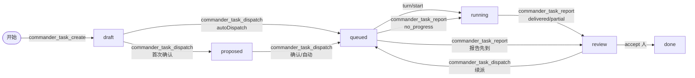
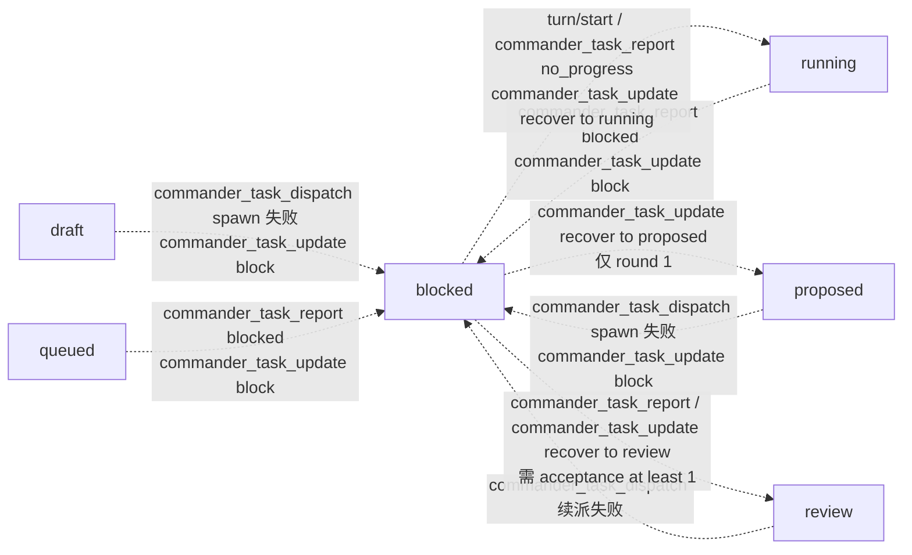
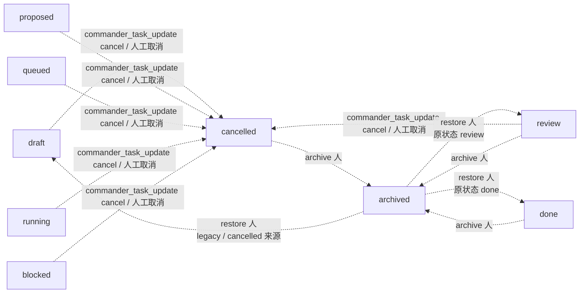

# 任务状态机 · 定案方案（v1.0）

> 日期：2026-11-22
> 状态：**定案（已实施，2026-11-22）**。本文取代 `task-state-machine-contract-patch.md` 中的讨论口径；两者冲突时以本文为准。
> 范围：**单任务状态机、工具语义、依赖编排、看板与验证**。
> 不在范围：Task Group / 子任务 / 单任务并行多工作区（仅保留讨论稿，见旧文档 §13）；无人值守全自动；多确认卡。
> 吸收来源：DSH **0.2.2-rc.3** 的 Agent Team 任务模型（`@deepseek-ai/dsh-agent-team` / `@deepseek-ai/dsh-tool-agent-team`）中可复用的纪律：action enum、`expectedRevision` CAS、`commander_task_get`、派生 `ready`、任务记录单一通用 mutator、不自动启动。

---

## 0. 一页结论

1. **状态枚举不变**：继续用 9 个状态 `draft / proposed / queued / running / blocked / review / done / cancelled / archived`。用户口径的「待派发」「待运行」「运行中」「待验收」「已验收」全部有对应状态，问题只在看板合并显示和写入口失守。
2. **看板改六列**：待派发 / 待运行 / 运行中 / 受阻 / 待验收 / 已验收；取消/归档放回收站。**不再提供通用状态拖拽**。
3. **状态推进由 commander 工具 + Host 事件完成**：
   - `commander_task_dispatch`：派发、续派、spawn 失败；
   - `turn/start`：机械进入 `running`；
   - `commander_task_report`：进入 `review`；
   - `commander_task_update(action=...)`：元数据、受阻、取消、恢复；
   - 人专用路由：`accept / archive / restore / cancel`。
4. **`commander_task_update` 彻底收窄**：不再接受裸 `status`，改为 action enum；**正常路径**不再写 `proposed/queued`，也不从非 `blocked` 状态写 `review/running`；`recover` 仅从 `blocked` 写 `proposed/review/running`。`commander_task_dispatch` 是进入「待派发/待运行」的唯一入口，`commander_task_report` 是进入「待验收」的唯一正常入口。
5. **吸收 DSH**：`commander_task_update` 必带 `expectedRevision`；新增只读 `commander_task_get`；依赖用 `dependsOn` + 派生 `ready`；Host 只校验和提醒，**不自动派发、不自动改依赖任务状态**。
6. **依赖编排（阶段 B）**：`dependsOn` DAG；`commander_task_dispatch` 拒绝未满足依赖；`accept` 成功后向 commander 注入 `[task-unblocked]`；就绪队列一次提醒一个，避免单确认卡被顶掉。
7. **不做 Task Group**：单任务跨工作区只支持**顺序多轮**；并行多工作区/子任务留给后续讨论稿，不进入本期实现。

---

## 1. 范围与非目标

### 1.1 本期范围

- 单任务状态机与迁移校验。
- 看板六列、文案、详情抽屉、取消/归档/恢复/验收入口。
- 工具语义收口：`commander_task_create` / `commander_task_get` / `commander_task_list` / `commander_task_update` / `commander_task_dispatch` / `commander_task_report`。
- 任务间依赖：`dependsOn`、`ready`、派发守卫、验收后提醒、就绪队列。
- 现有 7 张表不变；只给 `TaskRecord` 加可选字段。

### 1.2 明确不做

- **Task Group / 子任务 / 父子容器**（仅讨论，不实现）。
- 单任务**并行**派发到多个工作区（顺序跨工作区仍可用多轮派发）。
- 无人值守全自动执行、scheduler、自动派发依赖任务。
- 多确认卡/批量确认。
- owner/claim、write scope、worktree 隔离（这些属于 DSH Team 的模型，不搬进 commander）。
- 审批/提问进任务状态。
- 新增表、事件表、投影、回放。

---

## 2. 状态定义

| 内部状态 | 用户名称 | 语义 | 看板列 |
|---|---|---|---|
| `draft` | 建任务／草案 | 已建卡，尚未发起派发 | 待派发 |
| `proposed` | 待派发 | 已发起派发，等待确认或派发落地 | 待派发 |
| `queued` | 待运行 | 派发已落地（会话 + link + brief），等待 `turn/start` | 待运行 |
| `running` | 运行中 | 工作会话已开始回合；包含回合之间 | 运行中 |
| `blocked` | 受阻 | 异常：spawn/投递失败、无进展、人工受阻 | 受阻 |
| `review` | 待验收 | 报告已整理，等待人验收 | 待验收 |
| `done` | 已验收 | 人验收通过 | 已验收 |
| `cancelled` | 已取消 | 人/指挥官取消 | 回收站 |
| `archived` | 已归档 | 封存 | 回收站 |

**不变量**

1. `done` 只能从 `review` 进入，且只能由人通过 `POST /accept` 触发。
2. `review` 至少 1 条 acceptance。
3. `queued` 必须有 `primarySessionId`，且由 `commander_task_dispatch` 写入。
4. `blocked` 必须有 `block.reason`。
5. 终态 `done/cancelled/archived` 只能走专用出口（archive/restore）；工具不能写。
6. 一个任务同一时刻只有一个当前轮主会话；同一会话可被多个任务 attach，按 prompt queue 排队。
7. 状态迁移只更新任务记录一条，追加 timeline；不写事件表/投影。
8. 任何任务状态变化都必须经统一迁移入口；新增写入口必须先改本文。

---

## 3. 迁移矩阵与唯一写入者

`H` = Host 事件副作用，`C` = commander 工具，`U` = 人专用路由。表里只列**允许**的边；未列出的边一律禁止。

| From → To | 唯一入口 | 守卫/副作用 |
|---|---|---|
| `draft → proposed` | `commander_task_dispatch`（首次确认） | 无 pending decision；写 pending decision + timeline |
| `draft → queued` | `commander_task_dispatch`（autoDispatch） | spawn 成功；写 session/link/round |
| `proposed → queued` | `commander_task_dispatch`（确认/自动） | spawn 成功 |
| `review → queued` | `commander_task_dispatch`（续派） | round+1；上轮验收进历史；当前验收/报告/材料清空 |
| `queued → running` | `turn/start` | link 轮次匹配；清 block；状态真变化时写 timeline |
| `blocked → running` | `turn/start`；`commander_task_update(action=recover, to=running)` | 人工恢复仅从 blocked，且必须有 `primarySessionId` |
| `queued → review` | `commander_task_report(delivered/partial)` | 报告先于 turn/start 的竞态兜底；acceptance≥1 |
| `running → review` | `commander_task_report(delivered/partial)` | 当前轮；acceptance≥1 |
| `blocked → review` | `commander_task_report`；`commander_task_update(action=recover, to=review)` | recover 需 acceptance at least 1 |
| `draft/proposed → blocked` | `commander_task_dispatch`（spawn 失败）；`commander_task_update(action=block)` | 必须带 reason |
| `queued/running → blocked` | `commander_task_report(blocked)`；`commander_task_update(action=block)` | 必须带 reason |
| `review → blocked` | `commander_task_dispatch`（续派 spawn 失败） | 必须带 reason；round 不变 |
| `blocked → proposed` | `commander_task_update(action=recover, to=proposed)` | 仅 `round===1` 且无 acceptanceHistory |
| `review → done` | `POST /accept`（人） | 只能人；幂等 |
| `draft/proposed/queued/running/blocked/review → cancelled` | `commander_task_update(action=cancel)`；`POST /cancel`（人） | 先停 queued/running 会话；失败不落状态；清 pending/block；通知依赖它的任务 |
| `review/done/cancelled → archived` | `POST /archive`（人） | 写 `archivedFrom`；清 pending；`review` 来源通知依赖它的任务（`cancelled` 来源已在取消时通知，不重复） |
| `archived → draft/review/done` | `POST /restore`（人） | 按 `archivedFrom`；cancelled 来源回 draft；清 `archivedAt` |

### 3.1 `commander_task_update` 允许的 action（不直接写 status）

| action | 允许来源 | 字段 | 副作用 |
|---|---|---|---|
| `edit` | `draft/proposed/queued/running/blocked/review` | `title?/priority?/progress?` | 只改元数据；追加 timeline |
| `set_dependencies` | `draft/proposed/blocked(round=1)` | `dependsOn[]` | 校验 DAG/终态（同 commander_task_create）；清 `dependencyNotifiedAt`；不放行 queued/running/review |
| `block` | `draft/proposed/queued/running` | `reason` | 写 `block{reason,since}`；追加 timeline |
| `cancel` | 任何非终态 | — | 先停会话；清 pending/block；追加 timeline |
| `recover` | 仅 `blocked` | `to: proposed/review/running` | 清 block；to=proposed 仅 round1；to=review 需验收≥1 |

**`commander_task_update` 不允许**：写 `draft/queued/done/archived`；从非 `blocked` 状态写 `proposed/review/running`；无 `expectedRevision` 的写入。

---

## 4. 状态转移图

> 实线 = 正常推进；虚线 = 异常/恢复/人专用。边标签是唯一入口。看板没有通用状态拖拽；人只有 accept/archive/restore/cancel。

### 4.1 主链路 + 续派 + 验收



### 4.2 受阻与恢复



### 4.3 取消 / 归档 / 恢复



---

## 5. 工具契约

### 5.1 工具面

| 工具 | 类型 | 职责 |
|---|---|---|
| `commander_task_create` | 写 | 建 `draft`；可带 `dependsOn` |
| `commander_task_get` | 读 | 取单条最新任务（version/status/ready/waitingFor/block） |
| `commander_task_list` | 读 | 任务查询：状态/时间/标题过滤 + 分页 + 计数（见 §5.8） |
| `commander_workspace_list` | 读 | 已启用工作区目录（只读；派发目标） |
| `commander_session_list` | 读 | 指定工作区的根会话列表（只读；attach 目标） |
| `commander_task_update` | 写（action） | 元数据、依赖、受阻、取消、恢复；**任务记录唯一通用编辑入口** |
| `commander_task_dispatch` | 写（领域动作） | 派发/续派；写 `proposed/queued/blocked(spawn失败)` |
| `commander_task_report` | 写（领域动作） | 整理报告/验收；写 `review/blocked/running(no_progress)` |
| 人路由 | 写（人） | `accept/archive/restore/cancel`；不接受模型调用 |

原则：任务记录写入分两类——**通用编辑**（`commander_task_create`/`commander_task_update`）与**领域动作**（`commander_task_dispatch`/`commander_task_report`，各自只写自己拥有的状态）；所有写入都经统一迁移服务，不存在第三个通用 status 写入口。

### 5.2 `commander_task_create`

参数：`title`（必填）、`goal`（必填）、`workspaceId?`、`priority?`、`commandId?`、`dependsOn?: string[]`（≤5）。

- 校验 `dependsOn`：任务存在、非自身、无重复、无环；不要求依赖已完成（允许排期），但**不得指向 `cancelled` 或非 done 的 `archived`**（永远无法满足）。`done` 或 `archivedFrom='done'` 视为已满足。
- 输出：`{ taskId, status:'draft', version, dependsOn, waitingFor, ready }`。

### 5.3 `commander_task_get`

参数：`taskId`。

输出（紧凑 JSON）：`id, version, title, status, round, workspaceId, priority, dependsOn, waitingFor, ready, primarySessionId?, block?, pendingDispatch, acceptanceCount, evidenceInsufficientCount, updatedAt`。

用途：**任何 `commander_task_update` 前先取最新 `version`**，作为 CAS 前置。

### 5.4 `commander_task_update`

参数：

```json
{
  "taskId": "task_…",
  "expectedRevision": 12,
  "action": "edit|set_dependencies|block|cancel|recover",
  "title": "…",
  "priority": "low|normal|high|urgent",
  "progress": { "label": "…", "pct": 0.5 },
  "reason": "…",
  "dependsOn": ["task_a", "task_b"],
  "recoverTo": "proposed|review|running"
}
```

规则：

- `expectedRevision` **必填**；不等于当前 `version` → `task_stale_revision`，不落盘。
- 动作字段按 action 严格校验；无关字段拒绝。
- 有 pending decision 的任务，`edit/set_dependencies/block/recover` → `conflict('pending_dispatch')`；只有 `cancel` 会使 pending 失效。
- `recoverTo=running` 要求 `primarySessionId` 存在，否则 `precondition`；`recoverTo=review` 要求 `acceptance≥1`；`recoverTo=proposed` 仅 round1。
- 输出：`{ taskId, status, version }`；Host 广播 `task.updated` + `tasks.changed`。
- **不再接受裸 `status`**。

### 5.5 `commander_task_dispatch`

保留现有语义：首次恒 `needs_confirmation`（除非 `autoDispatch` 门控通过）；确认带 `decisionId + confirmTarget + requestId`；续派带 `instruction/userRequest`。

在创建 decision 之前新增守卫：

1. 任务状态 ∈ `{draft, proposed, review}`；否则 `task_state`。
2. `dependsOn` 未全部满足 → `rejected(code='dependency_unmet', message=缺失 id)`，**不生成确认卡**。
3. 另一个任务已有未决确认 → `rejected(code='pending_dispatch_exists')`；同一任务重试仍允许覆盖旧决策。
4. 任务有 pending decision 时，只允许同任务重试；其它任务拒绝。

确认路径在写循环内重读 `status/round/dependsOn`，避免与 accept/cancel/编辑竞态；spawn 失败写 `blocked` 时带 reason 并重试 version。

### 5.6 `commander_task_report`

- 来源仅 `queued/running/blocked`；其它状态 → `invalid_status`。
- 当前轮主会话校验保持现状；`acceptance` 为空时不能进 `review`。
- 目标：`review`（delivered/partial）、`blocked`（blocked）、`running`（no_progress）；从 `blocked` 离开到 `review/running` 时清 `block`。
- 写入后重算该任务的 `ready`？依赖的是 `done`，报告到 `review` 不解锁下游；不需要。
- 不写 `proposed/queued/done/archived`。

### 5.7 人专用路由

| 路由 | 迁移 | 守卫 |
|---|---|---|
| `POST /commander/tasks/:id/accept` | `review→done` | status=review；幂等；写 timeline；使该任务未决确认失效 |
| `POST /commander/tasks/:id/archive` | `review/done/cancelled→archived` | 先停该任务 queued/running 会话；失败不归档 |
| `POST /commander/tasks/:id/restore` | `archived→archivedFrom` | 无 archivedFrom 回 draft；清 archivedAt/pending/dependencyNotifiedAt |
| `POST /commander/tasks/:id/cancel` | 非终态→cancelled | 先停会话；失败不取消；清 pending/block |

看板 `PATCH /board/tasks/:id` **只保留 priority/title**；`status` 字段一律 400/409，不再接受拖拽改状态。

### 5.8 只读查询工具（2026-11-23 增补）

三个只读工具，同指挥官会话作用域，全部不写盘：

| 工具 | 入参（要点） | 出参（要点） |
|---|---|---|
| `commander_task_list` | `statuses?`、`includeArchived?`、`q?`、`searchIn?`、`timeField?`、`since?`、`until?`、`limit?`、`offset?` | `{total, offset, limit, returned, hasMore, nextOffset, now, counts, columns, pendingDispatch, tasks[]}`；行含 `version/round/dispatchable/waitingFor/blockReason/acceptanceCount/stale` |
| `commander_workspace_list` | 无 | `{total, workspaces:[{id,name,path,summary,policy,sessionCount}]}`；**只出配置中已启用（allowed）的** |
| `commander_session_list` | `workspaceId`（**必填**，id/名称/路径或 cwd 子目录）、`q?`、`includeArchived?`、`since?/until?`、`limit?/offset?` | `{total, offset, limit, returned, hasMore, nextOffset, now, workspace, sessions[]}`；**只出根会话** |

约定：

1. **领域分离**：任务工具只出任务；派发所需的 `workspaceId` 来自 `commander_workspace_list`，attach 所需的 `sessionId` 来自 `commander_session_list`。任务行仅保留去规范化的 `workspaceName` 展示字段。
2. **时间参数是人类格式字符串**（`2026-10-12`、`2026-10-12 14:40`），不是 epoch；`since` 闭、`until` 开；`until` 只写日期 = 次日零点（含当天全天）；无时区按 Host 本机时区。
3. **默认隐藏回收站**：`statuses` 省略时为活跃 7 状态；`includeArchived: true` 才含 `cancelled/archived`，`total`/`counts`/`columns` 同步包含。
4. **固定排序**：任务 `createdAt` 倒序、会话 `lastActiveAt` 倒序，tie-break `id` 升序；不提供 `sort` 参数。
5. **根会话判据**：`isRootSession` = 非 `isChild`、无 `parentSession` 指针、非指挥官会话；工具与 `GET /commander/sessions` 共用同一谓词。
6. 每个工具的 `output.schema` 必须与真实返回逐字段一致（`additionalProperties: false`），`output.render` 是模型唯一可见内容。

完整设计（参数语义、渲染格式、字段清单、测试清单、待核实项）见 `task-query-design.md`。

---

## 6. 依赖与就绪提醒

### 6.1 数据

`TaskRecord` 新增：

```ts
/** 依赖的任务 id；全部 done（或 done→archived）才允许派发。≤5，禁止环。 */
dependsOn?: string[]
/** 最近一次成功投递 [task-unblocked] 的时间；仅提醒去重，不是就绪真相。 */
dependencyNotifiedAt?: number
```

`ready(task) = task.status ∈ {draft, proposed} && dependsOn.every(dependencyMet)`。

```ts
function dependencyMet(dep: TaskRecord): boolean {
  return dep.status === 'done' || (dep.status === 'archived' && dep.archivedFrom === 'done')
}
```

`waitingFor(task) = dependsOn.filter(id => !dependencyMet(taskById(id)))`。

### 6.2 派发守卫

`commander_task_dispatch` 在创建 decision 前检查 `dependenciesMet(task)`（`dependsOn.every(dependencyMet)`），**不是 `ready`**——续派时任务在 `review`，`ready` 为 false 但依赖可能已满足。未满足 → `dependency_unmet`，不产生确认卡。任务保持原状态（`draft/proposed`），看板显示「等待 A/B 验收」badge。

### 6.3 验收后提醒

`accept` **首次成功**（`duplicate=false`）后：

1. 找 `dependsOn` 包含该任务、且 `ready`、且状态为 `draft/proposed` 的后继任务；
2. 入就绪队列，按 `updatedAt` 排序；
3. **一次只投一条** `[task-unblocked]` 给 commander（避免全局单确认卡被顶掉）；
4. `commander_task_dispatch` 成功（或拒绝）后 pump 下一条；
5. 投递成功写 `dependencyNotifiedAt`；投递失败留在队列，下一次 accept/启动重试；
6. Host 重启时对 `ready && dependencyNotifiedAt===undefined` 的任务补一次。

`[task-unblocked]` 文本：

```text
[task-unblocked] taskId=<B> status=draft
依赖任务 A（taskId=<A>，标题「…」）已验收通过；B 已满足依赖。
请调用 commander_task_dispatch(taskId=<B>, requestId=<新ID>, instruction=<若需要>) 派发。
首次仍走确认（或按 autoDispatch 配置自动派发）。本次只提醒，不改任务状态。
---
dependsOn=<A>
```

### 6.4 触发时机与依赖取消

就绪队列的 pump 时机：

- `accept` 成功（任务变成 `done`）；
- `commander_task_update(set_dependencies)` 成功（可能把依赖改成全部满足）；
- `commander_task_update recover to proposed` 成功；
- `restore` 恢复为 `draft`；
- `commander_task_dispatch` 成功/失败后（派完一个，提醒下一个）。

**依赖被取消/归档（未验收）**：`cancel` 成功后，或 `archive` 一个 `review` 来源的任务后，查它的后继；对仍在 `draft/proposed` 的后继注入 `[task-dependency-blocked]`，列出缺失依赖。Host **不改后继状态**，由用户决定取消后继、改 `dependsOn` 或新建替代任务。`cancelled` 来源归档不重复通知（取消时已发）。

```text
[task-dependency-blocked] taskId=<B>
依赖任务 A（taskId=<A>）已取消/归档（未验收），B 的依赖不会自动满足。
请决定：取消 B、修改依赖，或新建替代任务；Host 未改动 B 的状态。
---
dependsOn=<A>
```

### 6.5 单确认卡

全局仍只允许一条未决 `pendingDispatch`：

- 另一个任务已有未决确认 → `pending_dispatch_exists`，不覆盖旧卡；
- 同一任务重试允许覆盖；
- fan-out 场景按「确认 B → 再派 C」顺序推进；不要求同一刻启动。

### 6.6 不做自动启动

- `ready` 只用于判定可派发/可提醒；
- Host **不自动** `commander_task_dispatch`、不自动改后继状态；
- commander 收到提醒后自己调 tool；
- 将来要做无人值守，复用 `readyTasks()` 纯函数 + `dispatchTask()` 服务，加 opt-in 策略/触发源即可，不改 `dependsOn`、不改状态机。

---

## 7. Host 统一迁移服务

新增 `src/host/tasks/state-machine.ts`（零依赖纯函数 + 一个写入口）：

```ts
export type TransitionActor =
  | 'host_dispatch' | 'host_turn'
  | 'commander_tool' | 'user_accept'
  | 'user_archive' | 'user_restore' | 'user_cancel'

export interface TransitionContext {
  actor: TransitionActor
  acceptanceCount?: number
  hasPrimarySession?: boolean
  blockReason?: string
  round?: number
  hasAcceptanceHistory?: boolean
}

export function checkTransition(task: TaskRecord, to: TaskStatus, ctx: TransitionContext):
  | { ok: true }
  | { ok: false; code: 'task_state' | 'invalid_status' | 'precondition'; message: string }
```

职责：

1. 查迁移图 + actor 权限；
2. 执行守卫：review 验收≥1、queued 有 session、blocked 有 reason、blocked→proposed 仅 round1、done/archived 只走专用 actor；
3. 输出效果：`clearBlock`、`clearPendingInstruction`、`stampArchivedFrom`、`archiveAcceptanceHistory`、`timelineType`；
4. 所有写入口调用它，不再各自 `if`。

改造点：

| 文件 | 改动 |
|---|---|
| `src/host/schema.ts` | `dependsOn`/`dependencyNotifiedAt`/`archivedFrom`；迁移表；校验器 |
| `src/host/tasks/state-machine.ts` | 迁移检查、守卫、效果 |
| `src/host/tasks/actions.ts` | `accept` 走迁移 + 触发解锁提醒 |
| `src/host/board/service.ts` | 状态 PATCH 移除；archive/restore 走迁移；写 `archivedFrom`；清 archivedAt |
| `src/host/tools/index.ts` | `commander_task_get`；`commander_task_update` action/CAS；`commander_task_dispatch` 守卫；`commander_task_report` 来源守卫 |
| `src/host/dispatch/service.ts` | 依赖/单卡守卫；确认写循环重读 status/round/deps；spawn 失败重试 |
| `src/host/trigger/status.ts` | queued/blocked→running 走迁移；清 block；状态变化写 timeline |
| `src/host/api/routes/handlers.ts` | 新增 `/cancel`；accept/archive/restore 校验；board PATCH 只留 priority/title |
| `src/client/board.ts` / `BoardPage.tsx` / `locales.ts` / `styles.ts` | 六列、无拖拽、取消按钮、依赖 badge、抽屉五段、中英文案 |

---

## 8. 看板与文案

### 8.1 六列

| 列 | 状态 | 卡片要点 | 操作 |
|---|---|---|---|
| 待派发 | `draft`、`proposed` | 草案 chip；待确认高亮；无卡提示「需重新发起派发」；依赖 badge「等待 A 验收」 | 取消；详情 |
| 待运行 | `queued` | 已派发，等待回合开始；stale 徽标 | 取消；打开会话 |
| 运行中 | `running` | 最近活动；轮次；会话数 | 取消；打开会话 |
| 受阻 | `blocked` | `block.reason` | 取消；详情 |
| 待验收 | `review` | 验收条数/证据不足；继续派发 badge | 验收通过/继续派发/归档/取消 |
| 已验收 | `done` | 验收时间；只读 | 归档 |
| 回收站 | `cancelled`、`archived` | 状态/归档时间 | archived 可恢复 |

- **不做状态拖拽**；状态推进通过 commander 工具或人专用按钮。
- `board PATCH` 仅 priority/title；状态字段拒绝。
- 验收通过、归档、恢复、取消是看板按钮，不是拖拽。

### 8.2 文案

| key | 目标 |
|---|---|
| `task.status.draft` | 草案 |
| `task.status.proposed` | 待派发 |
| `task.status.queued` | 待运行 |
| `task.status.running` | 运行中 |
| `task.status.blocked` | 受阻 |
| `task.status.review` | 待验收 |
| `task.status.done` | 已验收 |
| `task.status.cancelled` | 已取消 |
| `task.status.archived` | 已归档 |
| `board.column.proposed` | 待派发 |
| `board.column.queued` | 待运行 |
| `board.column.running` | 运行中 |
| `board.column.blocked` | 受阻 |
| `board.column.review` | 待验收 |
| `board.column.done` | 已验收 |

英文同步：`Draft / Pending dispatch / Waiting to run / Running / Blocked / Ready for review / Accepted / Cancelled / Archived`。

### 8.3 抽屉

进度五段：**待派发 → 待运行 → 运行中 → 待验收 → 已验收**；`blocked` 在「运行中」叠加受阻标记；`cancelled/archived` 显示终止标记。

抽屉增加：`dependsOn`/`waitingFor`/`ready`、`pendingDispatch`、`block.reason`、`version`（调试/审计用，可折叠）。

---

## 9. 与 DSH Agent Team 的取舍

| DSH 做法 | 是否吸收 | 在 commander 的落法 |
|---|---|---|
| 只有 create/update 写任务记录 | **部分吸收** | 吸收其**单一通用 mutator + action** 纪律：`commander_task_update` 是唯一通用编辑入口；`commander_task_dispatch`/`commander_task_report` 是受状态机约束的领域动作，不能当通用 status 写入口 |
| action enum 而非裸 status | **吸收** | `edit/set_dependencies/block/cancel/recover` |
| `expectedRevision` CAS | **吸收** | `commander_task_update` 必填；stale 明确报错 |
| `team_task_get` 单条读 | **吸收** | 新增 `commander_task_get` |
| `blockedBy` + 派生 `ready` | **吸收** | `dependsOn` + `ready`/`waitingFor`；语义等价 |
| readiness 不自动启动 | **吸收** | 只提醒，不自动 dispatch |
| 4 个任务状态 | **不吸收** | commander 需要执行生命周期，保留 9 状态 |
| owner/claim | **不吸收** | commander 的“执行者”是工作会话，不是 agent 树成员 |
| owner 自己 complete | **不吸收** | `done` 仅人 accept |
| 无 dispatch/会话 | **不吸收** | `commander_task_dispatch` 是 commander 的核心价值 |
| 单进程/共享 cwd/write scope | **不吸收** | commander 跨工作区/会话，隔离模型不同 |

---

## 10. 数据、兼容与迁移

### 10.1 `TaskRecord` 新增可选字段

```ts
dependsOn?: string[]          // ≤5，无环
dependencyNotifiedAt?: number // 仅提醒去重
archivedFrom?: TaskStatus     // archive 时记录，restore 用
```

`TaskStatus` 不变；不新增表；`TaskView` 增加 `version/dependsOn/waitingFor/ready/pendingDispatch`。旧记录缺省：

- `dependsOn = []` → `draft/proposed` 时 ready；
- `archivedFrom` 缺省 → restore 回 `draft`；
- `dependencyNotifiedAt` 缺省 → 启动时补提醒。

### 10.2 破坏性变更

- `commander_task_update`：`status` 参数删除 → `action` + `expectedRevision`；prompt/工具 schema 必须同步。
- 新增 `commander_task_get`；`COMMANDER_TOOL_NAMES` 更新。
- `commander_task_dispatch` 新增 `dependency_unmet` / `pending_dispatch_exists` 错误。
- 看板 `PATCH status` 移除；新增 `POST /cancel`；client 改为按钮。
- 无数据迁移；旧任务可继续读写。

### 10.3 部署

- Host 改动 + 新增 `lib/` 文件：`pnpm --filter dsh-commander build`，用户重装 + 重启 DSH；
- Client 改动：build 后硬刷新；
- 不写 `~/.dsh`、不在 live 跑脚本；验证用一次性 `DSH_HOME`。

---

## 11. 实施顺序与测试

| 阶段 | 内容 | 预估 |
|---|---|---|
| A | 迁移表 + state-machine + schema 字段 + 纯函数测试 | 1d |
| B | commander_task_get + commander_task_update action/CAS + dispatch/commander_task_report 守卫 + 依赖/就绪队列 + accept 提醒 | 2–2.5d |
| C | 六列看板、无拖拽、取消/验收/归档按钮、依赖 badge、文案、抽屉 | 1d |
| D | 集成/e2e、文档、build | 1d |
| **合计** | | **5–5.5d** |

测试清单：

| 层 | 用例 |
|---|---|
| unit | 全迁移矩阵；actor 权限；review 验收、queued session、blocked reason、blocked→proposed round1；action 字段严格性；CAS stale |
| unit | `dependsOn` 自依赖/重复/环/不存在；`ready`/`waitingFor` 派生；dependencyMet 含 done→archived |
| integration | `commander_task_update` 不能从非 blocked 状态写 queued/proposed/review/running；`expectedRevision` 过期拒绝；pending 冲突 |
| integration | 看板 PATCH status 400/409；`/cancel` 先停会话，失败不落状态；accept/archive/restore 目标状态与 archivedAt |
| integration | dispatch：deps 未满足拒绝且无确认卡；另一任务 pending 拒绝；确认/accept 竞态不覆盖终态 |
| integration | accept A → `[task-unblocked]` B；多依赖最后一个 accept 才提醒；就绪队列一次一条；重复 accept 不重复提醒；A 取消/非 done 归档 → `[task-dependency-blocked]`；改依赖后 ready 补提醒 |
| client | 六列分组/排序；无拖拽；依赖/待确认/继续派发 badge；取消按钮只对非终态；抽屉五段；locale 两份 |
| e2e | A→B→C；A→(B∥C)→D；顺序跨工作区多轮；`proposed→queued→running→review→done` 全链路 |
| 手动 | live：六列、依赖提醒、单确认卡、取消停会话、归档/恢复 |

验收标准：

1. 六列可见，标签与用户口径一致；不能通过看板拖拽改状态。
2. 任何写入口无法产生 §3 之外的迁移；非法操作返回明确错误。
3. `commander_task_update` 只能 action，且 `expectedRevision` 过期不落盘。
4. `commander_task_dispatch` 是 `proposed/queued` 唯一入口；未满足依赖不生成确认卡。
5. `commander_task_report` 不能从 done/review/archived 回写。
6. `done` 仅人 accept；取消先停会话；block/archivedAt/pending 离开状态时清理。
7. accept 后只提醒 commander，不自动改后继任务状态；就绪队列不漏派。
8. typecheck/test/build/client harness/对应 e2e 全绿。

---

## 12. 已定决策

| # | 决策 |
|---|---|
| 1 | 保留 9 状态，不新增状态；Task Group/子任务本期不做 |
| 2 | 看板六列；取消/归档进回收站 |
| 3 | 取消通用状态拖拽；人只保留 accept/archive/restore/cancel |
| 4 | `commander_task_update` 改 action enum + `expectedRevision`，不再接受 `status` |
| 5 | 新增只读 `commander_task_get`；`commander_task_list` 返回 version/ready |
| 6 | `commander_task_dispatch` 是 `proposed/queued` 唯一入口；`commander_task_report` 是 `review` 唯一正常入口 |
| 7 | 依赖用 `dependsOn`（等价 DSH `blockedBy`），派生 `ready`；不新增「等待依赖」状态 |
| 8 | 依赖任务不自动派发；accept 后提醒 commander；就绪队列一次一条 |
| 9 | 全局单 pending 确认卡；不同任务重复首派返回 `pending_dispatch_exists` |
| 10 | `dependsOn` 最多 5 个；深度/环路校验；不做跨任务组 |
| 11 | `done` 仅人；`archived` 仅人；工具不可写 |
| 12 | 不做无人值守全自动；保留 `readyTasks()` + `dispatchTask()` 扩展点 |
| 13 | 任务查询工具查询化：筛选/分页/计数，明细留给 `commander_task_get`；时间用人类格式；固定 `createdAt` 倒序；默认隐藏回收站（`includeArchived` 放开） |
| 14 | 工作区/会话查询从任务工具拆出：`commander_workspace_list` / `commander_session_list`；工作区只出已启用的 |
| 15 | `commander_session_list` 必须指定工作区（id/名称/路径/cwd），只出根会话（排除 subagent/teammate/指挥官） |
| 16 | `commander_task_list` 不再返回工作区目录；`pendingContinue` 在工具行里改名为 `pendingInstruction`（API `TaskView` 字段名暂不动） |

---

## 13. 后续讨论（不进入本期）

- **Task Group / 子任务**：见 `task-state-machine-contract-patch.md` §13 的讨论稿；本期不实现。
- **单任务并行多工作区**：需要 Task Group 或 workstream 模型；本期只支持顺序跨工作区多轮。
- **无人值守自动执行**：未来可在 `readyTasks()` + `dispatchTask()` 上加 opt-in 策略和 scheduler，不改 `dependsOn`/状态机。
- **多确认卡/批量确认**：本期不做；单卡 + 顺序确认满足“可先后启动、能并行运行”。
