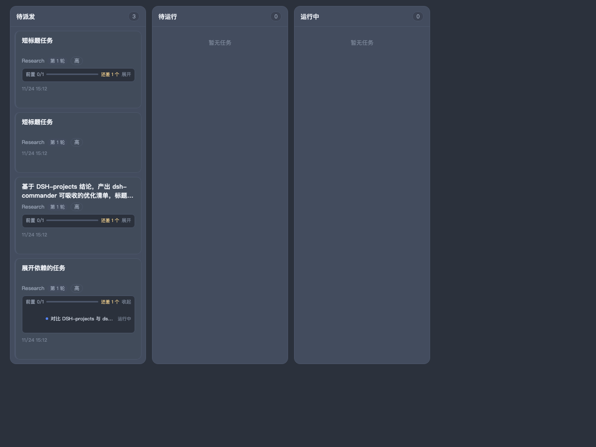
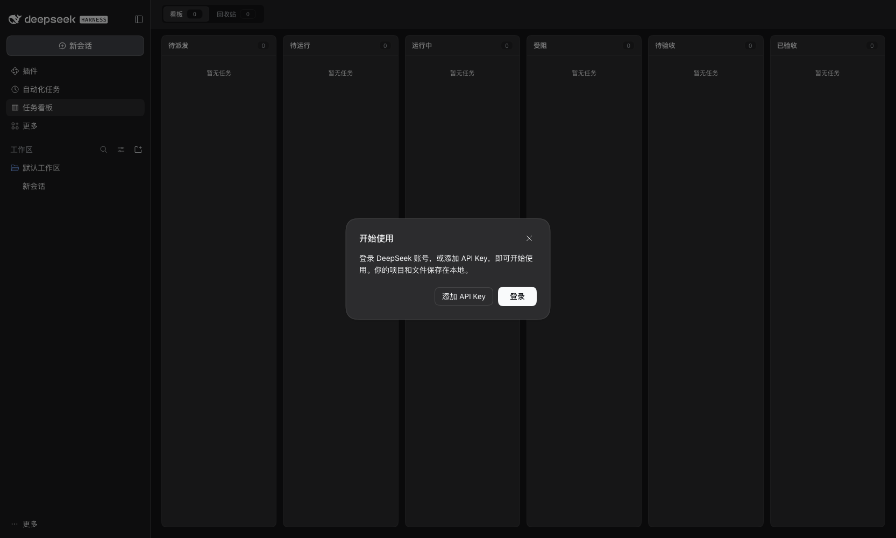
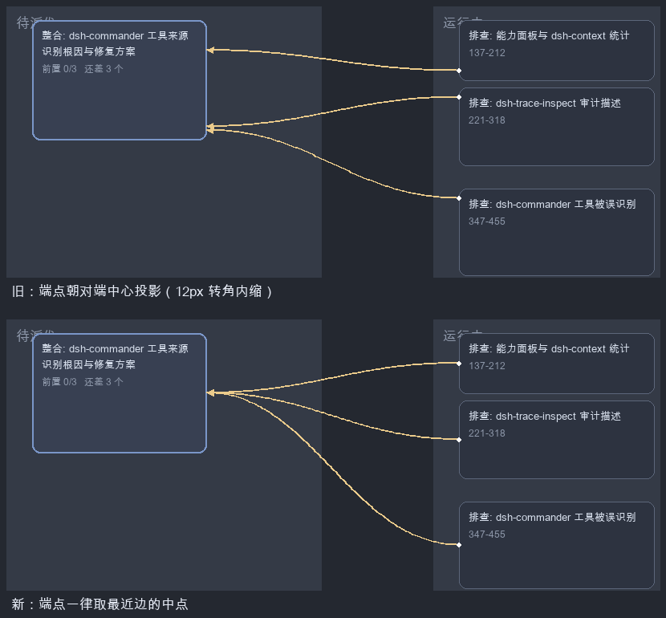

# 看板 / 回收站改版实现验证（2026-11-24）

> 范围：看板依赖闸门 + 悬停依赖链、回收站时间流 + 服务端筛选/分页。
> 设计来源：`prototype/board-redesign/`（2026-11-24 第三轮：A 六列 + 悬停依赖，去掉视图切换）。
> 契约：`docs/architecture/m2m3-contract-patch.md` §2.5.1（加法改动）。

## 1. 改动

### Host（`packages/dsh-commander/src/host`）

- `GET /commander/archive` 增加查询参数 `q / status / workspaceId / from / to`；响应增加
  `total / summary{archivedCount,cancelledCount,last30dCount} / months[]`；`tasks[]` 行补
  `round / sessionCount`。`limit` 仍为 1..100，`cursor` 仍是 `updatedAt`。
- `months` 应用 `q/status/workspaceId`、忽略 `from/to`，保证选完一个月后月份导航不塌缩。
- 只读，无 schema/迁移；旧 Client 调用不带参数时行为不变（多出的响应字段被忽略）。

### Client（`packages/dsh-commander/src/client`）

- 看板头部对齐设计：品牌方块 + 标题行、分段 tabs（带计数徽标）、悬停提示、实心「返回对话」。
  当前 DSH 主题的 `--dsw-alias-brand-primary` 是近白色，所以看板强调色（品牌标、queued/running 左边框、
  依赖点、高亮描边）显式取 `--dsw-static-deepseek-450`（#5686fe）。
- 看板卡片增加**依赖闸门**：`前置 done/total` + 进度条 + `还差 N 个 / 已就绪`，等待中的前置排在前面，
  折叠显示 2 个、展开显示状态；卡片补 `下游 N`。
- 悬停 / 键盘聚焦任务卡：**仅当存在可见的上下游关系时**，非关联卡淡出、上下游闭包高亮、
  在列与列之间画 SVG 依赖线；无依赖的卡悬停不产生淡化/高亮/连线。
  （等待中的依赖为琥珀虚线 + 箭头；已验收的前置为极淡绿点线）。打开任务抽屉时该链保持高亮。
  不再有「六列 / 依赖视图」切换。
- 回收站改为「月 → 日」时间流 + 搜索/状态/工作区/月份筛选 + 每批 60 条游标加载；
  统计卡跟随筛选；恢复按钮只对 archived 展示。
- 修复回收站 tab 计数：原实现把 cancelled 在 `counts` 与 `tasks` 中各算一次；
  现按状态取 max（`archiveCount`，带单测）。
- 新增文件：`BoardDependencies.tsx`、`ArchivePane.tsx`；样式与 i18n（zh/en）同步。

## 2. 验证（2026-11-24，本机 node v22.22.2）

| 项 | 命令 | 结果 |
|---|---|---|
| 类型检查 | `pnpm --filter dsh-commander typecheck` | PASS（host + client） |
| 单测/集成/Client 纯函数 | `pnpm --filter dsh-commander test` | **414/414 pass** |
| 构建 | `pnpm --filter dsh-commander build` | PASS（host + client + window） |
| Client harness | `DSH_COMMANDER_HARNESS_MODULES=… node tests/client/harness/run-harness.mjs` | smoke **51/51**、interact **195/195** |
| Host e2e（M2/M3） | `node packages/dsh-commander/tests/e2e/m23-e2e.mjs` | **26/26 PASS**，3 INFO（stale 时钟 / 审批 pending / live 走查） |
| Client 隔离加载 | `bash tools/dev/client-repro.sh` | exceptions 0、consoleErrors 0、`client apply ok` |
| Bundle 校验 | `node tools/dev/verify-bundle.mjs ...` | PASS；`lib/client.js` 481,575B |

Harness 新增覆盖：依赖闸门渲染、下游计数、focus 高亮/淡出、回收站首屏请求 `limit=60`、
状态筛选透传 Host、归档恢复；并验证生产 zh 字典无 key 直出。

Host 集成新增覆盖：`q/status/workspace/from-to` 过滤、`total/summary/months` 口径、
`months` 忽略区间、游标翻页 `total` 稳定、行字段 `round/sessionCount`、非法参数 400。

## 3. 未验证 / 已知限制

- **live UI 走查未做**：本次改动含 Host 路由 + 新增 client 模块，按仓库规则必须
  **重装插件 + 重启 DSH**，再硬刷新页面后人工走查；本会话未触碰 live。
- 回收站是**游标批量加载**（每批 60 条），不是页码跳转；需要任意跳页时再补 `offset` 或游标栈。
- Host 的 `q` 只匹配标题与任务 id；不支持按会话标题/材料搜索。
- 长依赖链跨多列时，SVG 线会从淡出的卡片上穿过；需要全局拓扑时仍用 prototype 的 C 方案做对照。
- 依赖标题来自快照 `tasks`（≤200）；已归档前置不在快照时，闸门降级显示任务 id + 「已归档」。
- `cancelled` 任务不可直接恢复（沿用 Host 既有规则），回收站不展示恢复按钮。
- 隔离环境只有空看板/空回收站，真实数据的视觉密度以 prototype 截图与 jsdom harness 为准。

## 4. 上线步骤（由用户执行）

```bash
pnpm --filter dsh-commander build
# 重装插件（安装是快照式；只重启不生效）
# 重启 DSH，然后硬刷新页面
```

回滚：恢复上一版 `lib/` 并重装/重启；本次没有域 schema 变更，数据无需迁移。

## 5. 追加：看板头部与依赖悬停细节（2026-11-24 15:00）

用户重启后看到 live 头部仍是旧样式；随后按反馈连续精简，最终头部只保留页签：

- `看板 / 回收站` 分段 tabs，带计数徽标，左对齐；
- 移除「看板」标题、副标题、品牌方块、悬停提示与「返回对话」按钮；
- 页面根节点保留 `aria-label="看板"`，可访问性不受影响。
- 悬停聚焦改为只对**有可见依赖关联**的任务生效；无依赖卡悬停不再淡出全板（`dependencyHighlightChain` 带单测）。


发现并修正一个主题差异：当前 DSH 主题里 `--dsw-alias-brand-primary` 实际是近白色（`#f9fafb`），
所以看板强调色（queued/running 左边框、依赖点、高亮描边）改用
`--dsw-static-deepseek-450`（`#5686fe`）。

本轮只改 Client（`BoardPage.tsx` / `styles.ts` / `board.ts`），重新 `build:client` 后
harness **51/51 + 195/195**、全量测试 **414/414** 通过；
live 已装过上一版的话**硬刷新即可**，不需要重装/重启 Host。


## 6. 卡片尺寸统一（2026-11-24 15:20）

用户反馈「有任务依赖的任务卡大小不一样」。根因不是设计，而是布局 bug：

- 依赖闸门里的前置标题是 `white-space: nowrap`，它把列的 **min-content 宽度**撑到约 528px；
  列虽然写了 `flex: 0 0 272px`，但没有 `min-width: 0`，flex item 仍被内容撑开。
- 折叠态还渲染一行前置标题，依赖卡比无依赖卡固定高出一行。

修复：

- `.dshc-board-column` 锁 `width: 272px` + `min-width: 0`；卡片、依赖块、依赖列表都补 `min-width: 0`，
  长标题只在内部省略（不再撑列）；
- 依赖区块统一为**一行**：有依赖的卡显示一行摘要，无依赖的卡**不渲染任何依赖块、也不留空位**（用户要求），
  折叠态不渲染前置列表，点「展开」才在卡内展开（此时高度增加是用户主动行为）；
- 卡片标题统一 2 行截断并保留 2 行高度；meta 不换行，workspace 省略。

用生产 CSS + 典型卡片做了静态量测（`/tmp/card-test.html`，1200px 视口）。无依赖卡不再保留空位，
因此高度会比有依赖卡少一行（这是“空隙不要留”的直接结果）；宽度、列宽仍然统一：

```text
columns: [274, 274, 274]            # 272 + 左右边框，三列不再被撑开
cards:   [256×156, 256×122, 256×156] # 有依赖 / 无依赖 / 超长标题；无依赖卡不再留空隙，高度随内容
expanded:[256×204]                    # 展开依赖列表的卡，用户主动展开才变高
overflow: [false, false, false, false]
```



回归：`pnpm --filter dsh-commander test` **414/414**、client harness **51/51 + 195/195**；
本轮仍只改 Client，live 硬刷新即可。


## 7. 看板 toast 全部移除（2026-11-24 17:15）

用户反馈验收后的绿色提示不需要，随后要求归档与错误提示也一并去掉。现在看板**不再有任何 toast**：

- 触发点全部移除：验收、归档、取消、恢复、优先级、标题、继续派发（成功与失败分支）；
- 移除 toast 的 state / 定时器 / 渲染节点 / `.dshc-board-toast` 样式 / 6 个 `board.toast.*` zh+en 字典项；
- 动作成功后只刷新看板/抽屉；失败目前静默（不再弹任何框），如后续需要反馈可改为非 toast 的行内错误；
- `grep -rn "toast" src/client` 已无结果。

Client-only；`build:client` 后 harness **51/51 + 195/195**、全量测试 **414/414** 通过。


## 8. 泳道等分与拖拽列宽（2026-11-24 17:30）

- **默认等分铺满**：`.dshc-board-columns` 改为 CSS grid，六条 track 都是
  `minmax(180px, 1fr)`，按容器宽度均分；窄于 6×180px+间距时横向滚动，不压扁。
- **拖拽列宽**：列间 12px 命中区（`.dshc-board-resizer`），拖动只调整相邻两列的 `fr`，
  总和不变，单列不低于 180px；双击任一命中区恢复六列等分。
- **持久化**：`localStorage['dshc:board-column-fr:v1']` 存 6 个正数，读取时校验；损坏/不可用回落等分。
- 列宽变化会让依赖连线按新卡片位置重算（`layoutKey` 含列宽）。

隔离 live（1666×1000）实测：

```text
默认       [214, 214, 214, 214, 214, 214]
拖第一分隔条 +80px → [249, 180, 214, 214, 214, 214]   # 第二列到 180px 下限
刷新后     [249, 180, 214, 214, 214, 214]             # localStorage 生效
双击分隔条 [214, 214, 214, 214, 214, 214]             # 恢复等分
```



回归：`pnpm --filter dsh-commander test` **414/414**、client harness **51/51 + 195/195**。
Client-only；live 硬刷新即可。


## 7. 依赖连线改走「最近的一对边」（2026-11-26 23:40）

用户反馈：看板里任务之间的连线**总指向矩形左侧中间**，应该按两张卡哪两条边更近来接。

根因在 `DependencyOverlay` 的几何：只量了卡片的 `left/right/midY`，横向一律连两张卡的左/右侧边中点。
于是同一列上下相邻的两张卡会从下卡的**右边**绕到上卡的**左边**（横跨整张卡再折回来），
跨列且上下错开的卡则从各自竖直正中出发，长 S 弯穿过相邻列。

修复（Client-only，`src/client/board.ts` + `src/client/BoardDependencies.tsx`）：

- 新增纯函数 `dependencyEdgePath(from, to)`：覆盖层只负责测量矩形（`left/right/top/bottom`），路径计算可单测。
- **同一列**（x 区间重叠，纵排）：连上卡的底边与下卡的顶边，垂直短线，不再绕到左右侧边；
- **跨列**（x 区间分离）：连左右相对的两条竖边，方向按两卡中心决定（依赖指向右侧时从右边出、左边进）；
- 端点位置朝另一张卡的中心投影，再按 **12px** 转角内缩（卡片圆角 10px），
  所以上下错开的卡从相近的两个角出发，不会钉在边的正中、也不会压到圆角。

截图（2026-11-26）实测几何作回归样本：待派发两张卡 `x 40–257, y 38–239 / 248–449`，
运行中卡 `x 572–815, y 38–159`；同列那条边从 `(148.5, 248)` 直上到 `(148.5, 239)`，
跨列那条边从 `(572, 147)` 到 `(257, 260)`。

证据：

- 新增单测 2 个（`tests/client/board.test.ts`：最近边选择、转角内缩/无 NaN），
  覆盖上述实测几何与反向依赖（目标在左）；
- `pnpm --filter dsh-commander test` **471/471**；
- `pnpm --filter dsh-commander build` + client harness **52/52 + 195/195 + 6/6**。

已知限制不变：连线仍只在悬停/抽屉打开时画出整条链，长链跨列时会从淡出的卡片上穿过。
只改 Client，live **硬刷新即可**，不需要重装/重启。


## 8. 已验收前置的连线加深（2026-11-26 23:45）

用户反馈：悬停依赖链里，**已完成**那一段的虚线太不明显（截图里几乎看不到）。

原样式 `.dshc-dep-edge[data-state='ready']`：`1 4` 的 1.2px 点线 + `opacity: .4`。
在深色列底上实测描边像素只有 `(87,101,105)`，底色 `(66,76,94)`，对比度接近 0。

改为：`stroke-dasharray: 3 3; stroke-width: 1.6; opacity: .8`（颜色仍是 success-primary，不加 6px 底色描边）。
仍然比 `waiting` 的琥珀虚线（实线感更强 + 底色描边）轻，但已经能看清走向。

用户随后反馈「绿色没有了箭头」：原实现的箭头只给 `waiting` 画，`ready` 段没有方向标识。
补了第二个 marker `dshc-dep-arrow-ready`（success 色填充），两条状态都带箭头；
`waiting` 仍是琥珀箭头 + 底色描边，`ready` 是绿色箭头 + 绿色虚线。

证据：

- 新增 `tests/client/board-styles.test.ts`（2 个用例）：锁住 ready 连线的可见下限
  （opacity ≥ .7、stroke-width ≥ 1.5、不再是 `1 4` 点线），并锁住 waiting 仍是琥珀虚线 + 6px 底色描边；
- `pnpm --filter dsh-commander test` **473/473**；
- `pnpm --filter dsh-commander build:client` + client harness **52/52 + 197/197 + 6/6**
  （interact 新增 2 条：等待中连线的琥珀箭头、前置改为 done 后的绿色箭头——jsdom 无布局，
  用固定卡片矩形驱动一次真实绘制）；
- `pnpm --filter dsh-commander test` **473/473**。

只改 Client（样式 + 箭头 marker），live **硬刷新即可**。


## 9. 悬停高亮整张任务图（含兄弟前置）（2026-11-27 01:10）

用户反馈：任务 C 依赖 A 和 B，鼠标移到 C 上会高亮 A+B，移到 A 上却只高亮 C——同一张图按悬停节点忽大忽小；
期望关注任意一个节点都把整张图的节点一起点亮。

根因：`dependencyClosure` 只从悬停节点**向上**走 `dependsOn`、**向下**走反查，
兄弟前置（A 与 B 互相不是上下游）不在任何一条路径上，所以悬停 A 拿不到 B。

修复（`src/client/board.ts`，只改 Client）：

- `dependencyClosure` 改为把 `dependsOn` 当**无向边**构图，从悬停节点做 BFS，返回整张依赖图的连通分量（含自身）；
- `dependencyHighlightChain`（看板高亮/淡出用）与 `DependencyOverlay`（连线绘制用）都基于它，
  所以悬停 A / B / C 得到同一张图：三张卡都高亮，A→C、B→C 两条连线都画出来；
- 空图（无依赖）仍然返回 null，不会淡出全板；连通图越大，悬停时淡出的其他卡越多，这是预期行为。

证据：

- 新增单测（`tests/client/board.test.ts`）：`C dependsOn [A, B]` 时悬停 A/B/C 都返回 `{a,b,c}`，
  `dependencyHighlightChain` 同样；旧实现下悬停 A 只有 `{a, c}`，该用例会失败；
- `pnpm --filter dsh-commander test` **487/487**；
- `typecheck` 通过、`build:client` 通过、client harness **52/52 + 197/197 + 6/6**。

只改 Client，live **硬刷新即可**。


## 10. 连线端点改回「最近边的中点」（2026-11-27 18:50）

用户反馈（截图：三张运行中卡都依赖待派发卡的 `整合: dsh-commander 工具来源…`）：
连线**出去的位置都不一致**，同一张目标卡上三个箭头落在三个不同高度；
期望「都在最近边的中心位置作为连接点」。

根因是 §7 的设计：`dependencyEdgePath` 把端点朝另一张卡的**中心投影**，
再按 12px 转角内缩夹住。于是 `from` 侧端点的 y 等于 `to` 的中心 y 被夹到本卡区间内——
目标卡中心落在源卡下沿外时，端点会被推到接近转角（截图里第一条线从卡底附近出发）；
`to` 侧同理，同一张卡收到的多条线各落在不同高度（`174.5 / 274 / 274`）。

修复（`src/client/board.ts` 的 `dependencyEdgePath`，只改 Client，删除投影与 `clampToSide`）：

- 端点一律取**最近那条边的中点**：跨列取 `from` 的左边/右边中点、`to` 的右边/左边中点；
  同列纵排取 `from` 的底边/顶边中点、`to` 的顶边/底边中点；
- 因此同一张卡的多条连线共用一个进出点（fan-in 收敛到目标卡的竖直中心），
  每条线都从本卡边的正中出发，不再出现贴角出发的斜线；
- 控制点（S 弯幅度）与最近边选择规则不变，长距离跨列仍是水平进出 + 中间弯。

实测几何（用户截图，2026-11-27）：目标卡 `x 40–257, y 137–286`；三张源卡 `y 137–212 / 221–318 / 347–455`。

| | 出发 y | 进入 y |
|---|---|---|
| 旧（投影） | 199.5 / 233 / 359（贴角） | 174.5 / 274 / 274（错位） |
| 新（边中点） | 174.5 / 269.5 / 401（各自边的中点） | 211.5 / 211.5 / 211.5（同一收敛点） |



证据：

- `tests/client/board.test.ts` 更新 2 个用例的期望路径，新增 1 个「每条边锚在自己的边中点 + fan-in 收敛」用例
  （旧实现下三条线终点为 `274`/`359` 等，该用例失败）；
- `pnpm --filter dsh-commander test` **516/516**；
- `typecheck` 通过、`build:client` 通过、client harness **52/52 + 197/197 + 6/6 + 8/8**。

只改 Client，live **硬刷新即可**，不需要重装/重启。
