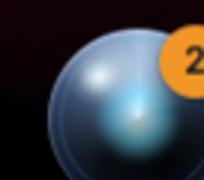
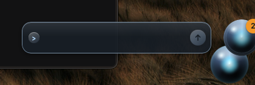

# 原生壳 v0.4 · 液态金属球 + 金属气泡 / 快捷输入（2026-11-26）

> v0.5（2026-11-26）起 working 气泡改为展示当前活动（工具 description / assistant 文本），见 `docs/validation/native-bubble-activity.md`；本文的「只显示正在思考」为 v0.4 阶段结论。

## 结论

- 球窗 **76×76**，球 **60px**，四周 **8px 透明边**；hover 1.055 后 63.3px，仍留 6.35px，边缘/高光不再被窗口裁。
- 球体材质为**液态金属**：银蓝 chrome conic + 左上白色高光 + 近黑底部 + 银色定向 rim；不透明、无 backdrop；边缘 `mask 86/94` + `blur 2px` 的 rim 光带，去掉了 1px 白边。
- working：**银白卫星**沿球缘环行（4.6s）；状态气泡只显示「正在思考」文字，**不再有 spinner/loading**。
- 完成：气泡显示「已完成 · 点击球查看」约 **5s**，随后文案收起，球进入**绿色脉冲核心 + 双层绿色声呐**未读态，直到点击浮球/打开面板（`commander:mode` true）确认；新回合 busy 重置；连接短暂抖动保留未读；完成时面板已打开则直接确认、不再提醒。
- 快捷输入：悬停 **0.8s** 唤起，复用气泡窗（336×76）；自动聚焦，Enter 发送、Esc 收起；空输入时光标离开球自动收起，有内容保留；无 placeholder、无关闭按钮。
- 状态气泡与快捷输入统一为**烟熏铬玻璃**：银色描边、顶部金属反光、镀铬 `>` 与发送键；气泡阴影收在 12px 内边距内。
- 悬停高亮：原生 80ms 轮询 `NSEvent.mouseLocation` + 球窗 frame，发 `commander:ball-hover` 到球页/气泡页；不依赖窗口焦点。

## 改动

| 层 | 文件 | 内容 |
|---|---|---|
| Native | `native/tauri/src/main.rs` | `BALL_SIZE 76`；8px hover radius（`BALL_SIZE/2 - 8`）；`set_quick_input` / `set_ball_unread`；`spawn_hover_watcher`；快捷输入复用 bubble 窗并聚焦；面板打开时关闭快捷输入 |
| Native | `native/tauri/build.rs`、`capabilities/default.json`、`permissions/autogenerated/set_ball_unread.toml` | `set_ball_unread` ACL、`allow-set-ball-unread` |
| Client | `WindowApp.tsx`、`window-styles.ts` | 60px 球、8px 窗口边、液态金属材质、银白 working 卫星、绿色未读脉冲、软边/去白边 |
| Client | `BubbleApp.tsx`、`shell-bridge.ts`、`bubble.ts` | 5s 完成提示、未读脉冲、面板 ack、working 无 spinner、金属气泡/快捷输入、空输入离开收起 |
| 测试 | `tests/client/window-styles.test.ts` | 76/8/60 窗口、金属材质、软边、working 卫星/未读脉冲、快捷输入、气泡阴影 |
| 契约 | `docs/architecture/native-shell-contract.md` | v0.4：球尺寸、材质、working/unread、快捷输入、命令/事件、ACL |

## 验证

| 项 | 结果 |
|---|---|
| `pnpm --filter dsh-commander typecheck` | PASS |
| `pnpm --filter dsh-commander test` | PASS，452/452 |
| `pnpm --filter dsh-commander build` | PASS（host + client + window） |
| `pnpm --filter dsh-commander build:native` | PASS（release，darwin-arm64） |
| 真机隔离探针 | PASS：`size=[76,76]`；快捷输入窗/焦点/金属 UI 正常；球 60px |
| client harness | smoke 52/52 PASS；`interact.mjs` 因环境缺 `jsdom` 未跑 |
| live 安装 | 窗口 bundle + native 已重装；插件管理器 `restart-required`，由用户重启 |

探针复用了 `tools/dev/native-shell-shot.mjs` 的假 Host + 隔离 state dir；截图中右侧上下两颗球是「探针新壳 + live 旧壳」同屏重叠，重启后只保留一颗。

## 视觉证据

金属球（60px，探针裁切放大）：

快捷输入 + 球（金属 UI；右侧两颗为探针/live 旧壳重叠）：

原型阶段的 4 个未读方向与 3 个 3D 材质方向：

- `prototype/shell-ball-redesign/unread.html` / `shots/unread-options.png`
- `prototype/shell-ball-redesign/depth.html` / `shots/depth-options.png`

最终选择：**未读 = 脉冲核心（绿色）**、**working = 银白卫星环行**、**球材质 = 液态金属**、**气泡/快捷输入 = 烟熏铬玻璃**。

## 交互与状态

- 悬停高亮：80ms 原生轮询；进入/离开球圆发 `commander:ball-hover`；球页面 `is-hover`，气泡页用于空输入离开收起。
- 快捷输入：0.8s 停留 → `set_ignore_cursor_events(false)` + show + focus；页面切输入条；Enter/Esc；发送走 `POST /commander/message`；空输入离开球收起；有内容移开保留；面板打开时关闭。
- 完成提示：working → 5s success 文案 → 未读绿色脉冲；点击浮球/打开面板 ack；新回合 busy 重置；连接抖动保留；面板已打开时直接确认。
- working：银白卫星沿球缘环行；气泡「正在思考」无 spinner。
- 未读：绿色核心脉冲 + 双层声呐；快捷输入/不再 hover 播放不清理该状态。
- 窗口：球 76×76；气泡/快捷输入 336×76；面板 420×660；气泡窗 12px 内边距，阴影 reach ≤ 12px。

## 已知限制

- 成功态「已完成 · 点击球查看」的干净截图未单独补拍；流程由 `BubbleApp` 的 `attentionTimer` / `panelOpen` / `acknowledged` 与样式单测覆盖。
- 只真机验证了球在右半屏时的左侧气泡；左半屏翻转、拖球跟随、面板打开隐藏由 Rust 逻辑实现，未逐项截图。
- 真机探针同屏有 live 旧壳，金属 UI 截图右侧出现两颗球；重启后只有一颗。
- 页内 DSH 浮球（`Overlay.tsx` / `styles.ts`）未改，仍是旧旗标/降级点；如需统一另开一轮。
- 需要重装 + 重启 native shell 才会加载新 `lib/window.js` 与二进制；仅硬刷新不会更新原生壳。
- 悬停依赖主线程每 80ms 轮询，开销很小；未读态只存在 bubble 页内存，bubble 页重载会丢；点击球/打开面板会清除。
- 球体不透明（液态金属无 backdrop）；气泡的浅色/深色主题都使用铬玻璃色板，没有单独做浅色金属主题。
