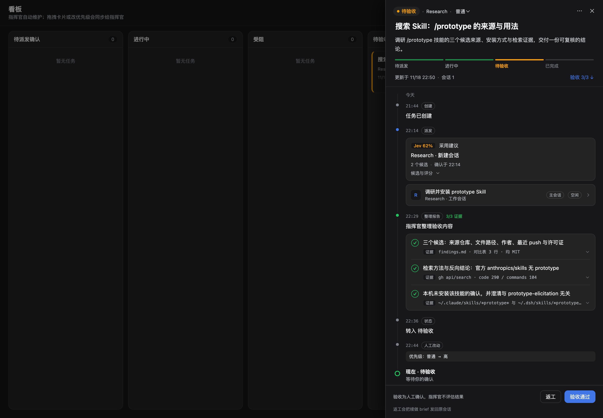
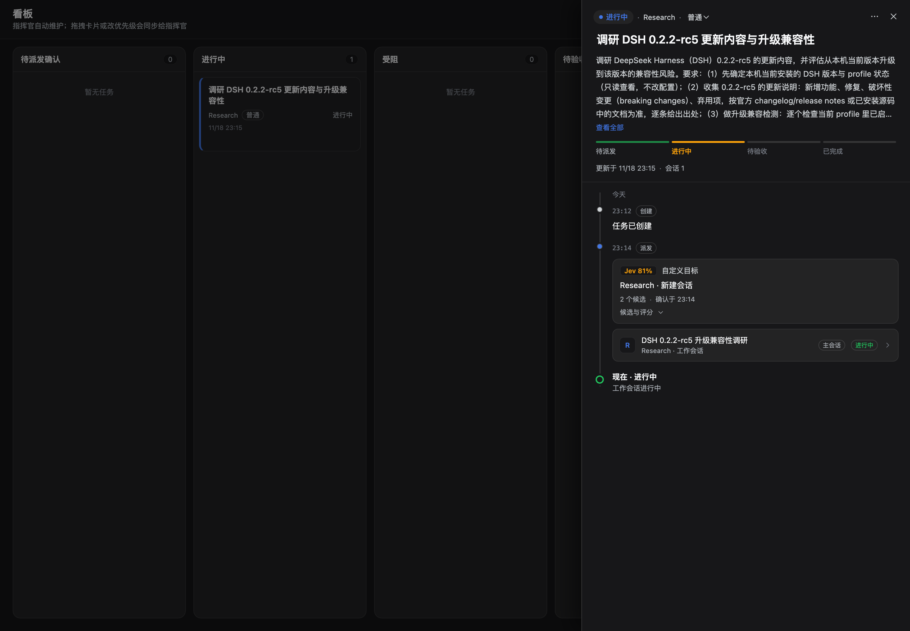
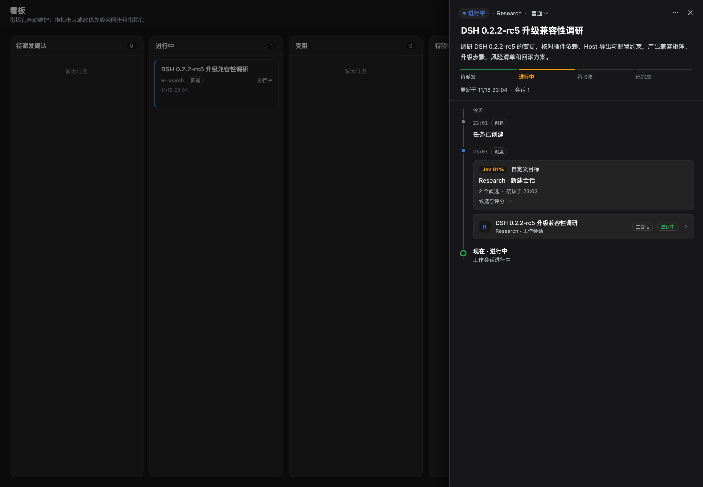

# 任务详情抽屉 D 方案（编年审阅）实现记录

- 日期：2026-11-18
- 范围：`packages/dsh-commander/src/client`（`BoardPage.tsx` / `board.ts` / `styles.ts` / `locales.ts`）+ client harness
- 性质：纯 Client 改动；未改 Host，未改 `/commander/*` 线格式

## 1. 设计 → 数据映射（逐项核对）

| 视觉块 | 数据来源 | 缺省/边界 |
|---|---|---|
| 状态 chip、四段进度 | `task.status`（draft/proposed/queued/running/blocked/review/done/cancelled/archived） | 未知状态归到「待派发」 |
| 标题（头部可编辑） | `TaskView.title` + `PATCH /board/tasks/:id {field:title}` | 空标题不提交；Enter/失焦提交，Esc 撤销 |
| 优先级（内联 select） | `TaskView.priority` + PATCH priority | 沿用 `BOARD_PRIORITIES` |
| 工作区 | `GET /state` 的 `workspaces[].name` + `task.workspaceId` | 名称缺失回退 id |
| 更新于 / 会话数 | `task.updatedAt` / `detail.sessions.length` | — |
| 「验收 N/M ↓」 | `detail.acceptance[]` 中 `state === 'evidence_present'` 的条数 | 无验收项时隐藏跳转 |
| 编年事件主轴 | `detail.timeline`（created / dispatch / session_stop / report / status / user_edit / accept / rework），按 `at` 升序 | 空 timeline 时只显示「现在」 |
| 派发回执 | `detail.dispatch`（createdAt / outcome / candidates / finalTarget / jev.pMax）挂到最后一个 dispatch 行 | 无 dispatch 记录时保留 Host 原始文本 |
| 验收块 | `detail.acceptance` 挂到最后一个 report 行；没有 report 时作为末尾独立「验收」块 | 无验收不渲染 |
| 会话卡 | `detail.sessions` 按 `sessionId` 挂到 dispatch / session_stop 行；主会话可兜底到最后一个 dispatch；剩余归入末尾「会话」块 | 无会话不渲染 |
| 人工改动 | `detail.boardEdits` 按 `at` 对齐 `user_edit` 行，展示 field + before → after；对不齐则补一条事件 | 空数组无事件 |
| 「现在」 | `task.status` + `task.block.code/reason` | 受阻时显示 code/reason |
| 底部操作 | review 时 `POST accept/rework`；归档走 `POST archive`（在「…」菜单） | 非 review 不显示验收条 |

## 2. 契约里没有、因此没做的

- **80% 阈值**：dispatch 记录只有 `jev.pMax`，没有 threshold；不显示「低于 80% 阈值」这类文案。
- **交付物文件名**：没有字段；原型里的 `findings.md` 之类改为 Host timeline 文本/会话卡，不再编造。
- **会话最近活动时间**：`sessions[]` 链接行不返回 `lastActiveAt`；会话卡只显示工作区 · 角色 · 状态。
- **验收逐条时间**：没有字段；统一挂到 report 行（或末尾块），不伪造时间。

## 3. 呈现层处理（避免枚举/技术串直出）

- dispatch 行有回执时隐藏 Host 文本（`派发到 ws_x（new）· confirmed`），由回执显示工作区名、新建/已有会话、outcome。
- report 行附验收时用「指挥官整理验收内容」替代 `outcome=...` 技术串。
- `状态 -> review` 映射为「转入 待验收」；created 显示「任务已创建」。
- 人工改动的 before/after 按字段本地化（如 `优先级：普通 → 高`）。
- 证据摘要常显，摘要行本身可点开完整 `evidence/verify/source`。
- 归档不再占顶部按钮位，收进「…」菜单；打开会话保留在会话卡和菜单两处。
- 编年线从 `border-l1`（7% 边框）提到 `border-l3`（22% 边框）：前者在部分主题/皮肤上几乎不可见（2026-11-18 live 反馈）。
- 中性节点（创建/状态/人工改动）从 `label-quaternary` 提到 `label-secondary`，并加 1px `border-l3` 描边：部分皮肤里最低一档文字色做 7px 圆点会直接消失，只剩背景色环把线“咬”出一个缺口。
- 任务目标默认最多 5 行（`-webkit-line-clamp`）；只有真正溢出时（`scrollHeight > clientHeight`，并监听 ResizeObserver）才出现「查看全部 / 收起」，短目标不显示按钮。
- 过滤 `needs_confirmation ...` 这类内部派发行（带 decisionId/reason 技术串）；等待确认态由状态与看板表达，有后续成功派发时更是纯噪音。
- 顺带补上 `task.status.archived` 文案（回收站行会用到），并加进 locale 回归的派生键集合。

## 4. 验证

- `pnpm --filter dsh-commander typecheck` → PASS
- `pnpm --filter dsh-commander test` → **257/257 PASS**
  - 新增 `buildTaskFeed` 单测：升序、回执挂载、验收 report/末尾回退、会话挂载与剩余块、编辑 diff 对齐/补事件、无时间戳排序、时间格式化。
- `pnpm --filter dsh-commander build` → PASS（`lib/client.js` 295 KB）
- `node packages/dsh-commander/tests/client/harness/run-harness.mjs` → **148/148 PASS**
  - 抽屉断言已改为编年结构：feed 事件、会话卡（工作区 · 标题，无裸 sessionId）、四段进度、标题/状态/工作区/优先级、真人验收提示、accept/rework、zh 文案无裸 key。
- 本地渲染（真实 `BoardPage` + 假 store + 近似 DSH token，不是 live 走查）：

任务目标折叠（长 goal，5 行 + 查看全部）：

「进行中」场景（已过滤 needs_confirmation、编年线可见）：

未覆盖：live DSH 里的真实 token、明暗主题、窄窗口与真实任务数据，需要用户硬刷新后走查。

## 5. 部署

纯 Client 改动：`pnpm --filter dsh-commander build` 后**硬刷新**即可，不需要重装插件或重启 DSH。
